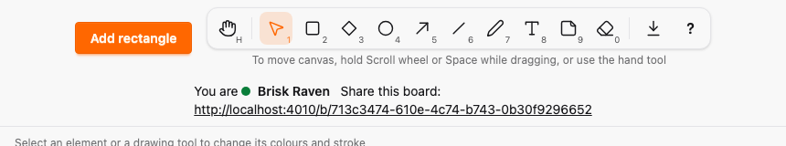
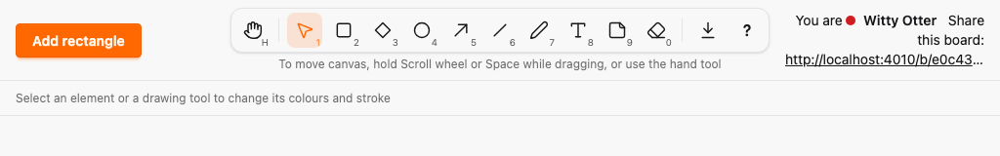
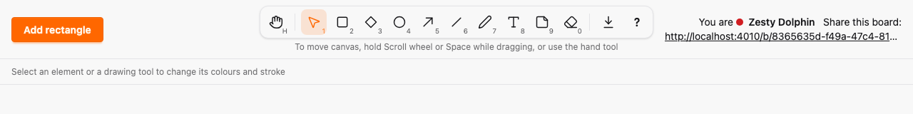
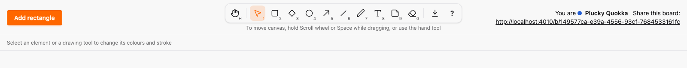

# Guardrails from agent mistakes

*2026-10-30T14:54:32Z by Showboat 0.6.1*
<!-- showboat-id: 79666b4f-f5af-47fa-bfd5-a82610ed7b5f -->

Outcome: three mistakes recent agent PRs made are now caught by the build, not by review. (1) Every keyboard shortcut is declared in a registry aggregated by `SketchWeb.Shortcuts`, which fails compilation when two actions share a chord in one focus context (rule A23); the help, `aria-keyshortcuts`, titles and the one client table come from it, and a source scan rejects literal key checks. (2) `e2e/tests/layout.spec.ts` checks that the header, style bar and canvas controls neither overlap nor leave the viewport at 860, 1024, 1280 and 1600 px; it failed at 860, 1024 and 1280 on `zoom`, and the layout is fixed at its cause. (3) A source-policy test rejects `pkill`, `killall` and `kill` without a PID variable in scripts and DEMO.md exec blocks. No new runtime dependency (A15), no migration.

The aggregate collects five registries; the compile-time check runs in the module body:

```bash
sed -n "/@registries \[/,/@shortcuts Aggregate/p" lib/sketch_web/shortcuts.ex
```

```output
  @registries [
    SketchWeb.Tools,
    SketchWeb.HistoryActions,
    SketchWeb.ZoomActions,
    SketchWeb.ExportActions,
    SketchWeb.FixedShortcuts
  ]

  @shortcuts Aggregate.aggregate!(@registries)
```

The Elixir tests: the aggregate has no conflicts, a module whose shortcut duplicates undo fails `Code.compile_string` with both actions named, keys and physical codes and Ctrl versus Ctrl/⌘ collide, repeated ids and malformed chords fail, and the help renders exactly the aggregate. With them, the architecture tests (A23 scan, process policy, registry A01-A23):

```bash
mix test test/sketch_web/shortcuts_test.exs test/architecture 2>&1 | grep -E "^Result"
```

```output
Result: 45 passed
```

On the client, `assets/js/hooks/shortcuts.ts` matches key presses against the generated `SHORTCUTS`. fast-check checks that no realistic key press matches two shortcuts in one context and that every chord reaches its own action:

```bash
docs/evidence/pbt-drag-share/run-ts.sh test/shortcuts.test.ts
```

```output
✔ no key press matches two shortcuts in one focus context (A23)
✔ every chord in the table reaches its own action in each of its contexts
✔ a chord needs its exact modifiers: Ctrl/⌘ for command, Ctrl alone for ctrl, neither for none
✔ only the Space key releases the pan, whatever is held
✔ a keydown without a key, as Chrome sends for autofill, matches nothing and does not throw
✔ key and code are read through the event's own getters, as on a real KeyboardEvent
ℹ tests 6
ℹ pass 6
ℹ fail 0
```

The layout spec, eight checks (fresh board, and with a drawing tool selected so the style bar is full, at four widths):

```bash
docs/evidence/pbt-drag-share/run-e2e.sh layout.spec.ts
```

```output
8 passed
```

The header after the fix at each width. Below 960 px the header wraps: the toolbar keeps its row and the viewer name and share link move to a second row. From 960 px it is the three-column grid, with the share link truncated inside its column instead of spilling over the toolbar. Below 1024 px the style bar shows its group labels to screen readers only, so a full bar fits at 860 px without scrolling.

```bash {image}

```



```bash {image}

```



```bash {image}

```



```bash {image}

```



Each mutation is applied by `mutate.sh` from `mutations/`, the check runs, and an `EXIT` trap reverts the patch; `mutate.sh` prints `Mutation killed` only when the check fails.

Mutation 1, a duplicate chord across two registries: `duplicate-chord.patch` gives Copy as PNG (in `SketchWeb.ExportActions`) the chord Ctrl/⌘+Z, which `SketchWeb.HistoryActions` already uses for undo. Compilation fails and names both:

```bash
docs/evidence/agent-guardrails/mutate.sh duplicate-chord mix compile 2>&1 | grep -E "duplicate chords|both match|^Mutation"
```

```output
** (CompileError) SketchWeb.Shortcuts has duplicate chords (A23):
  Ctrl/⌘+Z (undo in SketchWeb.HistoryActions) and Ctrl/⌘+Z (copy_png in SketchWeb.ExportActions) both match in the canvas context
Mutation killed (exit 1)
```

Mutation 2, a literal key check in a hook: `literal-key-check.patch` puts back the `event.key !== " "` check the canvas hook had for releasing Space. The A23 scan fails on that line:

```bash
docs/evidence/agent-guardrails/mutate.sh literal-key-check mix test test/architecture/source_policy_test.exs 2>&1 | grep -E "^ +A23 |^Mutation" | sed -E "s/^ +//"
```

```output
A23 assets/js/hooks/canvas.ts:933: literal key check: if (event.key !== " ") return
Mutation killed (exit 2)
```

Mutation 3, a header button that pushes the share link off-screen at 860 px: `header-button-pushes-share-link.patch` adds a Present button to the header and keeps it on one row (`flex-nowrap`), the way an agent might to avoid a taller header. The layout spec fails at 860 px:

```bash
docs/evidence/agent-guardrails/mutate.sh header-button-pushes-share-link docs/evidence/pbt-drag-share/run-e2e.sh layout.spec.ts -g "860x800 the header"
```

```output
1 failed
Mutation killed (exit 1)
```

Mutation 4, a process killed by name in an evidence script: `kill-by-name-in-evidence-script.patch` adds a by-name kill of every `phx.server` to `docs/evidence/render-model/dom.sh`, the command that killed the human's servers. The process-policy scan fails on that line. (The patch is a `.patch` file, which is not a script, so this DEMO itself stays clean.)

```bash
docs/evidence/agent-guardrails/mutate.sh kill-by-name-in-evidence-script mix test test/architecture/source_policy_test.exs 2>&1 | grep -E "^ +processes |^Mutation" | sed -E "s/^ +//"
```

```output
processes docs/evidence/render-model/dom.sh:4: pkill stops processes by name: pkill -f phx.server || true
Mutation killed (exit 2)
```

Every file this PR touched outside the evidence folder (A added, M modified) against `zoom`:

```bash
git diff --name-status zoom...HEAD -- . ':!docs/evidence' | sort -k2; git diff --shortstat zoom...HEAD -- . ':!docs/evidence'
```

```output
M	AGENTS.md
M	ARCHITECTURE.md
M	architecture/rules.exs
M	assets/js/export/export_logic.ts
M	assets/js/generated/manifest.ts
M	assets/js/hooks/canvas.ts
M	assets/js/hooks/element_history.ts
M	assets/js/hooks/export_menu.ts
A	assets/js/hooks/shortcuts.ts
M	assets/js/hooks/text_editor.ts
M	assets/js/hooks/tools.ts
M	assets/js/hooks/zoom_logic.ts
M	assets/test/element_history.test.ts
M	assets/test/export_logic.test.ts
A	assets/test/key_press.ts
A	assets/test/shortcuts.test.ts
M	assets/test/tools.test.ts
A	docs/adr/0009-one-keyboard-shortcut-registry.md
A	e2e/tests/layout.spec.ts
M	lib/sketch_web/client_manifest.ex
M	lib/sketch_web/components/export_menu.ex
M	lib/sketch_web/components/style_panel.ex
M	lib/sketch_web/components/toolbar.ex
M	lib/sketch_web/export_actions.ex
A	lib/sketch_web/fixed_shortcuts.ex
M	lib/sketch_web/history_actions.ex
M	lib/sketch_web/live/board_live.ex
A	lib/sketch_web/shortcuts.ex
A	lib/sketch_web/shortcuts/aggregate.ex
M	lib/sketch_web/tools.ex
M	lib/sketch_web/zoom_actions.ex
A	test/architecture/fixtures/files/a23/assets/js/generated/manifest.ts
A	test/architecture/fixtures/files/a23/assets/js/hooks/keys.ts
A	test/architecture/fixtures/files/a23/assets/js/hooks/shortcuts.ts
A	test/architecture/fixtures/files/a23/lib/board_live.ex
A	test/architecture/fixtures/files/processes/docs/evidence/demo/DEMO.md
A	test/architecture/fixtures/files/processes/docs/evidence/demo/record.sh
A	test/architecture/fixtures/files/processes/e2e/tests/restart.spec.ts
A	test/architecture/fixtures/files/processes/scripts/stop.mjs
M	test/architecture/registry_test.exs
M	test/architecture/source_policy_test.exs
M	test/sketch_web/live/board_live_export_test.exs
M	test/sketch_web/live/board_live_undo_test.exs
M	test/sketch_web/live/board_live_zoom_test.exs
A	test/sketch_web/shortcuts_test.exs
M	test/support/architecture_check.ex
 46 files changed, 1571 insertions(+), 512 deletions(-)
```
