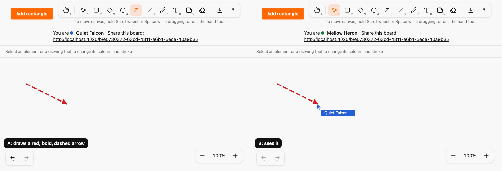
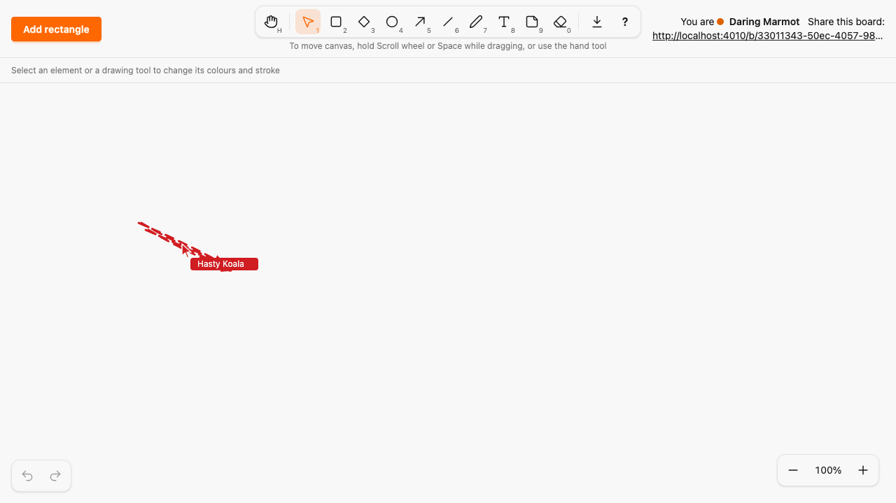
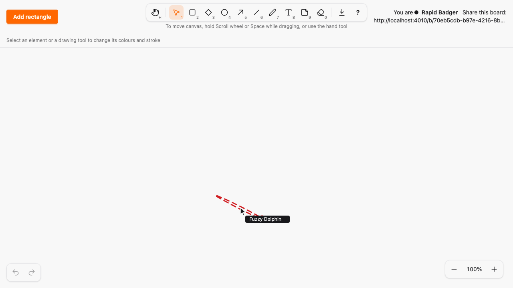
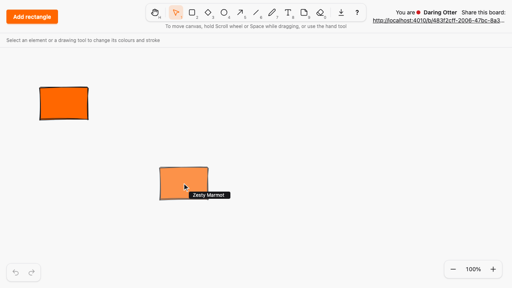
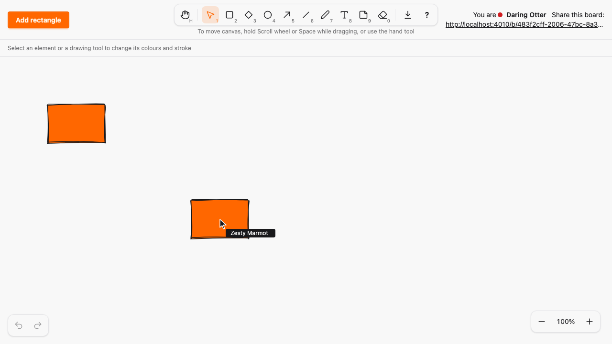
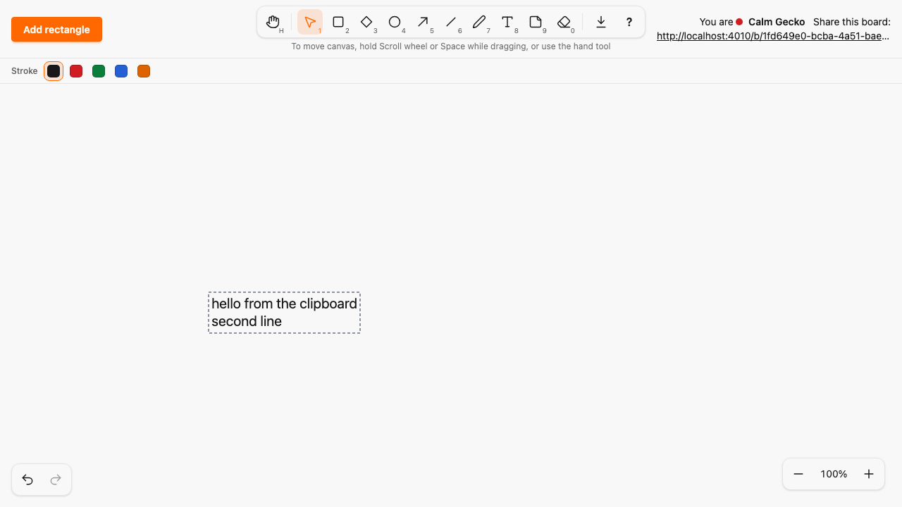

# Duplicate, copy, cut and paste, and Alt-drag

*2026-10-30T15:32:50Z by Showboat 0.6.1*
<!-- showboat-id: ba1ba861-bb1e-4971-bc5b-f8b93b5b94da -->

Outcome: the collaborative canvas can duplicate, copy, cut and paste the selected element, and Alt+drag drags a copy. Ctrl/⌘+D duplicates the selection with the same kind, points, text, style and seed (so the copy looks identical), offset by 10 canvas px and clamped into the canvas, and selects the copy; the browser bookmark shortcut is prevented. Ctrl/⌘+C copies a versioned JSON envelope (`{"type":"sketch/elements","version":1,"elements":[...]}`, a list so multi-select can extend it) to the system clipboard as text/plain, Ctrl/⌘+X copies and erases, and Ctrl/⌘+V pastes an envelope centred on the last pointer position (or the viewport centre) or plain text as a text element at the pointer, which works across boards and tabs. Malformed input is rejected on the client with a short status message and again by the server. Alt+drag on an element shows the copy as a draw preview, leaves the original untouched for everyone and creates one element on release. Each of duplicate, paste, Alt+drag and cut is one undo entry. Everything goes through the existing `create_element` and `erase` events, so Ash validation and the server clamp stay authoritative. No new runtime dependency (A15), no migration, no change to an architecture rule; the chords are in the new `SketchWeb.ClipboardActions` registry (A23), the pointer events stay in the canvas hook (A13) and no kind id is compared outside kind modules (A22). Single selection only: multi-select is the next PR.

The four chords are declared in `SketchWeb.ClipboardActions`, aggregated by `SketchWeb.Shortcuts` (compilation fails on a clash) and copied to the client by `mix sketch.gen.manifest`. Ctrl/⌘+D and the Diamond key `D` are different chords (Ctrl/⌘ versus none), and the chords are active on the canvas only, so a text editor keeps its native copy and paste:

```bash
grep -E "action: \"(duplicate|copy|cut|paste)\"" assets/js/generated/manifest.ts | sed -E "s/^ +//"
```

```output
{ group: "canvas", action: "duplicate", contexts: ["canvas"], chords: [{ key: ["d"], code: null, mod: "command", shift: false, alt: false }] },
{ group: "canvas", action: "copy", contexts: ["canvas"], chords: [{ key: ["c"], code: null, mod: "command", shift: false, alt: false }] },
{ group: "canvas", action: "cut", contexts: ["canvas"], chords: [{ key: ["x"], code: null, mod: "command", shift: false, alt: false }] },
{ group: "canvas", action: "paste", contexts: ["canvas"], chords: [{ key: ["v"], code: null, mod: "command", shift: false, alt: false }] },
```

The pure logic is `assets/js/hooks/clipboard_logic.ts`: envelope encode and decode, validation of every server rule before a create, group placement and clamping, and the plain-text fallback. An example envelope for a red, bold, dashed arrow:

```bash
cd assets && node --input-type=module -e 'import { encodeElements } from "./js/hooks/clipboard_logic.ts"; console.log(encodeElements([{ kind: "arrow", x: 80, y: 80, width: 120, height: 60, points: [{ x: 0, y: 0 }, { x: 120, y: 60 }], text: "", seed: 42, style: { stroke_color: "red", fill_color: "auto", stroke_width: "bold", stroke_style: "dashed" } }]))'
```

```output
{"type":"sketch/elements","version":1,"elements":[{"kind":"arrow","x":80,"y":80,"width":120,"height":60,"points":[{"x":0,"y":0},{"x":120,"y":60}],"text":"","stroke_color":"red","fill_color":"auto","stroke_width":"bold","stroke_style":"dashed","seed":42}]}
```

The fast-check properties: `decode(encode(x))` equals `x` for any valid group of elements, decode never throws on arbitrary strings, arbitrary JSON or 200,000 nested brackets, an unknown kind or any broken server rule rejects the whole envelope, a duplicate and a pasted group are always inside the canvas, and a pasted group keeps its internal layout:

```bash
docs/evidence/pbt-drag-share/run-ts.sh test/clipboard_logic.test.ts
```

```output
✔ decode(encode(x)) is x for every valid group of elements
✔ the envelope is versioned JSON with the flat element fields
✔ decode never throws on arbitrary strings and plain strings come back as text
✔ decode never throws on arbitrary JSON values, including envelopes with wrong parts
✔ deeply nested JSON and long text do not throw
✔ an element of an unknown kind is rejected, and so is every envelope containing one
✔ each rule the server enforces is checked before paste
✔ an unsupported version, no elements or too many are rejected
✔ a style property that does not apply to the kind is reset, as the server requires
✔ text that mentions the envelope but is not one is rejected, other text and JSON are text
✔ a duplicate is offset by 10 and stays inside the canvas
✔ a duplicate at the edge is clamped instead of leaving the canvas
✔ a duplicate keeps everything but the position
✔ a pasted group always lands inside the canvas, whatever the pointer
✔ a pasted group is centred on the pointer when it fits, and keeps its internal layout
✔ plain text becomes a text element at the pointer
✔ text that does not fit the text rules is not pasted
✔ pasted text is a valid element and stays inside the canvas wherever it lands
✔ Ctrl or Command with D, C, X and V pick the clipboard actions on the canvas only
✔ Alt on an element with Selection copies it; without Alt it moves; Alt on a handle still resizes
ℹ tests 20
ℹ pass 20
ℹ fail 0
```

The server side, over the real LiveView: a duplicate payload keeps kind, points, style and seed and reaches a second viewer, a pasted box or point kind past the edge is clamped by `fit_shape`, Ash rejects a create outside the canvas whatever the path, malformed pasted elements create nothing, and the help lists the four actions:

```bash
mix test test/sketch_web/live/board_live_clipboard_test.exs 2>&1 | grep -E "^Result"
```

```output
Result: 7 passed
```

The two-browser Playwright spec grants `clipboard-read` and `clipboard-write` to every Chromium context. A duplicates a styled arrow and B sees an identical copy offset by 10; a copy on board 1 is pasted on board 2 where B sees it; arbitrary text becomes a text element; malformed envelopes, over-long and blank text only show a message; Alt+drag leaves the original (same version and position for both) and B sees the copy at the drop point; undo removes each created element, and undo of a cut recreates it; Esc cancels an Alt+drag; inside the text editor Ctrl/⌘+C copies the selected text and Ctrl/⌘+V pastes text, never elements:

```bash
docs/evidence/pbt-drag-share/run-e2e.sh clipboard.spec.ts
```

```output
6 passed
```

No control was added, but the header and style bar are checked at the four widths anyway (the layout spec from the guardrails PR, unchanged):

```bash
docs/evidence/pbt-drag-share/run-e2e.sh layout.spec.ts
```

```output
8 passed
```

The two-browser run: `clipboard-demo.mjs` opens two Chromium contexts on one board. A draws a red, bold, dashed arrow, selects it and duplicates it with Ctrl/⌘+D; copies and pastes it at the pointer; draws a rectangle and Alt+drags a copy (the original stays, B sees the copy preview and then the copy at the drop point); pastes a malformed envelope (a short message, nothing created); then undoes twice. A is on the left, B on the right.

```bash {image}

```



B after A pressed Ctrl/⌘+D on the arrow: an identical copy, 10 px down and to the right.

```bash {image}

```



B on board 2, after A copied the arrow on board 1 and pasted it on board 2 with the pointer at the middle of the canvas:

```bash {image}

```



During A's Alt+drag, B sees the copy preview while the original has not moved, and after the drop the copy at the drop point:

```bash {image}

```



```bash {image}

```



A pastes a malformed envelope: a short message at the bottom, no element, no server round trip:

```bash {image}

```



Each mutation is applied by `mutate.sh` from `mutations/`, the check runs, and an `EXIT` trap reverts the patch; `mutate.sh` prints `Mutation killed` only when the check fails.

Mutation 1, the decoder accepts an unknown kind: `decoder-accepts-unknown-kind.patch` drops the kind check from `validElement`. The unknown-kind test fails:

```bash
docs/evidence/duplicate-paste/mutate.sh decoder-accepts-unknown-kind docs/evidence/pbt-drag-share/run-ts.sh test/clipboard_logic.test.ts 2>&1 | grep -E "^✖|^Mutation"
```

```output
✖ an element of an unknown kind is rejected, and so is every envelope containing one
✖ failing tests:
✖ an element of an unknown kind is rejected, and so is every envelope containing one
Mutation killed (exit 1)
```

Mutation 2, Alt+drag commits a move of the original: `alt-drag-moves-the-original.patch` makes an Alt+press on an element start an ordinary move. The two-browser Alt+drag test fails (the original moved and no copy exists):

```bash
docs/evidence/duplicate-paste/mutate.sh alt-drag-moves-the-original docs/evidence/pbt-drag-share/run-e2e.sh clipboard.spec.ts -g "Alt\+drag duplicates"
```

```output
1 failed
Mutation killed (exit 1)
```

Mutation 3, paste bypasses the server clamp: `paste-bypasses-server-clamp.patch` makes the `create_element` handler pass the pasted box to Ash as it is. Ash still rejects an out-of-canvas box, so nothing is stored, and the clamp tests fail (the Ash rejection test passes, which is the point: no path stores such a box):

```bash
docs/evidence/duplicate-paste/mutate.sh paste-bypasses-server-clamp mix test test/sketch_web/live/board_live_clipboard_test.exs 2>&1 | grep -E "^ +[0-9]+\) test|^Result|^Mutation" | sed -E "s/^ +[0-9]+\) //" | sort
```

```output
Mutation killed (exit 2)
Result: 5/7 passed
test a pasted box kind beyond the canvas edge is clamped into the canvas by the server (SketchWeb.BoardLiveClipboardTest)
test a pasted point kind beyond the canvas edge has its box rebuilt inside the canvas (SketchWeb.BoardLiveClipboardTest)
```

Every file this PR touched outside the evidence folder (A added, M modified) against `origin/agent-guardrails`:

```bash
git diff --name-status origin/agent-guardrails...HEAD -- . ':!docs/evidence' | sort -k2; git diff --shortstat origin/agent-guardrails...HEAD -- . ':!docs/evidence'
```

```output
M	ARCHITECTURE.md
M	assets/js/generated/manifest.ts
M	assets/js/hooks/canvas.ts
A	assets/js/hooks/clipboard_logic.ts
A	assets/js/hooks/clipboard.ts
M	assets/js/hooks/tools.ts
A	assets/test/clipboard_logic.test.ts
M	e2e/playwright.config.ts
A	e2e/tests/clipboard.spec.ts
M	e2e/tests/support/canvas.ts
M	lib/sketch_web/client_manifest.ex
A	lib/sketch_web/clipboard_actions.ex
M	lib/sketch_web/shortcuts.ex
A	test/sketch_web/live/board_live_clipboard_test.exs
 14 files changed, 1341 insertions(+), 26 deletions(-)
```
