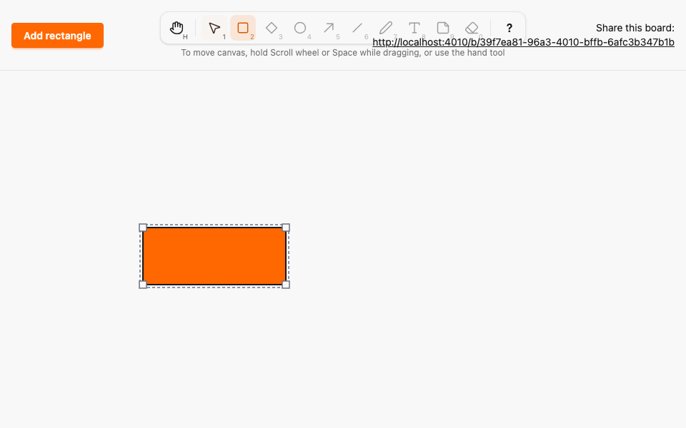
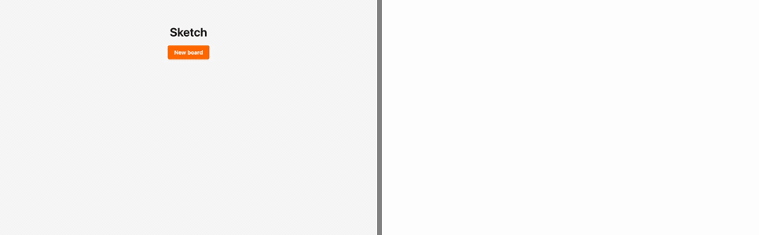

# Element model, selection and drawn rectangles

*2026-10-29T05:11:15Z by Showboat 0.6.1*
<!-- showboat-id: fcc479e3-86f4-46e5-ba1f-063ab8555fb6 -->

**Outcome: rectangles are now `Element`s with their own size. The Rectangle tool (R/2) draws a box of any size by dragging, and a click still makes the default 120 × 80. Other browsers see the shape while it is being drawn. The Selection tool (V/1) selects an element locally (outline plus four corner handles), moves it by its body and resizes it from a corner; every collaborator sees the resize live and the committed size persists. Existing rectangles were migrated in place.**

What is proven below:

1. Data preservation. The migration is a table rename plus columns backfilled with `kind = 'rectangle'`, `width = 120`, `height = 80`. A test migrates down, inserts raw `rectangles` rows, migrates up and reads them back as default-sized rectangles with their versions intact.
2. Box invariant (A08). For arbitrary integer boxes, Ash alone (changeset validity, no database) and PostgreSQL alone (raw SQL insert) each accept a box iff `x, y >= 0`, `width, height >= 1`, `x + width <= 4000` and `y + height <= 4000`.
3. Commit model (A08, A09, A11). Random sequences of `commit_position` and `commit_shape`, in and out of bounds and against the wrong board, match a pure model in stored state and in the exact list of broadcasts.
4. Merge. The highest-version-wins properties hold with events from create, move and resize mixed together.
5. Client geometry (fast-check). Drawn, resized, clicked and moved boxes are whole, at least 1 × 1 and inside the canvas, equal the unclamped box whenever it fits, and do not depend on drag direction.
6. Two real browsers (Playwright, `--repeat-each=3`). Draw with a live preview in B, select, resize (B sees the new size before release, version 1), move (version 2), reload; drawing past the canvas edge clamps; Esc and pointercancel during drawing create nothing.

The scripts reuse `run-ts.sh`, `run-tests.sh` and `run-e2e.sh` from `docs/evidence/pbt-drag-share/`, which drop timings so `showboat verify` can diff the output. `mutate.sh` applies a patch from `mutations/`, runs the command and reverts the patch through an `EXIT` trap.

```bash
docs/evidence/pbt-drag-share/run-tests.sh test/sketch/canvas/element_migration_test.exs --seed 1 --trace
```

```output


Sketch.Canvas.ElementMigrationTest [test/sketch/canvas/element_migration_test.exs]
  * test renaming rectangles to elements keeps every row as a default-sized rectangle [L#32]


Result: 1 passed
```

```bash
docs/evidence/pbt-drag-share/run-tests.sh test/sketch/properties test/sketch_web/properties --seed 1 --trace
```

```output


Sketch.Properties.BoardIsolationTest [test/sketch/properties/board_isolation_test.exs]
  * property each board lists exactly its own elements (A05) [L#9]

Sketch.Properties.CommitModelTest [test/sketch/properties/commit_model_test.exs]
  * property the database and the broadcasts follow a model of successful commits (A08, A09, A11) [L#109]

Sketch.Properties.GeometryTest [test/sketch/properties/geometry_test.exs]
  * property clamp_box always yields a box inside the canvas, and keeps one already inside [L#95]
  * property the default box of the next element is inside the canvas [L#103]
  * property PostgreSQL alone accepts a box iff it is at least 1 x 1 and inside the canvas [L#87]
  * property Ash alone accepts a box iff it is at least 1 x 1 and inside the canvas [L#81]

Sketch.Properties.LwwMergeTest [test/sketch/properties/lww_merge_test.exs]
  * property the state per element is its highest-version event, whichever action produced it [L#64]
  * property an event older than the known version never changes the state [L#70]
  * property two replicas that saw disjoint halves converge in either merge order [L#85]
  * property applying an event twice equals applying it once [L#55]
  * property every delivery order of the same events yields the same state [L#49]

SketchWeb.Properties.SharingTest [test/sketch_web/properties/sharing_test.exs]
  * property a shared link shows exactly that board, and a bad link creates nothing [L#67]

SketchWeb.Properties.DragEventsTest [test/sketch_web/properties/drag_events_test.exs]
  * property previews and cancels never touch the database and stay on their board (A07, A10) [L#173]


Result: 13 passed
```

```bash
docs/evidence/pbt-drag-share/run-ts.sh test/box_geometry.test.ts test/tools.test.ts test/remote_previews.test.ts
```

```output
✔ a drawn box is always whole, at least 1 x 1 and inside the canvas
✔ a drawn box equals the rounded drag rectangle whenever that is inside the canvas
✔ every box inside the canvas can be drawn exactly, from any of its four corners
✔ a drawn box does not depend on the drag direction
✔ a resized box is always whole, at least 1 x 1 and inside the canvas
✔ resizing keeps the opposite corner and follows the pointer whenever the result fits
✔ dropping a corner where it started leaves the box unchanged
✔ a click box has the default size where it fits and always lies inside the canvas
✔ a moved box keeps its size and stays inside the canvas
✔ any delivery order applies the highest-seq current preview of each drag
✔ a preview based on an older version than the known one never applies
✔ drag_cancel returns to the committed position and ends that drag
✔ re-delivering a preview is a no-op
✔ every enabled tool is reachable by its letter, in either case, and by its number
✔ no two tools share a key, and no tool key is reserved for Esc, ? or Space
✔ any key sequence selects the same tool as the simple binding model
✔ a key with Ctrl, Meta or Alt, or typed into an editable target, never changes the tool
✔ Esc always returns to Selection
✔ disabled tools never become active through keys or toolbar clicks
✔ the middle button, Space and Hand pan; Rectangle draws; Selection resizes, moves or deselects
✔ panning scrolls by exactly the opposite of the pointer movement
ℹ tests 21
ℹ pass 21
ℹ fail 0
```

```bash
docs/evidence/pbt-drag-share/run-e2e.sh elements --repeat-each=3
```

```output
9 passed
```

## Mutation checks

Each check must end with `Mutation killed`; the patch is reverted by the trap afterwards.

`mutations/box-check-drops-size.patch` makes the `FitsCanvas` validation compare only `x <= 4000` instead of `x + width <= 4000`. The Ash-alone property shrinks to a box that starts at 1 and is the full canvas width, which PostgreSQL would reject but Ash now accepts.

```bash
docs/evidence/elements/mutate.sh box-check-drops-size docs/evidence/pbt-drag-share/run-tests.sh test/sketch/properties/geometry_test.exs --seed 1
```

```output

...

  1) property Ash alone accepts a box iff it is at least 1 x 1 and inside the canvas (Sketch.Properties.GeometryTest)
     test/sketch/properties/geometry_test.exs:81
     Failed with generated values (after 18 successful runs):

         * Clause:    box <- any_box()
           Generated: %{x: 1, y: 2, width: 4000, height: 3998}

     %{x: 1, y: 2, width: 4000, height: 3998}
     code: check all box <- any_box(), max_runs: 300 do
     stacktrace:
       test/sketch/properties/geometry_test.exs:83: anonymous fn/3 in Sketch.Properties.GeometryTest."property Ash alone accepts a box iff it is at least 1 x 1 and inside the canvas"/1
       (stream_data 1.4.0) lib/stream_data.ex:2585: StreamData.shrink_failure/5
       (stream_data 1.4.0) lib/stream_data.ex:2551: StreamData.check_all/7
       test/sketch/properties/geometry_test.exs:82: (test)


Result: 3/4 passed
Failed: 1 property
Mutation killed (exit 2)
```

`mutations/commit-shape-keeps-version.patch` removes the atomic version increment from `commit_shape`. The commit model shrinks to a single in-bounds resize whose stored version stays 0 while the model expects 1.

```bash
docs/evidence/elements/mutate.sh commit-shape-keeps-version docs/evidence/pbt-drag-share/run-tests.sh test/sketch/properties/commit_model_test.exs --seed 1
```

```output


  1) property the database and the broadcasts follow a model of successful commits (A08, A09, A11) (Sketch.Properties.CommitModelTest)
     test/sketch/properties/commit_model_test.exs:109
     Failed with generated values (after 10 successful runs):

         * Clause:    ops <- list_of(op(), max_length: 20)
           Generated: [{:commit_shape, 0, %{x: 0, y: 0, width: 1, height: 1}}]

     Assertion with == failed
     code:  assert stored(ctx) == next
     left:  %{
              0 => %{version: 0, x: 0, y: 0, width: 1, height: 1},
              1 => %{
                version: 0,
                x: 250,
                y: 250,
                width: 120,
                height: 80
              },
              2 => %{
                version: 0,
                x: 400,
                y: 400,
                width: 120,
                height: 80
              }
            }
     right: %{
              0 => %{version: 1, x: 0, y: 0, width: 1, height: 1},
              1 => %{
                version: 0,
                x: 250,
                y: 250,
                width: 120,
                height: 80
              },
              2 => %{
                version: 0,
                x: 400,
                y: 400,
                width: 120,
                height: 80
              }
            }
     stacktrace:
       test/sketch/properties/commit_model_test.exs:122: anonymous fn/3 in Sketch.Properties.CommitModelTest."property the database and the broadcasts follow a model of successful commits (A08, A09, A11)"/1
       (elixir 1.20.4) lib/enum.ex:2622: Enum."-reduce/3-lists^foldl/2-0-"/3
       test/sketch/properties/commit_model_test.exs:117: anonymous fn/2 in Sketch.Properties.CommitModelTest."property the database and the broadcasts follow a model of successful commits (A08, A09, A11)"/1
       (stream_data 1.4.0) lib/stream_data.ex:2585: StreamData.shrink_failure/5
       (stream_data 1.4.0) lib/stream_data.ex:2551: StreamData.check_all/7
       test/sketch/properties/commit_model_test.exs:110: (test)


Result: 0/1 passed
Failed: 1 property
Mutation killed (exit 2)
```

`mutations/drawn-box-ignores-far-edge.patch` stops shifting a drawn box back inside the canvas when the drag ends on the right or bottom edge. Both the drawing and the resize properties shrink to a 1 × 1 box that pokes one pixel past the edge.

```bash
docs/evidence/elements/mutate.sh drawn-box-ignores-far-edge docs/evidence/pbt-drag-share/run-ts.sh test/box_geometry.test.ts
```

```output
✖ a drawn box is always whole, at least 1 x 1 and inside the canvas
✔ a drawn box equals the rounded drag rectangle whenever that is inside the canvas
✔ every box inside the canvas can be drawn exactly, from any of its four corners
✔ a drawn box does not depend on the drag direction
✖ a resized box is always whole, at least 1 x 1 and inside the canvas
✔ resizing keeps the opposite corner and follows the pointer whenever the result fits
✔ dropping a corner where it started leaves the box unchanged
✔ a click box has the default size where it fits and always lies inside the canvas
✔ a moved box keeps its size and stays inside the canvas
ℹ tests 9
ℹ pass 7
ℹ fail 2
✖ failing tests:
✖ a drawn box is always whole, at least 1 x 1 and inside the canvas
  Counterexample: [{"x":0,"y":0.5},{"x":0,"y":0.5},{"width":1,"height":1}]
  Shrunk 105 time(s)
✖ a resized box is always whole, at least 1 x 1 and inside the canvas
  Counterexample: [[{"width":2,"height":1},{"x":0,"y":0,"width":1,"height":1},"nw",{"x":0,"y":0.5}]]
  Shrunk 44 time(s)
Mutation killed (exit 1)
```

`mutations/resize-anchors-dragged-corner.patch` anchors a resize on the dragged corner instead of the opposite one. The anchor property and the "drop a corner where it started" property both shrink to a 1 × 1 box.

```bash
docs/evidence/elements/mutate.sh resize-anchors-dragged-corner docs/evidence/pbt-drag-share/run-ts.sh test/box_geometry.test.ts
```

```output
✔ a drawn box is always whole, at least 1 x 1 and inside the canvas
✔ a drawn box equals the rounded drag rectangle whenever that is inside the canvas
✔ every box inside the canvas can be drawn exactly, from any of its four corners
✔ a drawn box does not depend on the drag direction
✔ a resized box is always whole, at least 1 x 1 and inside the canvas
✖ resizing keeps the opposite corner and follows the pointer whenever the result fits
✖ dropping a corner where it started leaves the box unchanged
✔ a click box has the default size where it fits and always lies inside the canvas
✔ a moved box keeps its size and stays inside the canvas
ℹ tests 9
ℹ pass 7
ℹ fail 2
✖ failing tests:
✖ resizing keeps the opposite corner and follows the pointer whenever the result fits
  Counterexample: [[{"width":1,"height":1215},{"x":0,"y":0,"width":1,"height":1},"se",{"x":1,"y":1}]]
  Shrunk 13 time(s)
✖ dropping a corner where it started leaves the box unchanged
  Counterexample: [[{"width":1,"height":2},{"x":0,"y":0,"width":1,"height":1},"se"]]
  Shrunk 13 time(s)
Mutation killed (exit 1)
```

## Evidence images

Browser A with the drawn rectangle selected: dashed outline and four corner handles. B shows no handles, because selection is local. Then the two-browser recording: A (left) draws a rectangle while B (right) shows the dashed in-progress preview, then A selects it, resizes it from the bottom-right corner and moves it, and B mirrors each step. The GIF is Playwright video of the first E2E test, slowed 4x.

```bash {image}

```



```bash {image}

```


