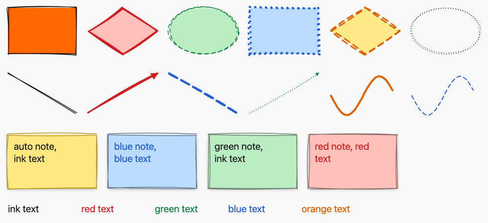
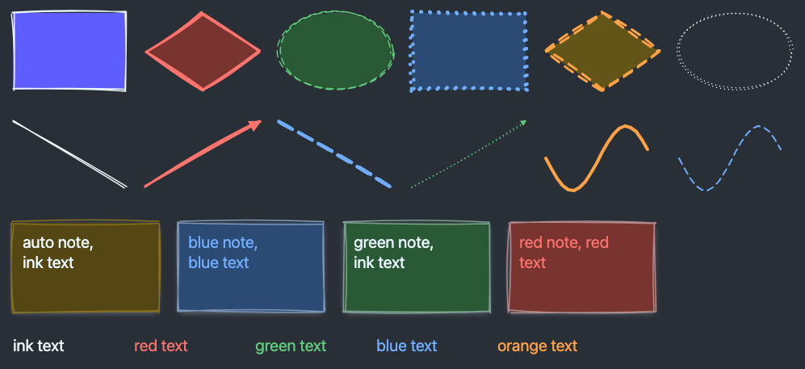
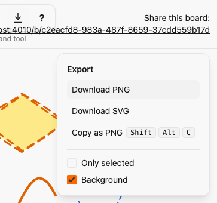

# Export to PNG and SVG, and copy to clipboard

*2026-10-30T09:46:29Z by Showboat 0.6.1*
<!-- showboat-id: a3acb52e-796d-460c-b3c5-4b413dd04995 -->

Outcome: the board, or just the selected element, can be downloaded as SVG or PNG and copied to the clipboard as a PNG (with the SVG as text next to it). An Export button in the toolbar opens a menu with Download PNG, Download SVG, Copy as PNG and the options Only selected and Background. Ctrl/⌘+Shift+E opens the menu and Shift+Alt+C copies a PNG. Everything happens in the browser from the live DOM: no server rendering and no new runtime dependency (A15). The file is a standalone SVG cropped to the content plus 16 px, with every palette class resolved to a concrete colour for the theme on screen.

The actions, their labels and chords live in one registry, `SketchWeb.ExportActions`. The menu, the shortcuts help and the generated client manifest all render from it, so the keyboard map is not written twice:

```bash
sed -n "/export const EXPORT_ACTIONS/,/^\] as const/p" assets/js/generated/manifest.ts
```

```output
export const EXPORT_ACTIONS = [
  { id: "open_menu", label: "Export", chord: { code: "KeyE", mod: true, shift: true, alt: false } },
  { id: "download_png", label: "Download PNG", chord: null },
  { id: "download_svg", label: "Download SVG", chord: null },
  { id: "copy_png", label: "Copy as PNG", chord: { code: "KeyC", mod: false, shift: true, alt: true } },
] as const satisfies readonly ExportActionSpec[]
```

The pure parts (crop, filename, which elements are included, PNG size cap, colour to paint, chord matching) are in `assets/js/export/export_logic.ts` with fast-check properties: the crop always contains every included box and is the tight bounds plus exactly 16 px on each side; only-selected keeps exactly the selected element; the PNG never exceeds 16 million pixels; every filename matches `sketch-<8 hex>-<yyyymmdd>-<hhmm>.<ext>`.

```bash
docs/evidence/pbt-drag-share/run-ts.sh test/export_logic.test.ts
```

```output
✔ the crop contains every included element's box
✔ the crop is the tight bounds plus exactly 16 px on every side
✔ the tight bounds touch the content on all four sides
✔ an empty board has no crop
✔ one element at the origin is cropped to its size plus 16 px each side
✔ only-selected keeps exactly the selected element
✔ without only-selected, or without a selection, every element is kept
✔ the filename carries the first 8 characters of the board id and a local date and time
✔ every filename matches the documented pattern
✔ the PNG never exceeds the pixel cap and keeps whole pixels
✔ a small area is rendered at the device pixel ratio
✔ paint is a lowercase hex colour with an opacity, and a fully transparent colour is none
✔ groups inline nothing, text inlines fonts, shapes inline paint and stroke
✔ an element wrapper keeps its position and identity but not its classes
✔ marker references are read from url() values
✔ shortcut chords match only their exact modifiers
✔ the registry's chords resolve to their actions
ℹ tests 17
ℹ pass 17
ℹ fail 0
```

The sample board is the styled board from the styling PR (`board.exs`: every kind, fill, stroke colour, width and stroke style, 21 elements). `export-sample.mjs` opens it in a light and a dark browser, opens the menu with Ctrl+Shift+E and downloads the SVG and the PNG through the menu. The committed files are those downloads. Parsing the SVGs: one group per element, no `class` attribute anywhere, every colour a concrete `#rrggbb` (or `none`), the arrowhead markers copied into `defs`, the background taken from the theme, and no selection handles:

```bash
python3 -I docs/evidence/export/svg-facts.py docs/evidence/export/sample-light.svg docs/evidence/export/sample-dark.svg
```

```output
sample-light.svg
  viewBox: 24 24 997 457 | width x height: 997 x 457
  element groups: 21 | class attributes: 0
  every fill and stroke is #rrggbb or none: True
  distinct paints: 18 | markers in defs: 2
  background fill: #f8f8f8 | luminance: 0.97
  selection handles or outlines: 0
sample-dark.svg
  viewBox: 24 24 997 457 | width x height: 997 x 457
  element groups: 21 | class attributes: 0
  every fill and stroke is #rrggbb or none: True
  distinct paints: 18 | markers in defs: 2
  background fill: #292f37 | luminance: 0.18
  selection handles or outlines: 0
```

The PNGs have the PNG signature and the size of the cropped area (997 by 457 px at a device pixel ratio of 1; the E2E test checks a ratio of 2):

```bash
python3 -I -c "
import struct
for name in (\"sample-light\", \"sample-dark\"):
    data = open(f\"docs/evidence/export/{name}.png\", \"rb\").read()
    print(name, \"signature ok:\", data[:8] == bytes([0x89, 0x50, 0x4E, 0x47, 0x0D, 0x0A, 0x1A, 0x0A]), \"size:\", \"x\".join(map(str, struct.unpack(\">II\", data[16:24]))))
"
```

```output
sample-light signature ok: True size: 997x457
sample-dark signature ok: True size: 997x457
```

```bash {image}

```



```bash {image}

```



The exported SVG files themselves (open them in any browser or editor): [sample-light.svg](sample-light.svg) and [sample-dark.svg](sample-dark.svg). The menu, opened with Ctrl+Shift+E, with the shortcut hints, the Only selected option (disabled until something is selected) and Background:

```bash {image}

```



The new Playwright spec, `export.spec.ts`, drives Chromium with clipboard permissions granted. It waits for the real download event and reads the file: Download SVG (viewBox is the content box plus 16 px, one group per element, no class attributes, concrete colours, no selection handles even with an element selected, arrowhead marker copied), Background off (no background rect), Download PNG (signature and the dimensions at a device pixel ratio of 2), Shift+Alt+C and the menu item (the clipboard holds image/png plus the SVG text), Only selected (one element, disabled and cleared without a selection), dark theme (dark background and different palette), keyboard (Ctrl+Shift+E opens it, focus moves in, Tab and Enter work, Escape closes and returns focus), an empty board ("Nothing to export"), a missing clipboard (a message, no uncaught error) and the shortcuts help. Then the whole suite:

```bash
docs/evidence/pbt-drag-share/run-e2e.sh export.spec.ts
```

```output
11 passed
```

```bash
docs/evidence/pbt-drag-share/run-e2e.sh
```

```output
68 passed
```

Mutation 1, the crop loses its padding: `mutations/crop-without-padding.patch` sets `EXPORT_PADDING` to 0. The "contains every element" property still holds (a tight crop contains them), but the exact-padding property and the worked example fail:

```bash
docs/evidence/export/mutate.sh crop-without-padding docs/evidence/pbt-drag-share/run-ts.sh test/export_logic.test.ts | grep -E "^(✖|Mutation)" | sort -u
```

```output
✖ failing tests:
✖ one element at the origin is cropped to its size plus 16 px each side
✖ the crop is the tight bounds plus exactly 16 px on every side
Mutation killed (exit 1)
```

Mutation 2, token classes are not inlined: `mutations/classes-not-inlined.patch` skips the computed-style step and keeps the `class` attributes. The exported file would only look right inside the app. The E2E test that parses the downloaded SVG fails on its class check:

```bash
docs/evidence/export/mutate.sh classes-not-inlined docs/evidence/pbt-drag-share/run-e2e.sh export.spec.ts -g "Download SVG is a standalone"
```

```output
1 failed
Mutation killed (exit 1)
```

Mutation 3, the selection overlay is exported: `mutations/handles-included.patch` appends a copy of the `#selection` group (outline and handles) to the exported content. The SVG test (an element is selected while it exports) and the Only selected test both fail:

```bash
docs/evidence/export/mutate.sh handles-included docs/evidence/pbt-drag-share/run-e2e.sh export.spec.ts -g "Download SVG is a standalone|Only selected"
```

```output
2 failed
Mutation killed (exit 1)
```

Every file this PR touched outside the evidence folder (A added, M modified) against `styling`. The registry, the menu component and the three client modules are new; the toolbar, board and manifest generator changes only render from the registry; the canvas hook change is one data attribute (`data-selected-element`) that tells the menu what is selected, and no pointer code was added anywhere (A13). `architecture/rules.exs` is untouched.

```bash
git diff --name-status -M styling...HEAD -- . ":!docs/evidence" | sort -k2; git diff --shortstat styling...HEAD -- . ":!docs/evidence"
```

```output
M	ARCHITECTURE.md
M	assets/js/app.ts
A	assets/js/export/export_dom.ts
A	assets/js/export/export_logic.ts
M	assets/js/generated/manifest.ts
M	assets/js/hooks/canvas.ts
A	assets/js/hooks/export_menu.ts
A	assets/test/export_logic.test.ts
A	e2e/tests/export.spec.ts
M	lib/sketch_web/client_manifest.ex
A	lib/sketch_web/components/export_menu.ex
M	lib/sketch_web/components/toolbar.ex
A	lib/sketch_web/export_actions.ex
M	lib/sketch_web/live/board_live.ex
A	test/sketch_web/live/board_live_export_test.exs
 15 files changed, 1421 insertions(+), 5 deletions(-)
```
