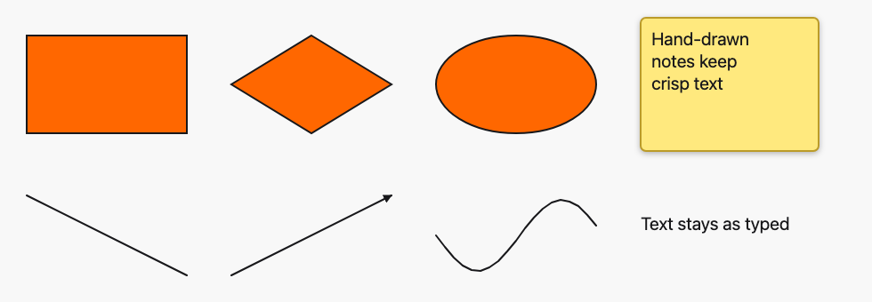
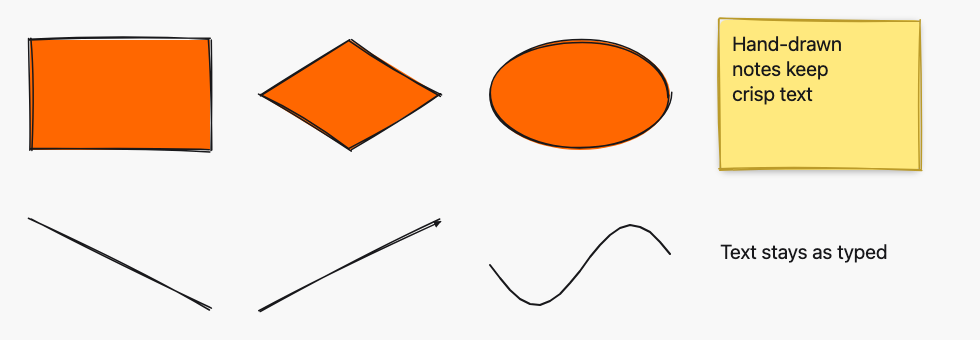
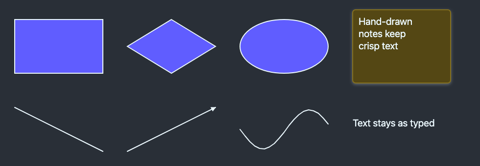
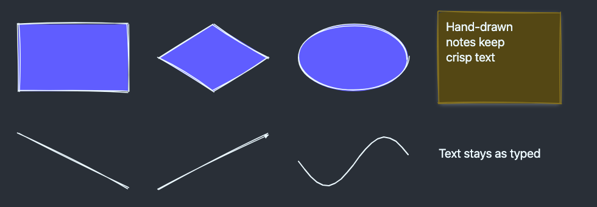
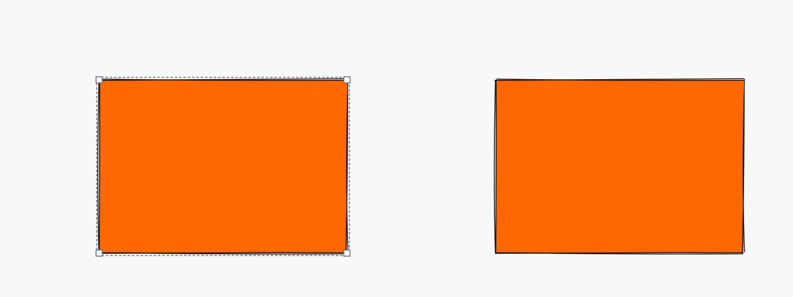

# Hand-drawn rendering with a per-element seed (ADR 0005)

*2026-10-30T06:21:03Z by Showboat 0.6.1*
<!-- showboat-id: c8ead799-6052-4280-b602-57d033e0502e -->

Outcome: every rectangle, diamond, ellipse, note, line and arrow now draws its outline as two slightly bowed, slightly offset strokes over the unchanged fill, from a `seed` stored on the element. The drawing client picks the seed, so A's preview, B's preview and the committed element wobble identically, in every browser and after a reload; resizing keeps the seed, so a shape keeps its character at any size. Freehand strokes and text are unchanged. Hit geometry is unchanged: fills keep their exact shape (now with a transparent stroke of the same width) and line and arrow hit lines are untouched; the sketch `path` never takes the pointer. No runtime dependency was added.

`Element.seed` is an integer in `0..2_147_483_647`: an Ash constraint, a `seed_in_range` CHECK, accepted only by `create`, with a random Ash default and a random database default so existing rows and old servers get one. The migration only adds the column and the CHECK.

```bash
sed -n "/def up/,/^  end/p" priv/repo/migrations/20261030055935_hand_drawn_seed.exs; grep -n "seed" lib/sketch/canvas/element.ex | grep -E "accept|attribute|check_constraint|migration_defaults|default:"
```

```output
  def up do
    alter table(:elements) do
      add :seed, :bigint, null: false, default: fragment("floor(random() * 2147483648)::bigint")
    end

    create constraint(:elements, :seed_in_range,
             check: """
               seed >= 0 AND seed <= 2147483647
             """
           )
  end
52:    migration_defaults seed: ~s|fragment("floor(random() * #{@max_seed + 1})::bigint")|
89:      check_constraint :seed, "seed_in_range", check: "seed >= 0 AND seed <= #{@max_seed}"
97:      accept [:kind, :x, :y, :width, :height, :points, :text, :seed, :board_id]
183:    attribute :seed, :integer,
185:      default: &__MODULE__.random_seed/0,
```

Both sides run the same generator: mulberry32 in 32-bit integer arithmetic (`Bitwise` with a mask in Elixir, `Math.imul` and `>>> 0` in TypeScript), coordinates in integer hundredths of a pixel, truncating division, and one printing rule (whole values as integers, otherwise exactly two decimals). No float is ever produced, so there is nothing to round or print differently. The same line, seed 7, from the server and from the client:

```bash
mix run --no-start -e 'IO.puts SketchWeb.HandDrawn.line(%{x: 0, y: 0}, %{x: 120, y: 40}, 7)' 2>&1 | tail -1
node --input-type=module -e 'import { line } from "./assets/js/elements/hand_drawn.ts"; console.log(line({ x: 0, y: 0 }, { x: 120, y: 40 }, 7))'
```

```output
M -0.33 0.78 C 39.09 16.83 79.11 31.04 120.27 41.85 M 0.59 0.75 C 39.20 16.91 78.85 29.95 119.01 41.46
M -0.33 0.78 C 39.09 16.83 79.11 31.04 120.27 41.85 M 0.59 0.75 C 39.20 16.91 78.85 29.95 119.01 41.46
```

Fixtures: the render fixture now renders every shape with a seed (0, 1, 7, 1 234 567 890 and the two largest; every seed for box kinds without text, the seeds in turn for point and text kinds), and a new `random_parity.json` holds the first 64 generator outputs for ten seeds (including 0, the largest element seed and 2^32 - 1) and how 23 hundredths values print, negative ones included. `mix sketch.gen.render_fixtures` writes all three and `--check` runs in `mix ci`.

```bash
mix sketch.gen.render_fixtures --check 2>&1 | tail -3 && python3 -c "
import json, collections
d = json.load(open(\"assets/test/fixtures/render_parity.json\"))
for kind, cases in d.items():
    print(kind, len(cases), sorted(collections.Counter(c[\"shape\"][\"seed\"] for c in cases)))
r = json.load(open(\"assets/test/fixtures/random_parity.json\"))
print(len(r[\"random\"]), \"seeds x\", len(r[\"random\"][0][\"outputs\"]), \"outputs;\", \", \".join(f[\"text\"] for f in r[\"format\"] if f[\"hundredths\"] in (-525, -5, 0, 5, 150, 400525)))
"
```

```output
assets/test/fixtures/render_parity.json is up to date
assets/test/fixtures/wrap_parity.json is up to date
assets/test/fixtures/random_parity.json is up to date
rectangle 294 [0, 1, 7, 1234567890, 2147483646, 2147483647]
diamond 294 [0, 1, 7, 1234567890, 2147483646, 2147483647]
ellipse 294 [0, 1, 7, 1234567890, 2147483646, 2147483647]
arrow 147 [0, 1, 7, 1234567890, 2147483646, 2147483647]
freedraw 294 [0, 1, 7, 1234567890, 2147483646, 2147483647]
line 147 [0, 1, 7, 1234567890, 2147483646, 2147483647]
text 576 [0, 1, 7, 1234567890, 2147483646, 2147483647]
note 576 [0, 1, 7, 1234567890, 2147483646, 2147483647]
10 seeds x 64 outputs; 0, 0.05, 1.50, 4005.25, -0.05, -5.25
```

Server side: the Element seed tests (stored, defaulted, rejected out of range by Ash and by the CHECK, immutable through both commit actions), the seed backfill migration test, an Ash-vs-PostgreSQL property over arbitrary seeds, the BoardLive tests (a client seed is stored and every view and a reload draw the same path; an invalid seed creates nothing; draw previews relay the seed), the renderer fixture tests, and StreamData properties that the generator is deterministic, stays within the box plus `max_jitter` (6.5 px), and prints values that read back exactly.

```bash
docs/evidence/pbt-drag-share/run-tests.sh test/sketch/canvas/element_test.exs test/sketch/canvas/element_migration_test.exs test/sketch/properties/geometry_test.exs test/sketch_web/live/board_live_test.exs test/sketch_web/elements_test.exs test/sketch_web/properties/hand_drawn_test.exs --seed 1 --trace 2>&1 | grep -E "seed|hand-drawn|jitter|same seed|format prints|zero-size|different seeds|renders the fixture|fixture is the generated|^Result" | sort
```

```output
  * property a box shape's strokes are the same for the same seed and stay within the box plus the jitter cap [L#56]
  * property a line's strokes are the same for the same seed and stay within its points' box plus the jitter cap [L#72]
  * property Ash and PostgreSQL both accept a seed iff it is an integer in 0..max_seed [L#225]
  * property format prints every hundredths value so that it reads back as the same value [L#87]
  * test a draw preview relays its seed, and one with an invalid seed is dropped [L#208]
  * test a zero-size shape is a valid path at the origin [L#93]
  * test adding the seed gives every existing row and every insert without one a random seed in range [L#111]
  * test arrow renders the fixture's node tree inside a wrapper translated to its box [L#21]
  * test create_element stores the client's seed and every view draws the same hand-drawn path from it [L#170]
  * test create_element without a seed stores a random one, and with an invalid seed creates nothing [L#191]
  * test diamond renders the fixture's node tree inside a wrapper translated to its box [L#21]
  * test different seeds draw the same shape differently [L#99]
  * test ellipse renders the fixture's node tree inside a wrapper translated to its box [L#21]
  * test freedraw renders the fixture's node tree inside a wrapper translated to its box [L#21]
  * test line renders the fixture's node tree inside a wrapper translated to its box [L#21]
  * test note renders the fixture's node tree inside a wrapper translated to its box [L#21]
  * test rectangle renders the fixture's node tree inside a wrapper translated to its box [L#21]
  * test seed (A08, ADR 0005) a create without a seed gets a random one in range [L#460]
  * test seed (A08, ADR 0005) Ash rejects a seed outside 0..max_seed [L#470]
  * test seed (A08, ADR 0005) cannot change after create [L#478]
  * test seed (A08, ADR 0005) create stores a chosen seed and its event carries it [L#449]
  * test seed (A08, ADR 0005) the database defaults a missing seed and rejects one out of range [L#489]
  * test text renders the fixture's node tree inside a wrapper translated to its box [L#21]
  * test the committed render parity fixture is the generated one (ADR 0004) [L#8]
  * test the committed wrap parity fixture is the generated one (ADR 0004) [L#13]
Result: 104 passed (10 properties, 94 tests)
```

Client side: the random source and formatter match the random fixture, every client renderer matches the server for every fixture shape and seed, then the whole assets suite.

```bash
docs/evidence/pbt-drag-share/run-ts.sh test/random_parity.test.ts test/render_parity.test.ts && npm --prefix assets test 2>&1 | grep -E "^ℹ (tests|pass|fail) "
```

```output
✔ the random parity fixture covers seed 0 and the largest seed (mix sketch.gen.render_fixtures)
✔ the client random source returns the same outputs as the server for every fixture seed
✔ the client prints every fixture hundredths value like the server
✔ the parity fixture covers every element kind (mix sketch.gen.render_fixtures)
✔ the rectangle client renderer draws the same node tree as the server renderer for every fixture shape
✔ the diamond client renderer draws the same node tree as the server renderer for every fixture shape
✔ the ellipse client renderer draws the same node tree as the server renderer for every fixture shape
✔ the arrow client renderer draws the same node tree as the server renderer for every fixture shape
✔ the freedraw client renderer draws the same node tree as the server renderer for every fixture shape
✔ the line client renderer draws the same node tree as the server renderer for every fixture shape
✔ the text client renderer draws the same node tree as the server renderer for every fixture shape
✔ the note client renderer draws the same node tree as the server renderer for every fixture shape
ℹ tests 12
ℹ pass 12
ℹ fail 0
ℹ tests 72
ℹ pass 72
ℹ fail 0
```

Playwright, two browsers, no sleeps, full suite. The new `hand-drawn.spec.ts` checks, for rectangle, diamond, ellipse, line and arrow, that A's local preview carries a seed, that B's remote preview has the same seed and exactly the same path `d`, and that after release the committed element in both browsers, and after B reloads (server-rendered), has that seed and that exact path. A drawn and typed note keeps its preview outline. A resize keeps the seed: mid-resize A's local re-render and B's remote preview draw the same new path, and the commit and a reload keep it. `line.spec.ts` and `arrow.spec.ts` still assert the exact hit `line` geometry, and now that each stroke of the sketched `path` starts and ends within the 2 px end jitter of the endpoints.

```bash
docs/evidence/pbt-drag-share/run-e2e.sh
```

```output
54 passed
```

Mutation 1, the random source, client only: `mutations/client-prng.patch` changes one mixing constant in `random.ts` (`t | 61` to `t | 63`). The random parity test fails, and so does every sketched kind's render parity; freehand and text, which do not use the seed, still pass.

```bash
docs/evidence/hand-drawn/mutate.sh client-prng docs/evidence/hand-drawn/client-parity.sh
```

```output
✔ the random parity fixture covers seed 0 and the largest seed (mix sketch.gen.render_fixtures)
✖ the client random source returns the same outputs as the server for every fixture seed
✔ the client prints every fixture hundredths value like the server
✔ the parity fixture covers every element kind (mix sketch.gen.render_fixtures)
✖ the rectangle client renderer draws the same node tree as the server renderer for every fixture shape
✖ the diamond client renderer draws the same node tree as the server renderer for every fixture shape
✖ the ellipse client renderer draws the same node tree as the server renderer for every fixture shape
✖ the arrow client renderer draws the same node tree as the server renderer for every fixture shape
✔ the freedraw client renderer draws the same node tree as the server renderer for every fixture shape
✖ the line client renderer draws the same node tree as the server renderer for every fixture shape
✔ the text client renderer draws the same node tree as the server renderer for every fixture shape
✖ the note client renderer draws the same node tree as the server renderer for every fixture shape
✖ failing tests:
Mutation killed (exit 1)
```

Mutation 2, number printing, server only: `mutations/server-format.patch` drops trailing zeros (`1.5` instead of `1.50`, as float printing would), the same value written differently. The committed fixture is stale, so `--check` fails; regenerated from the mutant, the client format test and every sketched kind's parity test fail.

```bash
docs/evidence/hand-drawn/mutate.sh server-format docs/evidence/hand-drawn/server-parity.sh
```

```output
** (Mix) assets/test/fixtures/render_parity.json is stale or was edited by hand. Run `mix sketch.gen.render_fixtures` and commit the result.
✔ the random parity fixture covers seed 0 and the largest seed (mix sketch.gen.render_fixtures)
✔ the client random source returns the same outputs as the server for every fixture seed
✖ the client prints every fixture hundredths value like the server
✔ the parity fixture covers every element kind (mix sketch.gen.render_fixtures)
✖ the rectangle client renderer draws the same node tree as the server renderer for every fixture shape
✖ the diamond client renderer draws the same node tree as the server renderer for every fixture shape
✖ the ellipse client renderer draws the same node tree as the server renderer for every fixture shape
✖ the arrow client renderer draws the same node tree as the server renderer for every fixture shape
✔ the freedraw client renderer draws the same node tree as the server renderer for every fixture shape
✖ the line client renderer draws the same node tree as the server renderer for every fixture shape
✔ the text client renderer draws the same node tree as the server renderer for every fixture shape
✖ the note client renderer draws the same node tree as the server renderer for every fixture shape
✖ failing tests:
Mutation killed (exit 1)
```

Mutation 3, the seed not sent on create, client only: `mutations/seed-not-sent-on-create.patch` drops `seed` from the hook's `create_element` push for drawn shapes. It type-checks and the whole assets suite (including both parity tests) still passes, because the server falls back to a random seed. Only the browser can see it: the committed rectangle gets a different seed, and so a different wobble, from the preview A drew, and `hand-drawn.spec.ts` fails on the seed comparison. The note and resize tests still pass, since text creation sends its own seed and a resize keeps the stored one.

```bash
docs/evidence/hand-drawn/mutate.sh seed-not-sent-on-create docs/evidence/hand-drawn/seed-e2e.sh
```

```output
ℹ pass 72
ℹ fail 0
Error: expect(locator).toHaveAttribute(expected) failed
Locator:  locator('[data-element][data-kind="rectangle"]')
Expected: "<A's seed>"
1 failed
2 passed
Mutation killed (exit 1)
```

Before and after, one board with every kind, light and dark theme. `board.exs` creates the board with fixed seeds 1 to 8; `screenshots.mjs` photographs it. "Before" is the `kind-note` branch served from a worktree against the same, already migrated database, which also shows the expand-only migration: the old server ignores the new column. Freehand strokes and text look the same in both.

```bash {image}

```



```bash {image}

```



```bash {image}

```



```bash {image}

```



Two-browser recording (`record.sh`, Playwright video of the resize test, slowed 3x, A left and B right): A draws a rectangle and B sees the same preview wobble while A drags, then the same committed outline; A selects it and drags the south-east corner, and B's remote preview redraws the same stretched outline as A's local one, keeping the rectangle's character (the same seed, the same pattern of bows and overshoots, scaled); both keep it after the commit.

```bash {image}

```


```bash {image}

```



Every file this PR touched outside the evidence folder (A added, M modified) against `kind-note`. New: ADR 0005, the generator and random source on both sides, the random fixture module, its generated fixture and parity test, the migration and snapshot, the property test and the E2E spec. Production dependencies are unchanged (A15 passes in `mix ci`).

```bash
git diff --name-status -M kind-note...HEAD -- . ":!docs/evidence" | sort -k2; git diff --shortstat kind-note...HEAD -- . ":!docs/evidence"
```

```output
M	ARCHITECTURE.md
M	architecture/rules.exs
M	assets/css/app.css
M	assets/js/elements/arrow.ts
M	assets/js/elements/diamond.ts
M	assets/js/elements/dom.ts
M	assets/js/elements/ellipse.ts
A	assets/js/elements/hand_drawn.ts
M	assets/js/elements/line.ts
M	assets/js/elements/note.ts
A	assets/js/elements/random.ts
M	assets/js/elements/rectangle.ts
M	assets/js/elements/renderer.ts
M	assets/js/elements/segments.ts
M	assets/js/generated/manifest.ts
M	assets/js/hooks/canvas.ts
M	assets/js/hooks/selection.ts
A	assets/test/fixtures/random_parity.json
M	assets/test/fixtures/render_parity.json
A	assets/test/random_parity.test.ts
M	docs/adr/0003-element-model.md
A	docs/adr/0005-hand-drawn-rendering-with-a-per-element-seed.md
M	docs/SPEC-ADDENDUM.md
M	e2e/tests/arrow.spec.ts
A	e2e/tests/hand-drawn.spec.ts
M	e2e/tests/line.spec.ts
M	e2e/tests/support/canvas.ts
M	lib/mix/tasks/sketch.gen.render_fixtures.ex
M	lib/sketch_web/element_renderer.ex
M	lib/sketch_web/elements.ex
M	lib/sketch_web/elements/arrow.ex
M	lib/sketch_web/elements/diamond.ex
M	lib/sketch_web/elements/ellipse.ex
M	lib/sketch_web/elements/line.ex
M	lib/sketch_web/elements/note.ex
M	lib/sketch_web/elements/rectangle.ex
A	lib/sketch_web/hand_drawn.ex
A	lib/sketch_web/hand_drawn/random.ex
M	lib/sketch_web/live/board_live.ex
A	lib/sketch_web/random_fixtures.ex
M	lib/sketch_web/render_fixtures.ex
M	lib/sketch/canvas/element.ex
M	lib/sketch/canvas/geometry.ex
A	priv/repo/migrations/20261030055935_hand_drawn_seed.exs
A	priv/resource_snapshots/repo/elements/20261030055936.json
M	test/sketch_web/elements_test.exs
M	test/sketch_web/live/board_live_test.exs
A	test/sketch_web/properties/hand_drawn_test.exs
M	test/sketch/canvas/element_migration_test.exs
M	test/sketch/canvas/element_test.exs
M	test/sketch/properties/geometry_test.exs
M	test/support/canvas_fixtures.ex
 52 files changed, 4402 insertions(+), 2022 deletions(-)
```
