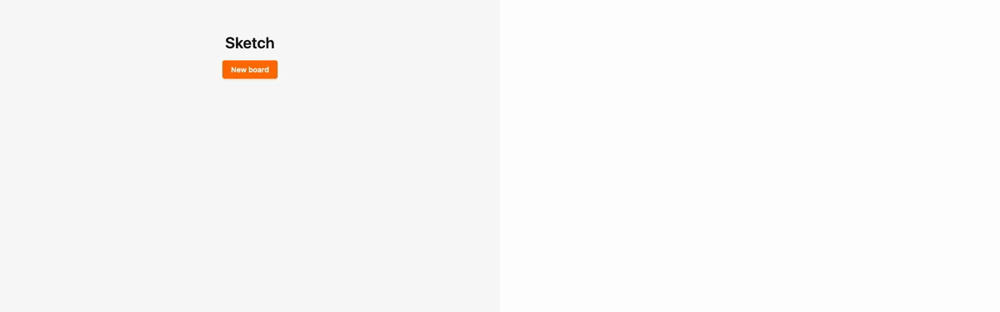
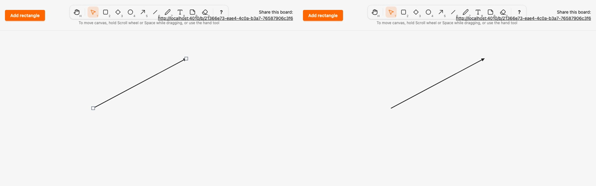

# Migrate arrow to the kind registry and local render model

*2026-10-29T22:54:45Z by Showboat 0.6.1*
<!-- showboat-id: d3535de3-b36b-45f7-a909-70b60566a2f2 -->

**Outcome: `arrow` is the fifth kind on the registry and the local render model. An arrow renders as `<g data-element data-kind="arrow" transform="translate(x y)" live-points="…">` with a transparent hit `line` and a visible stroke `line` in local coordinates, the stroke ending in `marker-end="url(#arrowhead)"`. `SketchWeb.Elements.Arrow` and `assets/js/elements/arrow.ts` are one-liners over a shared segment builder that `line` now uses too (`SketchWeb.ElementRenderer.segments/2` and `assets/js/elements/segments.ts`). The legacy arrow clause, `line_segment`, the arrow preview tag, the `marker-end` special case in `DrawLayer.shape` and the legacy segment setters (`setSegments`, `LINE_SEGMENTS`) are gone. No migration, no change to stored data.**

Arrow reads and writes live points through the generic path introduced for line (#23), so nothing kind-specific was added for it. Only freedraw, text and note remain legacy.

The registry and renderers agree on arrow: it is rendered, no longer legacy, and in the client manifest.

```bash
mix run --no-start -e 'IO.inspect(SketchWeb.Elements.kinds(), label: "rendered"); IO.inspect(Sketch.Canvas.legacy_kinds(), label: "legacy")' 2>&1 | grep -vE '^(Compiling|Generated)'; grep -E '^export const MIGRATED' assets/js/generated/manifest.ts; grep -n 'satisfies' assets/js/elements/index.ts
```

```output
rendered: [:rectangle, :diamond, :ellipse, :arrow, :line]
legacy: [:freedraw, :text, :note]
export const MIGRATED_KINDS = ["rectangle", "diamond", "ellipse", "arrow", "line"] as const
9:export const RENDERERS = { rectangle, diamond, ellipse, arrow, line } as const satisfies Record<MigratedKind, Renderer>
```

Both generated files are current (regenerated, never edited), and the server-side tests pass: the HEEx output equals the fixture for every arrow shape (147 cases, the same point paths as line), and the LiveView test sees the arrow as a translated wrapper with local endpoints and the arrowhead on the stroke.

```bash
mix sketch.gen.manifest --check 2>&1 | tail -1 && mix sketch.gen.render_fixtures --check 2>&1 | tail -1 && docs/evidence/pbt-drag-share/run-tests.sh test/sketch_web/elements_test.exs test/sketch_web/live/board_live_test.exs --seed 1 --trace 2>&1 | grep -E "arrow|renders the fixture|renderers cover|fixture is the generated|^Result"
```

```output
assets/js/generated/manifest.ts is up to date
assets/test/fixtures/render_parity.json is up to date
  * test arrow renders the fixture's node tree inside a wrapper translated to its box [L#23]
  * test rectangle renders the fixture's node tree inside a wrapper translated to its box [L#23]
  * test line renders the fixture's node tree inside a wrapper translated to its box [L#23]
  * test diamond renders the fixture's node tree inside a wrapper translated to its box [L#23]
  * test ellipse renders the fixture's node tree inside a wrapper translated to its box [L#23]
  * test the renderers cover exactly the kinds that left Sketch.Canvas.Kinds.Legacy [L#13]
  * test the committed render parity fixture is the generated one (ADR 0004) [L#8]
  * test lines a drawn arrow keeps its start and end and renders an arrowhead on the end [L#291]
Result: 41 passed
```

Client parity: the arrow client renderer is compared with the server fixture for all arrow shapes, then the whole assets suite runs.

```bash
docs/evidence/pbt-drag-share/run-ts.sh test/render_parity.test.ts && npm --prefix assets test 2>&1 | grep -E "^ℹ (tests|pass|fail) "
```

```output
✔ the parity fixture covers exactly the kinds with a renderer (mix sketch.gen.render_fixtures)
✔ the rectangle client renderer draws the same node tree as the server renderer for every fixture shape
✔ the diamond client renderer draws the same node tree as the server renderer for every fixture shape
✔ the ellipse client renderer draws the same node tree as the server renderer for every fixture shape
✔ the arrow client renderer draws the same node tree as the server renderer for every fixture shape
✔ the line client renderer draws the same node tree as the server renderer for every fixture shape
ℹ tests 6
ℹ pass 6
ℹ fail 0
ℹ tests 62
ℹ pass 62
ℹ fail 0
```

Playwright, two browsers, no sleeps. `arrow.spec.ts` selects `[data-element][data-kind="arrow"]` and asserts the wrapper transform plus local `x1/y1/x2/y2` on both the hit and the stroke line, for committed arrows, remote previews and the draw preview on B, and keeps the `marker-end="url(#arrowhead)"` assertion on the stroke and on B's draw preview. A new test draws an arrow, moves it (only the transform changes, `data-points` untouched, arrowhead present in both browsers) and drags its end outward (children redrawn, arrowhead kept). The run includes the line, freedraw and other gesture specs.

```bash
docs/evidence/pbt-drag-share/run-e2e.sh line arrow draw eraser dragging concurrent-drag drag-properties shortcuts render-model
```

```output
28 passed
```

Mutation: `mutations/client-drops-marker.patch` makes the client arrow renderer omit the `marker-end`. The type checks pass and the arrow looks plain, but the parity test fails on the first fixture shape.

```bash
docs/evidence/kind-arrow/mutate.sh client-drops-marker bash -c 'set -o pipefail; npm --prefix assets run --silent typecheck && cd assets && node --test test/render_parity.test.ts 2>&1 | grep -E "^(✔|✖) " | sed -E "s/ \([0-9.]+m?s\)$//" | awk "!seen[\$0]++"'
```

```output
✔ the parity fixture covers exactly the kinds with a renderer (mix sketch.gen.render_fixtures)
✔ the rectangle client renderer draws the same node tree as the server renderer for every fixture shape
✔ the diamond client renderer draws the same node tree as the server renderer for every fixture shape
✔ the ellipse client renderer draws the same node tree as the server renderer for every fixture shape
✖ the arrow client renderer draws the same node tree as the server renderer for every fixture shape
✔ the line client renderer draws the same node tree as the server renderer for every fixture shape
✖ failing tests:
Mutation killed (exit 1)
```

Two-browser recording (`record.sh`, Playwright video of the translated-wrapper test, slowed 3x): A (left) draws an arrow, moves it and drags its end outward; B (right) mirrors each step with the arrowhead visible throughout.

```bash {image}

```



```bash {image}

```



Data for "how easy is a new kind": every file this migration touched outside the evidence folder (A added, M modified) against `kind-line`. New files: the spec, the two renderers and the shared client segment builder (4). Regenerated, never hand-edited: the manifest and parity fixture (2). One-line registrations: `kinds.ex`, `legacy.ex`, `elements.ex`, `elements/index.ts`. The shared server segment builder lives in `element_renderer.ex`. The rest is removal of the arrow clause, `line_segment`, the preview tag and the segment setters, the A22 descriptions, and tests. No live-points work was needed.

```bash
git diff --name-status kind-line...HEAD -- . ':!docs/evidence' | sort -k2; git diff --shortstat kind-line...HEAD -- . ':!docs/evidence'
```

```output
M	architecture/rules.exs
A	assets/js/elements/arrow.ts
M	assets/js/elements/index.ts
M	assets/js/elements/line.ts
A	assets/js/elements/segments.ts
M	assets/js/generated/manifest.ts
M	assets/js/hooks/selection.ts
M	assets/test/fixtures/render_parity.json
M	e2e/tests/arrow.spec.ts
M	lib/sketch_web/element_renderer.ex
M	lib/sketch_web/elements.ex
A	lib/sketch_web/elements/arrow.ex
M	lib/sketch_web/elements/line.ex
M	lib/sketch_web/live/board_live.ex
M	lib/sketch/canvas/kinds.ex
A	lib/sketch/canvas/kinds/arrow.ex
M	lib/sketch/canvas/kinds/legacy.ex
M	test/sketch_web/live/board_live_test.exs
 18 files changed, 329 insertions(+), 151 deletions(-)
```
