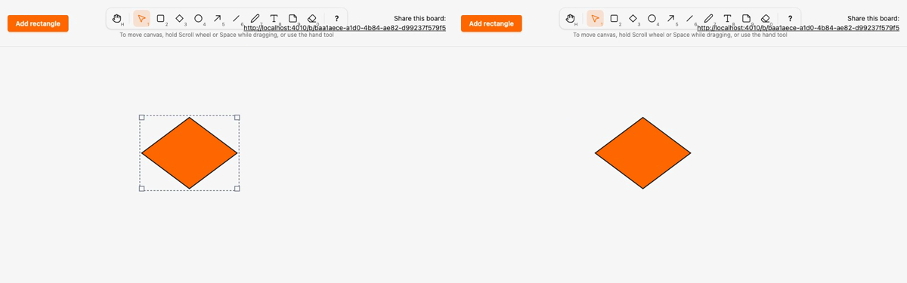

# Migrate diamond to the kind registry and local render model

*2026-10-29T21:49:54Z by Showboat 0.6.1*
<!-- showboat-id: 933ceaf3-a829-4cf2-bee1-3d03190076f3 -->

**Outcome: `diamond` is the second kind on the registry and the local render model. Its spec is `Sketch.Canvas.Kinds.Diamond`, it renders as the wrapper `<g data-element data-kind="diamond" transform="translate(x y)">` with one `polygon` in local coordinates, drawn by `SketchWeb.Elements.Diamond` on the server and `assets/js/elements/diamond.ts` on the client, and the old `polygon` clause, `diamond_points` and the `polygon` branch of `setBox` are gone. No migration, no change to stored data.**

Three things to know. Half-sizes of odd widths are fractions (`121 / 2` is `60.5`) and even ones must print without a decimal point (`60`, not `60.0`): the server renderer halves even sizes with `div/2` and odd ones with `/`, so HEEx writes the same text as JavaScript's `String(n)`. The parity fixture covers sizes 0, 1, 2, 119, 120, 3999 and 4000, so both parities are checked. `coordinate/1` stays in `board_live.ex` because the ellipse clause still uses it. A22's `legacy_kind_files` keeps all three files, since each still branches for other kinds; only the `board_live.ex` description lost diamond.

The registry and renderers now agree on diamond: it is rendered, no longer legacy, and in the client manifest.

```bash
mix run --no-start -e 'IO.inspect(SketchWeb.Elements.kinds(), label: "rendered"); IO.inspect(Sketch.Canvas.legacy_kinds(), label: "legacy")' 2>&1 | grep -vE '^(Compiling|Generated)'; grep -E '^export const MIGRATED' assets/js/generated/manifest.ts; grep -n 'satisfies' assets/js/elements/index.ts
```

```output
rendered: [:rectangle, :diamond]
legacy: [:ellipse, :arrow, :freedraw, :line, :text, :note]
export const MIGRATED_KINDS = ["rectangle", "diamond"] as const
6:export const RENDERERS = { rectangle, diamond } as const satisfies Record<MigratedKind, Renderer>
```

Both generated files are current, and the server-side tests pass: the committed fixture is the generated one, the renderers cover exactly the non-legacy kinds, the HEEx output of `Elements.element/1` equals the fixture for every diamond shape, and the LiveView test sees a diamond as a translated wrapper with a local polygon (odd width 101 gives `50.5,0 101,20 50.5,40 0,20`).

```bash
mix sketch.gen.manifest --check 2>&1 | tail -1 && mix sketch.gen.render_fixtures --check 2>&1 | tail -1 && docs/evidence/pbt-drag-share/run-tests.sh test/sketch_web/elements_test.exs test/sketch_web/live/board_live_test.exs --seed 1 --trace 2>&1 | grep -E 'diamond|renderers cover|fixture is the generated|^Result'
```

```output
assets/js/generated/manifest.ts is up to date
assets/test/fixtures/render_parity.json is up to date
  * test diamond renders the fixture's node tree inside a wrapper translated to its box [L#23]
  * test the renderers cover exactly the kinds that left Sketch.Canvas.Kinds.Legacy [L#13]
  * test the committed render parity fixture is the generated one (ADR 0004) [L#8]
  * test a drawn diamond is stored with its kind and rendered as a local polygon in every view [L#73]
Result: 38 passed
```

Client parity: the diamond client renderer is compared with the server fixture for every size in {0, 1, 2, 119, 120, 3999, 4000}² (odd and even half-sizes), then the whole assets suite runs.

```bash
docs/evidence/pbt-drag-share/run-ts.sh test/render_parity.test.ts && npm --prefix assets test 2>&1 | grep -E '^ℹ (tests|pass|fail) '
```

```output
✔ the parity fixture covers exactly the kinds with a renderer (mix sketch.gen.render_fixtures)
✔ the rectangle client renderer draws the same node tree as the server renderer for every fixture shape
✔ the diamond client renderer draws the same node tree as the server renderer for every fixture shape
ℹ tests 3
ℹ pass 3
ℹ fail 0
ℹ tests 59
ℹ pass 59
ℹ fail 0
```

Playwright, two browsers, no sleeps. `diamond.spec.ts` now selects `[data-element][data-kind="diamond"]` and asserts the polygon in local coordinates under the wrapper (live previews on B included). The new last test draws a 121×81 diamond (odd sizes, fractional half-sizes), moves it, then resizes it: mid-move both browsers show only a new `transform` with the polygon unchanged and the committed `data-x` untouched, and mid-resize the polygon is redrawn while the transform stays. The other specs that touch diamonds (eraser, dragging, shortcuts) run alongside.

```bash
docs/evidence/pbt-drag-share/run-e2e.sh diamond eraser dragging concurrent-drag shortcuts render-model
```

```output
20 passed
```

Mutation (a): `mutations/client-floors-half-width.patch` changes only the client diamond, so its half-width is `Math.floor(width / 2)`. Both type checks pass and the change is invisible for even sizes, but the parity test fails on the first odd width, with the fixture on the server side unchanged.

```bash
docs/evidence/kind-diamond/mutate.sh client-floors-half-width bash -c 'set -o pipefail; npm --prefix assets run --silent typecheck && cd assets && node --test test/render_parity.test.ts 2>&1 | grep -E "^(✔|✖) |^ +[+-] +points:" | sed -E "s/ \([0-9.]+m?s\)$//" | awk "!seen[\$0]++"'
```

```output
✔ the parity fixture covers exactly the kinds with a renderer (mix sketch.gen.render_fixtures)
✔ the rectangle client renderer draws the same node tree as the server renderer for every fixture shape
✖ the diamond client renderer draws the same node tree as the server renderer for every fixture shape
✖ failing tests:
  +       points: '0,0 1,0 0,0 0,0'
  -       points: '0.5,0 1,0 0.5,0 0,0'
Mutation killed (exit 1)
```

Mutation (b), the numeric-formatting risk: `mutations/server-float-half.patch` halves every size with `/ 2` on the server and the fixture is regenerated, so only the parity test can catch it. HEEx writes `0.0` for an even half where the client writes `0`.

```bash
docs/evidence/kind-diamond/mutate.sh server-float-half bash -c 'set -o pipefail; mix sketch.gen.render_fixtures > /dev/null && cd assets && node --test test/render_parity.test.ts 2>&1 | grep -E "^(✔|✖) |^ +[+-] +points:" | sed -E "s/ \([0-9.]+m?s\)$//" | awk "!seen[\$0]++"'
```

```output
✔ the parity fixture covers exactly the kinds with a renderer (mix sketch.gen.render_fixtures)
✔ the rectangle client renderer draws the same node tree as the server renderer for every fixture shape
✖ the diamond client renderer draws the same node tree as the server renderer for every fixture shape
✖ failing tests:
  +       points: '0,0 0,0 0,0 0,0'
  -       points: '0.0,0 0,0.0 0.0,0 0,0.0'
Mutation killed (exit 1)
```

Two-browser recording (`record.sh`, Playwright video of the last `diamond.spec.ts` test, slowed 3x): A (left) draws a 121×81 diamond, moves it and resizes it from the south-east handle, and B (right) mirrors each step. Final frame of both browsers below.

```bash {image}

```


```bash {image}

```



Data for "how easy is a new kind": every file this migration touched outside the evidence folder, with its status against `render-model` (A added, M modified). New files are the spec, the server renderer and the client renderer (3). Regenerated, never hand-edited: the manifest and the parity fixture (2). Edited by hand to register the kind: `kinds.ex`, `elements.ex` and `elements/index.ts` (one line each). The rest is removal of the old diamond code (`legacy.ex`, `board_live.ex`, `selection.ts`), the A22 description (`rules.exs`) and tests. The tool entry already existed, and no migration or ADR change was needed.

```bash
git diff --name-status render-model...HEAD -- . ':!docs/evidence' | sort -k2; git diff --shortstat render-model...HEAD -- . ':!docs/evidence'
```

```output
M	architecture/rules.exs
A	assets/js/elements/diamond.ts
M	assets/js/elements/index.ts
M	assets/js/generated/manifest.ts
M	assets/js/hooks/selection.ts
M	assets/test/fixtures/render_parity.json
M	e2e/tests/diamond.spec.ts
M	lib/sketch_web/elements.ex
A	lib/sketch_web/elements/diamond.ex
M	lib/sketch_web/live/board_live.ex
M	lib/sketch/canvas/kinds.ex
A	lib/sketch/canvas/kinds/diamond.ex
M	lib/sketch/canvas/kinds/legacy.ex
M	test/sketch_web/live/board_live_test.exs
 14 files changed, 171 insertions(+), 55 deletions(-)
```
