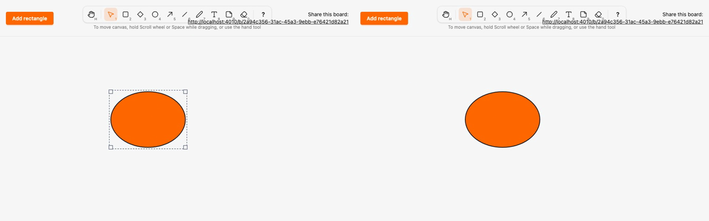

# Migrate ellipse to the kind registry and local render model

*2026-10-29T22:07:14Z by Showboat 0.6.1*
<!-- showboat-id: bb18d895-9042-4429-aae1-69af3c43c682 -->

**Outcome: `ellipse` is the third kind on the registry and the local render model. Its spec is `Sketch.Canvas.Kinds.Ellipse`, it renders as the wrapper `<g data-element data-kind="ellipse" transform="translate(x y)">` with one `ellipse` in local coordinates (`cx=w/2 cy=h/2 rx=w/2 ry=h/2`), drawn by `SketchWeb.Elements.Ellipse` on the server and `assets/js/elements/ellipse.ts` on the client, and the old `ellipse` clause, `coordinate/1` and the ellipse branch of `setBox` are gone. No migration, no change to stored data.**

Three things to know. Half-sizes of odd widths are fractions and even ones must print without a decimal point, so the one shared helper `SketchWeb.ElementRenderer.half/1` (server) and `assets/js/elements/half.ts` (client) now serve both diamond and ellipse; diamond lost its private `half/1`. `coordinate/1` was only used by the ellipse clause and is deleted. A22's `legacy_kind_files` keeps all three files; the `board_live.ex` description lost ellipse.

The registry and renderers agree on ellipse: it is rendered, no longer legacy, and in the client manifest.

```bash
mix run --no-start -e 'IO.inspect(SketchWeb.Elements.kinds(), label: "rendered"); IO.inspect(Sketch.Canvas.legacy_kinds(), label: "legacy")' 2>&1 | grep -vE '^(Compiling|Generated)'; grep -E '^export const MIGRATED' assets/js/generated/manifest.ts; grep -n 'satisfies' assets/js/elements/index.ts
```

```output
rendered: [:rectangle, :diamond, :ellipse]
legacy: [:arrow, :freedraw, :line, :text, :note]
export const MIGRATED_KINDS = ["rectangle", "diamond", "ellipse"] as const
7:export const RENDERERS = { rectangle, diamond, ellipse } as const satisfies Record<MigratedKind, Renderer>
```

Both generated files are current, and the server-side tests pass: the committed fixture is the generated one, the renderers cover exactly the non-legacy kinds, the HEEx output equals the fixture for every ellipse shape, and the LiveView test sees an ellipse as a translated wrapper with a local ellipse (odd width 101 gives `cx=50.5`).

```bash
mix sketch.gen.manifest --check 2>&1 | tail -1 && mix sketch.gen.render_fixtures --check 2>&1 | tail -1 && docs/evidence/pbt-drag-share/run-tests.sh test/sketch_web/elements_test.exs test/sketch_web/live/board_live_test.exs --seed 1 --trace 2>&1 | grep -E 'ellipse|renderers cover|fixture is the generated|^Result'
```

```output
assets/js/generated/manifest.ts is up to date
assets/test/fixtures/render_parity.json is up to date
  * test ellipse renders the fixture's node tree inside a wrapper translated to its box [L#23]
  * test the renderers cover exactly the kinds that left Sketch.Canvas.Kinds.Legacy [L#13]
  * test the committed render parity fixture is the generated one (ADR 0004) [L#8]
  * test a drawn ellipse is stored with its kind and rendered as a local ellipse in every view [L#95]
Result: 39 passed
```

Client parity: the ellipse client renderer is compared with the server fixture for every size in the fixture grid (odd and even half-sizes), then the whole assets suite runs.

```bash
docs/evidence/pbt-drag-share/run-ts.sh test/render_parity.test.ts && npm --prefix assets test 2>&1 | grep -E '^ℹ (tests|pass|fail) '
```

```output
✔ the parity fixture covers exactly the kinds with a renderer (mix sketch.gen.render_fixtures)
✔ the rectangle client renderer draws the same node tree as the server renderer for every fixture shape
✔ the diamond client renderer draws the same node tree as the server renderer for every fixture shape
✔ the ellipse client renderer draws the same node tree as the server renderer for every fixture shape
ℹ tests 4
ℹ pass 4
ℹ fail 0
ℹ tests 60
ℹ pass 60
ℹ fail 0
```

Playwright, two browsers, no sleeps. `ellipse.spec.ts` selects `[data-element][data-kind="ellipse"]` and asserts `cx/cy/rx/ry` in local coordinates on the child (live previews on B included). The new last test draws a 121×81 ellipse (fractional half-sizes), moves it, then resizes it: mid-move both browsers show only a new `transform` with the ellipse unchanged and `data-x` untouched, and mid-resize the ellipse is redrawn while the transform stays.

```bash
docs/evidence/pbt-drag-share/run-e2e.sh ellipse diamond eraser dragging concurrent-drag shortcuts render-model
```

```output
25 passed
```

Mutation (a): `mutations/client-floors-half-width.patch` changes only the shared client helper to `Math.floor(size / 2)`. Both type checks pass and even sizes are unaffected, but the parity test fails on the first odd size (diamond and ellipse both, since they share the helper).

```bash
docs/evidence/kind-ellipse/mutate.sh client-floors-half-width bash -c 'set -o pipefail; npm --prefix assets run --silent typecheck && cd assets && node --test test/render_parity.test.ts 2>&1 | grep -E "^(✔|✖) " | sed -E "s/ \([0-9.]+m?s\)$//" | awk "!seen[\$0]++"'
```

```output
✔ the parity fixture covers exactly the kinds with a renderer (mix sketch.gen.render_fixtures)
✔ the rectangle client renderer draws the same node tree as the server renderer for every fixture shape
✖ the diamond client renderer draws the same node tree as the server renderer for every fixture shape
✖ the ellipse client renderer draws the same node tree as the server renderer for every fixture shape
✖ failing tests:
Mutation killed (exit 1)
```

Mutation (b), the numeric-formatting risk: `mutations/server-float-half.patch` halves every size with `/ 2` in the shared server helper and the fixture is regenerated, so only the parity test can catch it. HEEx writes `0.0` where the client writes `0`.

```bash
docs/evidence/kind-ellipse/mutate.sh server-float-half bash -c 'set -o pipefail; mix sketch.gen.render_fixtures > /dev/null && cd assets && node --test test/render_parity.test.ts 2>&1 | grep -E "^(✔|✖) |^ +[+-] +cx:" | sed -E "s/ \([0-9.]+m?s\)$//" | awk "!seen[\$0]++"'
```

```output
✔ the parity fixture covers exactly the kinds with a renderer (mix sketch.gen.render_fixtures)
✔ the rectangle client renderer draws the same node tree as the server renderer for every fixture shape
✖ the diamond client renderer draws the same node tree as the server renderer for every fixture shape
✖ the ellipse client renderer draws the same node tree as the server renderer for every fixture shape
✖ failing tests:
  +       cx: '0',
  -       cx: '0.0',
Mutation killed (exit 1)
```

Two-browser recording (`record.sh`, Playwright video of the last `ellipse.spec.ts` test, slowed 3x): A (left) draws a 121×81 ellipse, moves it and resizes it from the south-east handle, and B (right) mirrors each step.

```bash {image}

```


```bash {image}

```



Data for "how easy is a new kind": every file this migration touched outside the evidence folder (A added, M modified) against `kind-diamond`. New files: the spec, the server renderer, the client renderer, and the shared client `half.ts` (4). Regenerated, never hand-edited: the manifest and parity fixture (2). One-line registrations: `kinds.ex`, `elements.ex`, `elements/index.ts`. The rest is removal of the old ellipse code, the shared `half/1` extraction from diamond, the A22 description and tests.

```bash
git diff --name-status kind-diamond...HEAD -- . ':!docs/evidence' | sort -k2; git diff --shortstat kind-diamond...HEAD -- . ':!docs/evidence'
```

```output
M	architecture/rules.exs
M	assets/js/elements/diamond.ts
A	assets/js/elements/ellipse.ts
A	assets/js/elements/half.ts
M	assets/js/elements/index.ts
M	assets/js/generated/manifest.ts
M	assets/js/hooks/selection.ts
M	assets/test/fixtures/render_parity.json
M	e2e/tests/ellipse.spec.ts
M	lib/sketch_web/element_renderer.ex
M	lib/sketch_web/elements.ex
M	lib/sketch_web/elements/diamond.ex
A	lib/sketch_web/elements/ellipse.ex
M	lib/sketch_web/live/board_live.ex
M	lib/sketch/canvas/kinds.ex
A	lib/sketch/canvas/kinds/ellipse.ex
M	lib/sketch/canvas/kinds/legacy.ex
M	test/sketch_web/live/board_live_test.exs
 18 files changed, 176 insertions(+), 58 deletions(-)
```
