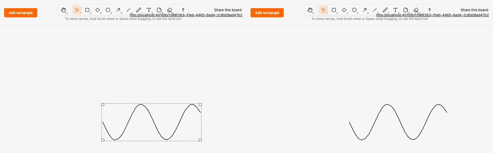

# Migrate freehand draw to the kind registry and local render model

*2026-10-29T23:14:22Z by Showboat 0.6.1*
<!-- showboat-id: 01c89c10-19a3-4f6a-b5fb-db51667a6374 -->

**Outcome: `freedraw` (the Draw tool, P/7) is the sixth kind on the registry and the local render model. A stroke renders as `<g data-element data-kind="freedraw" transform="translate(x y)" live-points="…">` with a transparent hit `polyline` (stroke-width 14) and a visible stroke `polyline` (stroke-width 2, `pointer-events: none`) whose `points` are in local coordinates. `SketchWeb.Elements.Freedraw` and `assets/js/elements/freedraw.ts` are one-liners over polyline builders that sit beside the segment builders (`SketchWeb.ElementRenderer.polylines/1`, `polylines` in `assets/js/elements/segments.ts`). The legacy freedraw clause, `stroke_polyline`, the freedraw preview tag and the polyline setters (`setPolylines`, `POLYLINES`) are gone. No migration, no change to stored data.**

Freedraw is the first kind whose corner resize scales its points through a renderer. The scaling itself (`scalePoints`) is unchanged; what is new is that the scaled points reach the DOM only as the wrapper's `live-points` and the renderer's local `points`. Only text and note remain legacy.

The registry and renderers agree on freedraw: it is rendered, no longer legacy, and in the client manifest.

```bash
mix run --no-start -e 'IO.inspect(SketchWeb.Elements.kinds(), label: "rendered"); IO.inspect(Sketch.Canvas.legacy_kinds(), label: "legacy")' 2>&1 | grep -vE '^(Compiling|Generated)'; grep -E '^export const MIGRATED' assets/js/generated/manifest.ts; grep -n 'satisfies' assets/js/elements/index.ts
```

```output
rendered: [:rectangle, :diamond, :ellipse, :arrow, :freedraw, :line]
legacy: [:text, :note]
export const MIGRATED_KINDS = ["rectangle", "diamond", "ellipse", "arrow", "freedraw", "line"] as const
10:export const RENDERERS = { rectangle, diamond, ellipse, arrow, freedraw, line } as const satisfies Record<MigratedKind, Renderer>
```

Both generated files are current (regenerated, never edited). The fixture holds 147 two-point and 147 twelve-point freedraw shapes, and the HEEx output of the server renderer equals the fixture for every one of them.

```bash
mix sketch.gen.manifest --check 2>&1 | tail -1 && mix sketch.gen.render_fixtures --check 2>&1 | tail -1 && python3 -c "import json,collections; f=json.load(open('assets/test/fixtures/render_parity.json'))['freedraw']; print(sorted(collections.Counter(len(c['shape']['points']) for c in f).items()))" && docs/evidence/pbt-drag-share/run-tests.sh test/sketch_web/elements_test.exs test/sketch_web/live/board_live_test.exs --seed 1 --trace 2>&1 | grep -E 'freedraw|stroke|renders the fixture|renderers cover|fixture is the generated|^Result'
```

```output
assets/js/generated/manifest.ts is up to date
assets/test/fixtures/render_parity.json is up to date
[(2, 147), (12, 147)]
  * test line renders the fixture's node tree inside a wrapper translated to its box [L#23]
  * test arrow renders the fixture's node tree inside a wrapper translated to its box [L#23]
  * test rectangle renders the fixture's node tree inside a wrapper translated to its box [L#23]
  * test freedraw renders the fixture's node tree inside a wrapper translated to its box [L#23]
  * test diamond renders the fixture's node tree inside a wrapper translated to its box [L#23]
  * test ellipse renders the fixture's node tree inside a wrapper translated to its box [L#23]
  * test the renderers cover exactly the kinds that left Sketch.Canvas.Kinds.Legacy [L#13]
  * test the committed render parity fixture is the generated one (ADR 0004) [L#8]
  * test freehand strokes a stroke with too few, too many or malformed points creates nothing [L#496]
  * test freehand strokes a drawn stroke is stored with its relative points and rendered in every view [L#469]
  * test freehand strokes resizing a stroke commits the scaled points and every view renders them [L#545]
  * test freehand strokes a stroke preview grows in other views and is never persisted [L#515]
Result: 42 passed
```

Client parity: the freedraw client renderer is compared with the server fixture for all freedraw shapes, then the whole assets suite runs.

```bash
docs/evidence/pbt-drag-share/run-ts.sh test/render_parity.test.ts && npm --prefix assets test 2>&1 | grep -E '^ℹ (tests|pass|fail) '
```

```output
✔ the parity fixture covers exactly the kinds with a renderer (mix sketch.gen.render_fixtures)
✔ the rectangle client renderer draws the same node tree as the server renderer for every fixture shape
✔ the diamond client renderer draws the same node tree as the server renderer for every fixture shape
✔ the ellipse client renderer draws the same node tree as the server renderer for every fixture shape
✔ the arrow client renderer draws the same node tree as the server renderer for every fixture shape
✔ the freedraw client renderer draws the same node tree as the server renderer for every fixture shape
✔ the line client renderer draws the same node tree as the server renderer for every fixture shape
ℹ tests 7
ℹ pass 7
ℹ fail 0
ℹ tests 63
ℹ pass 63
ℹ fail 0
```

Playwright, two browsers, no sleeps. `draw.spec.ts` selects `[data-element][data-kind="freedraw"] > polyline[data-freedraw-stroke]` and its hit sibling, and asserts the wrapper transform plus local points on both, for committed strokes and for the draw preview on B. A new test, "a corner resize of a stroke commits scaled points inside the box and B sees them without an error", draws a stroke, selects it, drags the south-east corner, and checks that A and B both show the box grown, the points scaled by `round(p * newSize / oldSize)` (and different from the originals), every point inside the box, no `#flash-error` in either browser (a violated DB CHECK would flash "Could not add element"), and the same stroke after B reloads. The run is the full suite.

```bash
docs/evidence/pbt-drag-share/run-e2e.sh
```

```output
51 passed
```

Mutation 1, client only: `mutations/client-drops-round-join.patch` makes the client freedraw renderer omit `stroke-linejoin`. The type checks pass and the stroke looks almost the same, but the parity test fails on the first fixture shape.

```bash
docs/evidence/kind-freedraw/mutate.sh client-drops-round-join bash -c 'set -o pipefail; npm --prefix assets run --silent typecheck && cd assets && node --test test/render_parity.test.ts 2>&1 | grep -E "^(✔|✖) " | sed -E "s/ \([0-9.]+m?s\)$//" | awk "!seen[\$0]++"'
```

```output
✔ the parity fixture covers exactly the kinds with a renderer (mix sketch.gen.render_fixtures)
✔ the rectangle client renderer draws the same node tree as the server renderer for every fixture shape
✔ the diamond client renderer draws the same node tree as the server renderer for every fixture shape
✔ the ellipse client renderer draws the same node tree as the server renderer for every fixture shape
✔ the arrow client renderer draws the same node tree as the server renderer for every fixture shape
✖ the freedraw client renderer draws the same node tree as the server renderer for every fixture shape
✔ the line client renderer draws the same node tree as the server renderer for every fixture shape
✖ failing tests:
Mutation killed (exit 1)
```

Mutation 2, resize: `mutations/resize-skips-scale-points.patch` makes a corner resize keep the original points instead of scaling them. Everything type-checks and the points still lie inside the (larger) box, so the DB CHECK and the commit succeed; only the new E2E notices that the committed points were not scaled.

```bash
docs/evidence/kind-freedraw/mutate.sh resize-skips-scale-points bash -c 'set -o pipefail; npm --prefix e2e test -- draw -g "corner resize" 2>&1 | grep -E "^ +[0-9]+ (passed|failed)|Expected: not" | cut -c1-60; exit ${PIPESTATUS[0]}'
```

```output
    Expected: not [{"x": 0, "y": 49}, {"x": 2, "y": 53}, {"x
  1 failed
Mutation killed (exit 1)
```

Two-browser recording (`record.sh`, Playwright video of the draw, move and resize test, slowed 3x): A (left) draws a wave, moves it and drags the south-east corner outward; B (right) mirrors each step.

```bash {image}

```


```bash {image}

```



Data for "how easy is a new kind": every file this migration touched outside the evidence folder (A added, M modified) against `kind-arrow`. New files: the spec and the two renderers (3). Regenerated, never hand-edited: the manifest and parity fixture (2). One-line registrations: `kinds.ex`, `legacy.ex`, `elements.ex`, `elements/index.ts`. The polyline builders sit in `element_renderer.ex` and `segments.ts` beside the segment builders. The rest is removal of the freedraw clause, `stroke_polyline`, the preview tag and the polyline setters, the A22 descriptions, and tests. No live-points work was needed.

```bash
git diff --name-status kind-arrow...HEAD -- . ':!docs/evidence' | sort -k2; git diff --shortstat kind-arrow...HEAD -- . ':!docs/evidence'
```

```output
M	architecture/rules.exs
A	assets/js/elements/freedraw.ts
M	assets/js/elements/index.ts
M	assets/js/elements/segments.ts
M	assets/js/generated/manifest.ts
M	assets/js/hooks/selection.ts
M	assets/test/fixtures/render_parity.json
M	e2e/tests/draw.spec.ts
M	lib/sketch_web/element_renderer.ex
M	lib/sketch_web/elements.ex
A	lib/sketch_web/elements/freedraw.ex
M	lib/sketch_web/live/board_live.ex
M	lib/sketch/canvas/kinds.ex
A	lib/sketch/canvas/kinds/freedraw.ex
M	lib/sketch/canvas/kinds/legacy.ex
M	test/sketch_web/live/board_live_test.exs
 16 files changed, 476 insertions(+), 98 deletions(-)
```
