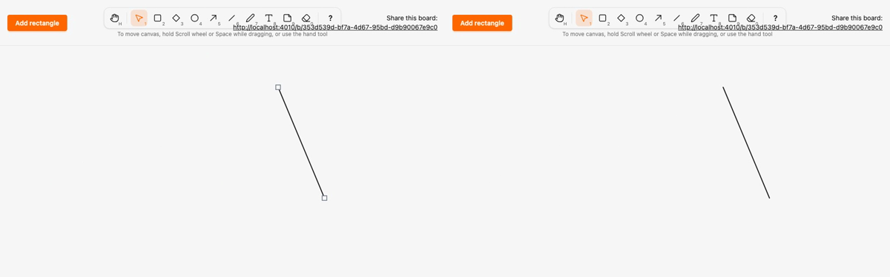

# Migrate line to the local render model, with live points for point kinds

*2026-10-29T22:30:22Z by Showboat 0.6.1*
<!-- showboat-id: 4a515f38-fb3a-4aaf-aca4-c13e76d321fe -->

**Outcome: `line` is the fourth kind on the registry and the local render model, and every element wrapper now carries live points beside its live box. A line renders as `<g data-element data-kind="line" transform="translate(x y)" live-points="…">` with a transparent hit `line` and a visible stroke `line` in local coordinates, drawn by `SketchWeb.Elements.Line` and `assets/js/elements/line.ts`. The legacy line clause, the `line` preview tag and the kind-specific point reading in the hook are gone. No migration, no change to stored data.**

How live points work, for every point kind. `data-points` stays the committed record, like `data-x/y/width/height`, and `revert` reads it. The points on screen sit in the non-data `live-points` attribute, next to the live `x/y/width/height`. The server renders both; while a gesture has claimed the wrapper (`phx-update="ignore"`), LiveView 1.2 merges only `data-*` into it, so a remote commit updates `data-points` but leaves `live-points` and the children to the gesture. `renderedShape` in `canvas.ts` reads `live-points`, then `data-points`, with no kind list. Move, resize (`scalePoints`), endpoint drag, remote previews and draw previews all go through `setShape`, which writes `live-points` and re-renders children through the kind's client renderer (or, for arrow and freedraw until they move, through the legacy segment and polyline setters). Arrow and freedraw wrappers render `live-points` too, so they already use this path.

Two smaller changes came with it. A cancelled edit (Esc, pointer cancel, disconnect) now reverts to the committed shape rather than to the shape at the start of the gesture, so a remote commit received mid-drag is what remains after a cancel. And the legacy clause is now `%{kind: :arrow}` with an unconditional arrowhead.

The registry and renderers agree on line: it is rendered, no longer legacy, and in the client manifest.

```bash
mix run --no-start -e 'IO.inspect(SketchWeb.Elements.kinds(), label: "rendered"); IO.inspect(Sketch.Canvas.legacy_kinds(), label: "legacy")' 2>&1 | grep -vE '^(Compiling|Generated)'; grep -E '^export const MIGRATED' assets/js/generated/manifest.ts; grep -n 'satisfies' assets/js/elements/index.ts
```

```output
rendered: [:rectangle, :diamond, :ellipse, :line]
legacy: [:arrow, :freedraw, :text, :note]
export const MIGRATED_KINDS = ["rectangle", "diamond", "ellipse", "line"] as const
8:export const RENDERERS = { rectangle, diamond, ellipse, line } as const satisfies Record<MigratedKind, Renderer>
```

The renderer contract already passed `points` (and `text`) to every renderer; what changed is that the parity fixture now exercises them. A point kind is rendered along three deterministic paths inside every box of the size grid (corner to corner, a zigzag between the top and bottom edges, and strictly interior points with odd coordinates), with its minimum point count and its maximum capped at 12. For line (exactly 2 points) that is 49 sizes × 3 paths = 147 cases. Every point lies inside its box:

```bash
mix run --no-start -e '
cases = SketchWeb.RenderFixtures.shapes(:line)
IO.puts("line cases: #{length(cases)}")
IO.puts("all points inside the box: #{Enum.all?(cases, fn s -> length(s.points) == 2 and Enum.all?(s.points, &(&1.x in 0..s.width//1 and &1.y in 0..s.height//1)) end)}")
for s <- cases, s.width == 119 and s.height == 120, do: IO.inspect(s.points, label: "119 x 120")' 2>&1 | grep -vE '^(Compiling|Generated)'
```

```output
line cases: 147
all points inside the box: true
119 x 120: [%{x: 0, y: 0}, %{x: 119, y: 120}]
119 x 120: [%{x: 119, y: 0}, %{x: 0, y: 120}]
119 x 120: [%{x: 39, y: 80}, %{x: 79, y: 40}]
```

Both generated files are current, and the server-side tests pass: the HEEx output equals the fixture for every line shape (parsed inside `<svg>`, since the HTML parser would otherwise nest the two self-closing `line`s), the wrapper's `live-points` equals `data-points`, and the LiveView tests see lines as translated wrappers with local endpoints.

```bash
mix sketch.gen.manifest --check 2>&1 | tail -1 && mix sketch.gen.render_fixtures --check 2>&1 | tail -1 && docs/evidence/pbt-drag-share/run-tests.sh test/sketch_web/elements_test.exs test/sketch_web/live/board_live_test.exs --seed 1 --trace 2>&1 | grep -E 'line|renderers cover|fixture is the generated|^Result'
```

```output
assets/js/generated/manifest.ts is up to date
assets/test/fixtures/render_parity.json is up to date
  * test line renders the fixture's node tree inside a wrapper translated to its box [L#23]
  * test the renderers cover exactly the kinds that left Sketch.Canvas.Kinds.Legacy [L#13]
  * test the committed render parity fixture is the generated one (ADR 0004) [L#8]
  * test lines moving a line commits only its position; the points move with it [L#425]
  * test lines dragging an endpoint previews to other views and commit_shape stores the new shape [L#372]
  * test lines a drawn arrow keeps its start and end and renders an arrowhead on the end [L#291]
  * test lines a line with too few, too many or malformed points creates nothing [L#328]
  * test lines the server rebuilds a line's box around its points clamped into the canvas [L#313]
  * test text typed text is stored and rendered one tspan per line in every view [L#609]
  * test lines a drawn line is stored with its relative points and rendered in local coordinates in every view [L#269]
  * test lines a line draw preview carries its points to other views, even when 0 tall [L#349]
Result: 40 passed
```

Client parity: the line client renderer is compared with the server fixture for all 147 line shapes, then the whole assets suite runs.

```bash
docs/evidence/pbt-drag-share/run-ts.sh test/render_parity.test.ts && npm --prefix assets test 2>&1 | grep -E '^ℹ (tests|pass|fail) '
```

```output
✔ the parity fixture covers exactly the kinds with a renderer (mix sketch.gen.render_fixtures)
✔ the rectangle client renderer draws the same node tree as the server renderer for every fixture shape
✔ the diamond client renderer draws the same node tree as the server renderer for every fixture shape
✔ the ellipse client renderer draws the same node tree as the server renderer for every fixture shape
✔ the line client renderer draws the same node tree as the server renderer for every fixture shape
ℹ tests 5
ℹ pass 5
ℹ fail 0
ℹ tests 61
ℹ pass 61
ℹ fail 0
```

Playwright, two browsers, no sleeps. `line.spec.ts` selects `[data-element][data-kind="line"]` and asserts the wrapper transform plus local `x1/y1/x2/y2` on both the hit and the stroke line, for committed lines, remote previews and the draw preview on B. Two new tests:

- **Translated wrapper.** A draws a line, moves it, drags the end outward (a line has endpoint handles, not corner handles, so lengthening is its resize) and swings the start across. Mid-move both browsers show only a new `transform` with `data-*` untouched; mid-endpoint-drag the children are redrawn and the handles follow.
- **Remote commit mid-endpoint-drag.** A holds an endpoint drag; B selects the same line and commits a drag of the other endpoint. A receives the new `data-points`, `data-x/y` and version, but its stroke, transform and endpoint handles stay where A is dragging. A presses Esc and the line reverts to B's committed points, in both browsers.

The run includes the arrow and freedraw specs (still on the old path, now reading live points) and the other gesture specs.

```bash
docs/evidence/pbt-drag-share/run-e2e.sh line arrow draw eraser dragging concurrent-drag drag-properties shortcuts render-model
```

```output
27 passed
```

Mutation (a), parity: `mutations/client-reverses-line.patch` makes the client renderer draw from the end point to the start point. That looks identical on screen and both type checks pass, but the parity test fails on the first non-degenerate fixture shape.

```bash
docs/evidence/kind-line/mutate.sh client-reverses-line bash -c 'set -o pipefail; npm --prefix assets run --silent typecheck && cd assets && node --test test/render_parity.test.ts 2>&1 | grep -E "^(✔|✖) " | sed -E "s/ \([0-9.]+m?s\)$//" | awk "!seen[\$0]++"'
```

```output
✔ the parity fixture covers exactly the kinds with a renderer (mix sketch.gen.render_fixtures)
✔ the rectangle client renderer draws the same node tree as the server renderer for every fixture shape
✔ the diamond client renderer draws the same node tree as the server renderer for every fixture shape
✔ the ellipse client renderer draws the same node tree as the server renderer for every fixture shape
✖ the line client renderer draws the same node tree as the server renderer for every fixture shape
✖ failing tests:
Mutation killed (exit 1)
```

Mutation (b), the reason live points are not `data-*`: `mutations/live-points-in-data.patch` renames the live attribute to `data-live-points` on both sides, consistently, so everything still works when nobody else is editing. During A's endpoint drag, B's commit then makes LiveView merge the server's `data-live-points` into A's claimed wrapper; the selection observer re-reads the shape and A's end handle jumps from x=375 (A's pointer) to x=335 (B's points on A's box). The mid-drag test catches it. The control run, unmutated, passes.

```bash
docs/evidence/kind-line/mutate.sh live-points-in-data bash -c 'set -o pipefail; npm --prefix e2e test -- line -g "remote commit mid-endpoint-drag" 2>&1 | grep -E "^ +[0-9]+ (passed|failed)|Expected|Received|^ +> [0-9]+ \|" | sed -E "s/^ +//"'; docs/evidence/pbt-drag-share/run-e2e.sh line -g 'remote commit mid-endpoint-drag'
```

```output
Expected: "375"
Received: "335"
> 72 |     await expect(handle).toHaveAttribute("x", String(x - handleSize / 2))
1 failed
Mutation killed (exit 1)
1 passed
```

Mutation (c): `mutations/cancel-restores-origin.patch` puts back the old cancel, which restored the shape from the start of the gesture. After B's commit and A's Esc, A then shows its stale pre-drag line at `translate(100 100)` instead of B's committed one at `translate(60 40)`.

```bash
docs/evidence/kind-line/mutate.sh cancel-restores-origin bash -c 'set -o pipefail; npm --prefix e2e test -- line -g "remote commit mid-endpoint-drag" 2>&1 | grep -E "^ +[0-9]+ (passed|failed)|Expected|Received|^ +> [0-9]+ \|" | sed -E "s/^ +//"'
```

```output
Expected: "translate(60 40)"
Received: "translate(100 100)"
> 32 |   await expect(page.locator(wrapper)).toHaveAttribute("transform", `translate(${String(x)} ${String(y)})`)
1 failed
Mutation killed (exit 1)
```

Two-browser recording (`record.sh`, Playwright video of the translated-wrapper test, slowed 3x): A (left) draws a line, moves it, drags its end outward and swings its start across; B (right) mirrors each step, including the live endpoint drags.

```bash {image}

```


```bash {image}

```



Data for "how easy is a new kind": every file this migration touched outside the evidence folder (A added, M modified) against `kind-ellipse`. New files: the spec and the two renderers (3). Regenerated, never hand-edited: the manifest and parity fixture (2). One-line registrations: `kinds.ex`, `legacy.ex`, `elements.ex`, `elements/index.ts`. The kind-agnostic live-points work is in `elements.ex` (wrapper attribute), `elements/dom.ts`, `canvas.ts` and `selection.ts`, plus `render_fixtures.ex` for point sets; it is done once and arrow and freedraw will not repeat it. The rest is removal of the line clause and preview tag, the A22 description and tests.

```bash
git diff --name-status kind-ellipse...HEAD -- . ':!docs/evidence' | sort -k2; git diff --shortstat kind-ellipse...HEAD -- . ':!docs/evidence'
```

```output
M	architecture/rules.exs
M	assets/js/elements/dom.ts
M	assets/js/elements/index.ts
A	assets/js/elements/line.ts
M	assets/js/generated/manifest.ts
M	assets/js/hooks/canvas.ts
M	assets/js/hooks/selection.ts
M	assets/test/fixtures/render_parity.json
M	e2e/tests/line.spec.ts
M	lib/sketch_web/elements.ex
A	lib/sketch_web/elements/line.ex
M	lib/sketch_web/live/board_live.ex
M	lib/sketch_web/render_fixtures.ex
M	lib/sketch/canvas/kinds.ex
M	lib/sketch/canvas/kinds/legacy.ex
A	lib/sketch/canvas/kinds/line.ex
M	test/sketch_web/elements_test.exs
M	test/sketch_web/live/board_live_test.exs
 18 files changed, 445 insertions(+), 82 deletions(-)
```
