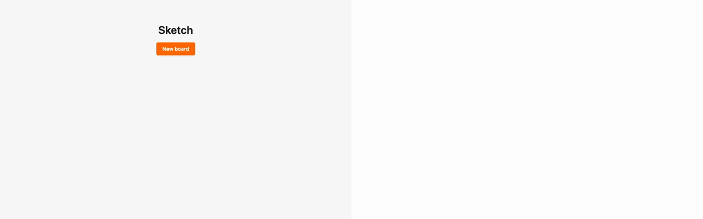
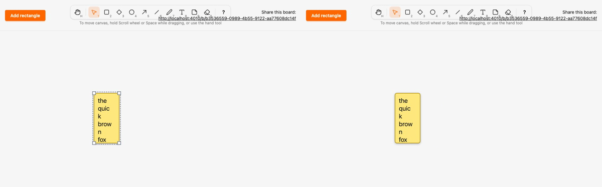

# Migrate note, wrap on the server, and remove the legacy kind path

*2026-10-30T00:15:09Z by Showboat 0.6.1*
<!-- showboat-id: 32ab25b5-9437-4624-ae93-85c19c8acabe -->

**Outcome: `note` (the Note tool, N/9), the last kind, is on the registry and the local render model, and ADR 0004 is finished. A note renders as `<g data-element data-kind="note" transform="translate(x y)">` with `rect[data-note-body]` (`0,0,w,h`, `rx` 6, `stroke-width` 2, `note-body`) and a nested `svg[data-note-clip]` (`0,0,w,h`, `overflow: hidden`, `pointer-events: none`) holding a `text` translated by the 12 px padding with one `tspan x="0" y="19 + 25·i"` per wrapped line. The server now wraps: `Sketch.Canvas.Geometry.wrap_text/3` is a port of the client `wrapText`, and two fixtures force them equal. `Sketch.Canvas.Kinds.Legacy`, `legacy_kinds`, the legacy `element_shape` clause, `MIGRATED_KINDS` and A22's `legacy_kind_files` are gone. The hook's last kind branches now read `draw_gesture`, `text` and `default_size` from the generated specs. No migration.**

Both wrap implementations use one explicit whitespace class, generated into the manifest as `TEXT_WHITESPACE` from `Geometry` (space, tab, CR, LF, the same class that decides whether text is blank). A no-break space, ideographic space, line separator, zero-width no-break space, vertical tab or form feed is part of a word on both sides; JavaScript `\s` and PCRE `\s` disagree on most of these, which is why neither side uses a regex class. Lengths are code points (`String.codepoints/1`, `Array.from`), not graphemes, so a ZWJ emoji counts as three.

The registry has no legacy entries, every kind has a renderer on both sides, and the manifest has no `MIGRATED_KINDS`.

```bash
mix run --no-start -e 'IO.inspect(Sketch.Canvas.element_kinds(), label: "kinds"); IO.inspect(Code.ensure_loaded?(Sketch.Canvas.Kinds.Legacy), label: "Kinds.Legacy loaded"); IO.inspect(function_exported?(Sketch.Canvas, :legacy_kinds, 0), label: "Sketch.Canvas.legacy_kinds/0")' 2>&1 | grep -vE "^(Compiling|Generated)"; grep -c MIGRATED assets/js/generated/manifest.ts; grep -n "satisfies" assets/js/elements/index.ts; grep -E "^  (note|text|freedraw):" assets/js/generated/manifest.ts; grep -n "legacy_kind_files" architecture/rules.exs || echo "no legacy_kind_files in rules.exs"
```

```output
kinds: [:rectangle, :diamond, :ellipse, :arrow, :freedraw, :line, :text, :note]
Kinds.Legacy loaded: false
Sketch.Canvas.legacy_kinds/0: false
0
13:export const RENDERERS = { rectangle, diamond, ellipse, arrow, freedraw, line, text, note } as const satisfies Record<ElementKind, Renderer>
  freedraw: { id: "freedraw", geometry: { points: { min: 2, max: 500 } }, text: "none", drawGesture: "path", defaultSize: { width: 120, height: 80 } },
  text: { id: "text", geometry: "box", text: "required", drawGesture: "click_to_type", defaultSize: { width: 1, height: 25 } },
  note: { id: "note", geometry: "box", text: "optional", drawGesture: "box", defaultSize: { width: 200, height: 160 } },
no legacy_kind_files in rules.exs
```

Both generated files and the new wrap fixture are current. The render fixture draws note and text with 16 texts (the nine text cases plus a sentence, a long word, runs of spaces, whitespace-only, NBSP/ideographic space/line separator, astral code points, and a multi-line text with a tab) in boxes 0 or 4000 tall and 0, 1, 4000 or a wrapping boundary wide: 2×12 padding plus 0 to 3 and 14 character widths, each ±1 px, so widths below 2×padding are included. The wrap fixture holds 885 deterministic `(text, max_width, char_width)` cases: a grid of 15 texts × 19 widths, and 600 cases from a seeded generator over an alphabet of words, CR/LF/CRLF, tabs, spaces and the Unicode spaces above.

```bash
mix sketch.gen.manifest --check 2>&1 | tail -1 && mix sketch.gen.render_fixtures --check 2>&1 | tail -2 && python3 -c "
import json
d = json.load(open(\"assets/test/fixtures/render_parity.json\"))
print({k: len(v) for k, v in d.items()})
w = json.load(open(\"assets/test/fixtures/wrap_parity.json\"))
print(len(w), \"wrap cases\")
for c in w:
    if c[\"char_width\"] == 12 and c[\"max_width\"] == 36 and c[\"text\"] in (\"supercalifragilisticexpialidocious\", \"no break space between words\", \"a  b   c    d     e\", \"\t \t\"):
        print(json.dumps(c[\"text\"]), \"->\", json.dumps(c[\"lines\"]))
"
```

```output
assets/js/generated/manifest.ts is up to date
assets/test/fixtures/render_parity.json is up to date
assets/test/fixtures/wrap_parity.json is up to date
{'rectangle': 49, 'diamond': 49, 'ellipse': 49, 'arrow': 147, 'freedraw': 294, 'line': 147, 'text': 576, 'note': 576}
885 wrap cases
"\t \t" -> [""]
"supercalifragilisticexpialidocious" -> ["sup", "erc", "ali", "fra", "gil", "ist", "ice", "xpi", "ali", "doc", "iou", "s"]
"a  b   c    d     e" -> ["a b", "c d", "e"]
"no\u00a0break\u00a0space between words" -> ["no\u00a0", "bre", "ak\u00a0", "spa", "ce", "bet", "wee", "n", "wor", "ds"]
```

Server side: the HEEx output of every renderer equals the fixture, both fixtures are current, the LiveView tests assert that the server renders the wrapped `tspan`s (creation, an empty note, an edit, and a resize from 200 to 90 px that re-wraps a NBSP-joined word and breaks a long one), A22 passes with no per-file exception and the kind specs are consistent.

```bash
docs/evidence/pbt-drag-share/run-tests.sh test/sketch_web/elements_test.exs test/sketch_web/live/board_live_test.exs test/architecture/source_policy_test.exs test/sketch/canvas/kind_contract_test.exs --seed 1 --trace 2>&1 | grep -E "test note|renders the fixture|fixture is the generated|kind branching|A22|no per-file|draw gesture|^Result" | sort
```

```output
  * test a draw gesture must be able to produce its kind's geometry and text [L#48]
  * test arrow renders the fixture's node tree inside a wrapper translated to its box [L#21]
  * test diamond renders the fixture's node tree inside a wrapper translated to its box [L#21]
  * test ellipse renders the fixture's node tree inside a wrapper translated to its box [L#21]
  * test freedraw renders the fixture's node tree inside a wrapper translated to its box [L#21]
  * test kind-specific branching lives in kind modules, renderers and generated files (A22) application [L#73]
  * test kind-specific branching lives in kind modules, renderers and generated files (A22) only the kind modules, renderers and generated files may branch, with no per-file exception [L#109]
  * test kind-specific branching lives in kind modules, renderers and generated files (A22) rejects every direct form of kind branching outside the allowed paths [L#84]
  * test line renders the fixture's node tree inside a wrapper translated to its box [L#21]
  * test note a note is created with its text and renders as a rounded body with the server-wrapped text clipped in every view [L#813]
  * test note an empty note is still created, and overlong text creates nothing [L#841]
  * test note editing commits the text with the same box, and clearing it keeps an empty note [L#857]
  * test note has a spec, is in the client manifest and is drawn by the property generators [L#26]
  * test note renders the fixture's node tree inside a wrapper translated to its box [L#21]
  * test note resizing commits the new box without touching the text, and the server re-wraps it [L#904]
  * test note typing previews of a new note reach other views as note previews [L#967]
  * test rectangle renders the fixture's node tree inside a wrapper translated to its box [L#21]
  * test text renders the fixture's node tree inside a wrapper translated to its box [L#21]
  * test the committed client manifest is the generated one (A22) [L#18]
  * test the committed render parity fixture is the generated one (ADR 0004) [L#8]
  * test the committed wrap parity fixture is the generated one (ADR 0004) [L#13]
Result: 66 passed
```

Client parity: the note client renderer matches the server fixture for all 576 note shapes, `wrapText` matches all 885 wrap cases, then the whole assets suite runs (including a new check that each drawing tool gets its gesture and click size from its spec).

```bash
docs/evidence/pbt-drag-share/run-ts.sh test/render_parity.test.ts test/wrap_parity.test.ts && npm --prefix assets test 2>&1 | grep -E "^ℹ (tests|pass|fail) "
```

```output
✔ the parity fixture covers every element kind (mix sketch.gen.render_fixtures)
✔ the rectangle client renderer draws the same node tree as the server renderer for every fixture shape
✔ the diamond client renderer draws the same node tree as the server renderer for every fixture shape
✔ the ellipse client renderer draws the same node tree as the server renderer for every fixture shape
✔ the arrow client renderer draws the same node tree as the server renderer for every fixture shape
✔ the freedraw client renderer draws the same node tree as the server renderer for every fixture shape
✔ the line client renderer draws the same node tree as the server renderer for every fixture shape
✔ the text client renderer draws the same node tree as the server renderer for every fixture shape
✔ the note client renderer draws the same node tree as the server renderer for every fixture shape
✔ the wrap parity fixture has cases (mix sketch.gen.render_fixtures)
✔ the client wraps every fixture text into the same lines as the server
ℹ tests 11
ℹ pass 11
ℹ fail 0
ℹ tests 69
ℹ pass 69
ℹ fail 0
```

Playwright, two browsers, no sleeps, full suite. `note.spec.ts` now selects the wrapper and checks, in both browsers, its `transform` and live box, the local body `rect` and clip `svg` at `0,0,w,h`, the text's padding transform, and every `tspan`'s exact text and local `x`/`y`: for B's preview while A types, after commit, mid-resize in A (local re-render with the live width) and B (remote preview), after the resize commits, and after B reloads (server-rendered). Wrapped lines are exact strings, not "fits the width" checks, because both sides now wrap identically.

```bash
docs/evidence/pbt-drag-share/run-e2e.sh
```

```output
51 passed
```

Mutation 1, wrap rule, server only: `mutations/server-wrap-rule.patch` makes the server accept a line only when it is shorter than the limit (`<` instead of `<=`). The committed fixtures no longer match, so `render_fixtures --check` fails; regenerated from the mutant, both client parity tests fail, so the copies cannot drift even if someone regenerates.

```bash
docs/evidence/kind-note/mutate.sh server-wrap-rule bash -c 'mix sketch.gen.render_fixtures --check 2>&1 | grep -E "stale|up to date"; mix sketch.gen.render_fixtures > /dev/null 2>&1; cd assets && node --test test/wrap_parity.test.ts test/render_parity.test.ts 2>&1 | grep -E "^(✔|✖) " | sed -E "s/ \([0-9.]+m?s\)$//" | awk "!seen[\$0]++"; exit "${PIPESTATUS[0]}"'
```

```output
** (Mix) assets/test/fixtures/render_parity.json is stale or was edited by hand. Run `mix sketch.gen.render_fixtures` and commit the result.
✔ the parity fixture covers every element kind (mix sketch.gen.render_fixtures)
✔ the rectangle client renderer draws the same node tree as the server renderer for every fixture shape
✔ the diamond client renderer draws the same node tree as the server renderer for every fixture shape
✔ the ellipse client renderer draws the same node tree as the server renderer for every fixture shape
✔ the arrow client renderer draws the same node tree as the server renderer for every fixture shape
✔ the freedraw client renderer draws the same node tree as the server renderer for every fixture shape
✔ the line client renderer draws the same node tree as the server renderer for every fixture shape
✔ the text client renderer draws the same node tree as the server renderer for every fixture shape
✖ the note client renderer draws the same node tree as the server renderer for every fixture shape
✔ the wrap parity fixture has cases (mix sketch.gen.render_fixtures)
✖ the client wraps every fixture text into the same lines as the server
✖ failing tests:
Mutation killed (exit 1)
```

Mutation 2, JavaScript `\s`, client only: `mutations/client-js-whitespace.patch` tests each character against JavaScript `/\s/` instead of the explicit class. The type checks pass and ASCII text wraps the same, but the fixtures with a no-break, ideographic or zero-width no-break space, a line separator, a vertical tab or a form feed differ, and both parity tests fail.

```bash
docs/evidence/kind-note/mutate.sh client-js-whitespace bash -c 'set -o pipefail; npm --prefix assets run --silent typecheck && cd assets && node --test test/wrap_parity.test.ts test/render_parity.test.ts 2>&1 | grep -E "^(✔|✖) " | sed -E "s/ \([0-9.]+m?s\)$//" | awk "!seen[\$0]++"'
```

```output
✔ the parity fixture covers every element kind (mix sketch.gen.render_fixtures)
✔ the rectangle client renderer draws the same node tree as the server renderer for every fixture shape
✔ the diamond client renderer draws the same node tree as the server renderer for every fixture shape
✔ the ellipse client renderer draws the same node tree as the server renderer for every fixture shape
✔ the arrow client renderer draws the same node tree as the server renderer for every fixture shape
✔ the freedraw client renderer draws the same node tree as the server renderer for every fixture shape
✔ the line client renderer draws the same node tree as the server renderer for every fixture shape
✔ the text client renderer draws the same node tree as the server renderer for every fixture shape
✖ the note client renderer draws the same node tree as the server renderer for every fixture shape
✔ the wrap parity fixture has cases (mix sketch.gen.render_fixtures)
✖ the client wraps every fixture text into the same lines as the server
✖ failing tests:
Mutation killed (exit 1)
```

Mutation 3, a kind branch back in the hook: `mutations/note-branch-in-canvas.patch` replaces `isTextKind(draw.kind)` in `finishDraw` with `draw.kind === "note"`. It type-checks (TypeScript narrows `draw.kind` to `"note"`, a drawn text kind) and behaves the same today, so only A22 can catch it; with no allowlist left, the application scan fails.

```bash
docs/evidence/kind-note/mutate.sh note-branch-in-canvas bash -c 'set -o pipefail; npm --prefix assets run --silent typecheck && docs/evidence/pbt-drag-share/run-tests.sh test/architecture/source_policy_test.exs --seed 1 2>&1 | grep -E "^ +[0-9]+\) test|A22 assets|^Result"'
```

```output
  1) test kind-specific branching lives in kind modules, renderers and generated files (A22) application (Sketch.Architecture.SourcePolicyTest)
     A22 assets/js/hooks/canvas.ts:584: kind branch: if (draw.kind === "note") {
Result: 9/10 passed
Mutation killed (exit 2)
```

Mutation 4, a missing client renderer: `mutations/renderer-missing-note.patch` drops `note` from `RENDERERS`. `satisfies Record<ElementKind, Renderer>` makes `tsc` fail.

```bash
docs/evidence/kind-note/mutate.sh renderer-missing-note bash -c 'npm --prefix assets run --silent typecheck 2>&1 | grep -E "error TS1360|Property .note. is missing" | cut -c1-90; exit "${PIPESTATUS[0]}"'
```

```output
js/elements/index.ts(13,96): error TS1360: Type '{ readonly rectangle: Renderer; readonly 
  Property 'note' is missing in type '{ readonly rectangle: Renderer; readonly diamond: Re
Mutation killed (exit 2)
```

Two-browser recording (`record.sh`, Playwright video of the main note test, slowed 3x): A (left) presses N and clicks, a 200×160 note opens with its editor and B (right) sees the dashed preview; A types the sentence and B sees it wrapped into four lines; A presses Esc and both show the committed note; A selects it and drags the south-east corner from 200 to 80 px wide, and both browsers re-wrap it into 12 short lines while the drag is in progress (A locally, B from the preview) and after it commits; the clip hides the lines below the box. B then reloads and the server renders the same lines.

```bash {image}

```



```bash {image}

```



Every file this PR touched outside the evidence folder (A added, M modified, D deleted, R renamed) against `kind-text`. New: the note spec, both renderers, the wrap fixture module, its generated fixture and its parity test. Note itself needed the spec, two renderers, two registry lines, the server wrap port and the fixture cases; the rest is removal of the legacy path, the `draw_gesture` field on every spec, the hook reading specs instead of kind ids, and tests and docs.

```bash
git diff --name-status -M kind-text...HEAD -- . ':!docs/evidence' | sort -k2; git diff --shortstat kind-text...HEAD -- . ':!docs/evidence'
```

```output
M	ARCHITECTURE.md
M	architecture/rules.exs
M	assets/css/app.css
M	assets/js/elements/index.ts
A	assets/js/elements/note.ts
M	assets/js/generated/manifest.ts
M	assets/js/hooks/canvas_logic.ts
M	assets/js/hooks/canvas.ts
M	assets/js/hooks/selection.ts
M	assets/js/hooks/text_editor.ts
M	assets/js/hooks/tools.ts
M	assets/test/fixtures/render_parity.json
A	assets/test/fixtures/wrap_parity.json
M	assets/test/render_parity.test.ts
M	assets/test/tools.test.ts
A	assets/test/wrap_parity.test.ts
M	docs/adr/0003-element-model.md
M	e2e/tests/note.spec.ts
M	lib/mix/tasks/sketch.gen.render_fixtures.ex
M	lib/sketch_web/client_manifest.ex
M	lib/sketch_web/elements.ex
A	lib/sketch_web/elements/note.ex
M	lib/sketch_web/elements/text.ex
M	lib/sketch_web/live/board_live.ex
M	lib/sketch_web/render_fixtures.ex
A	lib/sketch_web/wrap_fixtures.ex
M	lib/sketch/canvas.ex
M	lib/sketch/canvas/geometry.ex
M	lib/sketch/canvas/kind.ex
M	lib/sketch/canvas/kinds.ex
M	lib/sketch/canvas/kinds/arrow.ex
M	lib/sketch/canvas/kinds/diamond.ex
M	lib/sketch/canvas/kinds/ellipse.ex
M	lib/sketch/canvas/kinds/freedraw.ex
D	lib/sketch/canvas/kinds/legacy.ex
M	lib/sketch/canvas/kinds/line.ex
A	lib/sketch/canvas/kinds/note.ex
M	lib/sketch/canvas/kinds/rectangle.ex
M	lib/sketch/canvas/kinds/text.ex
R100	test/architecture/fixtures/files/a22/assets/js/hooks/legacy.ts	test/architecture/fixtures/files/a22/assets/js/hooks/note.ts
M	test/architecture/source_policy_test.exs
M	test/sketch_web/elements_test.exs
M	test/sketch_web/live/board_live_drag_test.exs
M	test/sketch_web/live/board_live_test.exs
M	test/sketch/canvas/kind_contract_test.exs
 45 files changed, 2757 insertions(+), 822 deletions(-)
```

## Adding a kind now

Derived from what the kind migrations in this stack (ending with #26 and this PR) actually touched, minus the one-time legacy removal. A new box kind without text, like rectangle, diamond or ellipse, needs exactly:

1. `lib/sketch/canvas/kinds/<kind>.ex`: the spec (`id`, `geometry`, `text`, `draw_gesture`, `default_size`). Compilation fails if the gesture cannot produce the geometry.
2. `lib/sketch/canvas/kinds.ex`: one entry in `@registry`.
3. `lib/sketch_web/elements/<kind>.ex`: the server renderer, in local coordinates.
4. `lib/sketch_web/elements.ex`: one entry in `@renderers` (compilation fails without it).
5. `assets/js/elements/<kind>.ts`: the client renderer.
6. `assets/js/elements/index.ts`: one entry in `RENDERERS` (`tsc` fails without it).
7. `lib/sketch_web/tools.ex`: the tool (label, keys, icon, `creates`).
8. Regenerated, never edited: `assets/js/generated/manifest.ts` (`mix sketch.gen.manifest`) and `assets/test/fixtures/render_parity.json` (`mix sketch.gen.render_fixtures`); `mix ci` fails while either is stale, and the parity test fails until the two renderers agree.
9. Tests: an `e2e/tests/<kind>.spec.ts` and LiveView assertions in `test/sketch_web/live/board_live_test.exs`.

A kind with points or text also needs a migration from `mix ash.codegen` (the CHECK constraints list point and text kinds; `ash.codegen --check` fails without it), fixture texts or point paths if the new kind exercises something the existing ones do not (`lib/sketch_web/render_fixtures.ex`), and CSS in `assets/css/app.css` for any new class or preview style. Nothing in `assets/js/hooks/` changes: the hook reads the gesture, text mode and click size from the generated spec, and A22 rejects a kind-id branch there.
