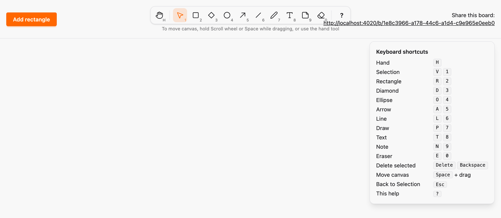

# Kind registry, tool manifest and generated client contract

*2026-10-29T19:07:11Z by Showboat 0.6.1*
<!-- showboat-id: 43276581-2a54-448a-8b5a-a4ae4b42c4eb -->

**Outcome: every element kind is declared once in `Sketch.Canvas.Kinds`, every toolbar tool once in `SketchWeb.Tools`, and the client reads both from a generated `assets/js/generated/manifest.ts`. Each copy is either derived or checked: a tool for an unknown kind does not compile, a hand-edited or stale manifest fails `mix ci` and CI, and the new rule A22 rejects kind branching outside kind modules, renderers and generated files. No migration, and the toolbar is unchanged (ADR 0004 items 1, 2, 3 and 6).**

How it works:

- `Sketch.Canvas.Kinds` lists the kinds in board order. `rectangle` is its own module, `Sketch.Canvas.Kinds.Rectangle`; the other seven keep their `%Sketch.Canvas.Kind{}` specs in `Sketch.Canvas.Kinds.Legacy` and move out one per PR. The `kind` attribute is the `Sketch.Canvas.ElementKind` enum built from the registry. `Geometry` (point counts, text kinds, default sizes), the validations and the CHECK SQL derive from the specs.
- `SketchWeb.Tools` holds each tool’s id, label, keys, icon and the kind it creates. The toolbar renders from it.
- `mix sketch.gen.manifest` renders the kinds, specs, tools and geometry into TypeScript; `--check` runs in `mix ci` and in the CI static job. `tools.ts` derives `ToolId`, `TOOLS`, `DrawnKind`, `isPointKind` and `selectionHandles` from it, and `canvas.ts` takes `TEXT_KINDS` from it.
- A22 scans `lib/` and `assets/js/` for literal kind branching. The three files that still branch for Legacy kinds are listed in `legacy_kind_files`; every entry must still match, and the list must be empty exactly when `Legacy` is.

The registry and what derives from it:

```bash
mix run --no-start -e 'IO.inspect(Sketch.Canvas.element_kinds(), label: "kinds"); IO.inspect(Sketch.Canvas.Kinds.legacy_ids(), label: "still in Legacy"); IO.inspect(Sketch.Canvas.point_kinds(), label: "point kinds"); IO.inspect(Sketch.Canvas.geometry() |> Map.take([:default_width, :default_height, :note_width, :note_height]) |> Enum.sort(), label: "default sizes")' 2>&1 | grep -vE '^(Compiling|Generated)'
```

```output
kinds: [:rectangle, :diamond, :ellipse, :arrow, :freedraw, :line, :text, :note]
still in Legacy: [:diamond, :ellipse, :arrow, :freedraw, :line, :text, :note]
point kinds: [:arrow, :freedraw, :line]
default sizes: [default_height: 80, default_width: 120, note_height: 160, note_width: 200]
```

The contract test (each kind has a well-formed spec, is in the manifest and is drawn by the shared property generator; every tool creates a registered kind and every kind has a tool) and the A22 tests (the application, the negative fixture, stale legacy entries, and Legacy and the allowlist emptying together):

```bash
docs/evidence/pbt-drag-share/run-tests.sh test/sketch/canvas/kind_contract_test.exs test/architecture/source_policy_test.exs --seed 1 --trace 2>&1 | grep -E '^  \* test (the committed|rectangle has|note has|every tool|the registry|kind-specific)|^Result'
```

```output
  * test kind-specific branching lives in kind modules, renderers and generated files (A22) rejects every direct form of kind branching outside the allowed paths [L#85]
  * test kind-specific branching lives in kind modules, renderers and generated files (A22) application [L#74]
  * test kind-specific branching lives in kind modules, renderers and generated files (A22) legacy_kind_files is empty exactly when Sketch.Canvas.Kinds.Legacy has no kinds [L#121]
  * test kind-specific branching lives in kind modules, renderers and generated files (A22) every legacy kind file still branches on a kind [L#109]
  * test note has a spec, is in the client manifest and is drawn by the property generators [L#26]
  * test every tool creates a registered kind and every kind has exactly one tool [L#42]
  * test rectangle has a spec, is in the client manifest and is drawn by the property generators [L#26]
  * test the registry, the element attribute and the specs list the same kinds in the same order [L#36]
  * test the committed client manifest is the generated one (A22) [L#18]
Result: 22 passed
```

(a) Editing the generated manifest by hand (Eraser’s digit 0 changed to X) fails `mix sketch.gen.manifest --check`, which `mix ci` and CI run:

```bash
docs/evidence/kind-registry/mutate.sh manifest-edited-by-hand mix sketch.gen.manifest --check 2>&1 | grep -vE '^(Compiling|Generated)'
```

```output
** (Mix) assets/js/generated/manifest.ts is stale or was edited by hand. Run `mix sketch.gen.manifest` and commit the result.
Mutation killed (exit 1)
```

(b) Adding a tool that creates a kind the registry does not have fails compilation:

```bash
docs/evidence/kind-registry/mutate.sh tool-creates-unknown-kind mix compile 2>&1 | grep -E 'Compilation error|CompileError|Mutation|SURVIVED'
```

```output
== Compilation error in file lib/sketch_web/tools.ex ==
** (CompileError) SketchWeb.Tools creates kinds that are not in Sketch.Canvas.element_kinds(): [{"star", :star}]
Mutation killed (exit 1)
```

(c) A `kind === \"diamond\"` branch in `tools.ts`, which is not allowlisted, fails A22:

```bash
docs/evidence/kind-registry/mutate.sh diamond-branch-in-tools docs/evidence/pbt-drag-share/run-tests.sh test/architecture/source_policy_test.exs --seed 1 2>&1 | grep -E '^  [0-9]+\) test|A22 |^Result|Mutation' | sed -E 's/ \(Sketch.Architecture.SourcePolicyTest\)//'
```

```output
  1) test kind-specific branching lives in kind modules, renderers and generated files (A22) application
     A22 assets/js/hooks/tools.ts:77: kind branch: if (kind === "diamond") return "corners"
Result: 10/11 passed
Mutation killed (exit 2)
```

(d) Removing `selection.ts` from `legacy_kind_files` while it still branches fails A22, and listing a file that no longer branches fails the stale-entry test:

```bash
docs/evidence/kind-registry/mutate.sh legacy-entry-removed docs/evidence/pbt-drag-share/run-tests.sh test/architecture/source_policy_test.exs --seed 1 2>&1 | grep -E '^  [0-9]+\) test|A22 |^Result|Mutation' | sed -E 's/ \(Sketch.Architecture.SourcePolicyTest\)//'; docs/evidence/kind-registry/mutate.sh stale-legacy-entry docs/evidence/pbt-drag-share/run-tests.sh test/architecture/source_policy_test.exs --seed 1 2>&1 | grep -E '^  [0-9]+\) test|no longer branches|^Result|Mutation' | sed -E 's/ \(Sketch.Architecture.SourcePolicyTest\)//'
```

```output
  1) test kind-specific branching lives in kind modules, renderers and generated files (A22) application
     A22 assets/js/hooks/selection.ts:248: kind branch: const shape = kind === "note" ? noteGroup(id) : this.previewShape(id, kind)
     A22 assets/js/hooks/selection.ts:249: kind branch: if (kind === "arrow") shape.setAttribute("marker-end", "url(#arrowhead)")
     A22 assets/js/hooks/selection.ts:265: kind branch: class: kind === "text" ? "draw-preview text-element" : "draw-preview",
Result: 10/11 passed
Mutation killed (exit 2)
  1) test kind-specific branching lives in kind modules, renderers and generated files (A22) every legacy kind file still branches on a kind
     assets/js/hooks/tools.ts no longer branches on a kind; remove it from legacy_kind_files
Result: 10/11 passed
Mutation killed (exit 2)
```

(e) No migration: `ash.codegen --check` is clean and no migration or snapshot changed against the base branch. The CHECK constraints list point kinds in the order the existing migration was generated with (line, arrow, freedraw); generating them in registry order would change the SQL text, and the check catches that:

```bash
mix ash.codegen --check > /dev/null 2>&1; echo "ash.codegen --check exit $?"; echo "migration and snapshot files changed since tool-eraser: $(git diff --name-only tool-eraser -- priv/repo/migrations priv/resource_snapshots | wc -l | tr -d ' ')"; docs/evidence/kind-registry/mutate.sh check-sql-in-registry-order mix ash.codegen --check 2>&1 | grep -E 'Pending|Mutation|SURVIVED'
```

```output
ash.codegen --check exit 0
migration and snapshot files changed since tool-eraser: 0
** (Mix) Pending Code Generation Detected for 2 files
Mutation killed (exit 1)
```

The toolbar is unchanged. `compare-toolbar.sh` opens a new board on a server running `tool-eraser` and one running this branch, opens the shortcuts help, and diffs the DOM of `#toolbar` and `#shortcuts-help` after removing dev-only debug annotations (`data-phx-loc`, `@caller` comments) and per-render `data-phx-id`s. Run against both servers on 2026-10-29 (not re-run by `showboat verify`, because it needs two live servers):

Command: `docs/evidence/kind-registry/compare-toolbar.sh http://127.0.0.1:4021/ http://127.0.0.1:4020/`. It reported the tool buttons `hand selection rectangle diamond ellipse arrow line draw text note eraser` and "toolbar and shortcuts help DOM, without dev-only debug annotations: identical to tool-eraser (17862 bytes)".

Pixel comparison was not usable: two screenshots of the same base server already differ. The screenshot below is this branch, with the shortcuts help open.

```bash {image}

```


