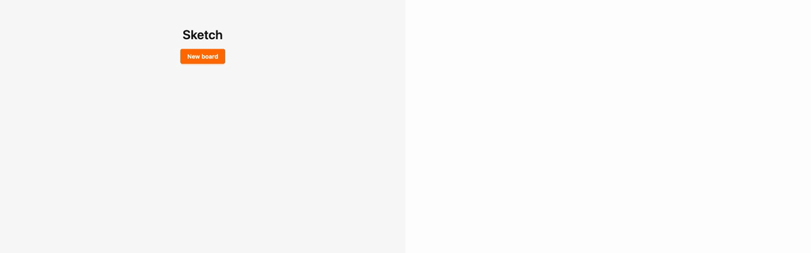
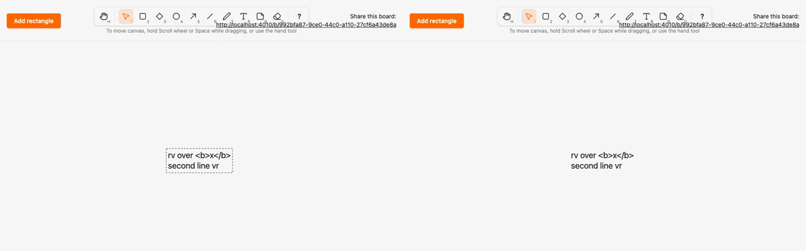

# Migrate text to the kind registry and local render model

*2026-10-29T23:39:19Z by Showboat 0.6.1*
<!-- showboat-id: 90ec079e-8d6c-41fa-84c0-a032d4c70031 -->

**Outcome: `text` (the Text tool, T/8) is the seventh kind on the registry and the local render model. Text renders as `<g data-element data-kind="text" transform="translate(x y)">` with a transparent hit `rect` at `0,0,width,height` and a `text` (`font-size` 20, `pointer-events: none`, `text-element fill-base-content`) holding one `tspan x="0" y="19 + 25·i"` per line. `SketchWeb.Elements.Text` reads the font size, baseline and line height from `Sketch.Canvas.Geometry`; `assets/js/elements/text.ts` reads them from the generated manifest's `GEOMETRY`. Typing previews, live edits and reverts go through the client renderer; the text `element_shape` clause, the text preview tag and the text-only `setText` paths are gone. Note is the only legacy kind left. No migration, no change to stored data.**

Lines split on CRLF, CR or LF on both sides (the client's `textLines`, which the editor already used to size the box), so a stored CR never reaches a `tspan`. A node's text in the parity tree is the unescaped string a browser shows as `textContent`, and is left out when empty, because an empty `tspan` has no text node in either the HEEx output or the DOM. The ExUnit tree keeps text exactly (whitespace-only lines included) instead of trimming it.

The registry and renderers agree on text: it is rendered, no longer legacy, and in the client manifest.

```bash
mix run --no-start -e 'IO.inspect(SketchWeb.Elements.kinds(), label: "rendered"); IO.inspect(Sketch.Canvas.legacy_kinds(), label: "legacy")' 2>&1 | grep -vE '^(Compiling|Generated)'; grep -E '^export const MIGRATED' assets/js/generated/manifest.ts; grep -n 'satisfies' assets/js/elements/index.ts
```

```output
rendered: [:rectangle, :diamond, :ellipse, :arrow, :freedraw, :line, :text]
legacy: [:note]
export const MIGRATED_KINDS = ["rectangle", "diamond", "ellipse", "arrow", "freedraw", "line", "text"] as const
11:export const RENDERERS = { rectangle, diamond, ellipse, arrow, freedraw, line, text } as const satisfies Record<MigratedKind, Renderer>
```

Both generated files are current (regenerated, never edited). The fixture renders nine texts in every one of the 49 boxes (441 text cases): empty (the note case), one line, two lines, an empty middle line, a trailing newline, whitespace-only lines with tabs, CRLF and a lone CR, accents, CJK and astral code points (emoji, a musical symbol and a ZWJ sequence), and `< > & " '` plus already-escaped `&amp;` and `&lt;`. The HEEx output of the server renderer, parsed by LazyHTML, equals the fixture for every case.

```bash
mix sketch.gen.manifest --check 2>&1 | tail -1 && mix sketch.gen.render_fixtures --check 2>&1 | tail -1 && python3 -c "
import json
cases = json.load(open('assets/test/fixtures/render_parity.json'))['text']
print(len(cases), 'text cases')
first = {}
for case in cases: first.setdefault(case['shape']['text'], case)
for text, case in first.items(): print(json.dumps(text, ensure_ascii=False), '->', [span.get('text', '') for span in case['children'][1]['children']])
" && docs/evidence/pbt-drag-share/run-tests.sh test/sketch_web/elements_test.exs test/sketch_web/live/board_live_test.exs --seed 1 --trace 2>&1 | grep -E 'test text|renders the fixture|renderers cover|fixture is the generated|^Result'
```

```output
assets/js/generated/manifest.ts is up to date
assets/test/fixtures/render_parity.json is up to date
441 text cases
"" -> ['']
"a" -> ['a']
"two\nlines" -> ['two', 'lines']
"three\n\nlines" -> ['three', '', 'lines']
"trailing newline\n" -> ['trailing newline', '']
"  padded  \n \t \n\tend" -> ['  padded  ', ' \t ', '\tend']
"crlf\r\nand\rcr" -> ['crlf', 'and', 'cr']
"ünïcødé ñ 中文 😀 𝄞 👩‍💻" -> ['ünïcødé ñ 中文 😀 𝄞 👩\u200d💻']
"<b>bold</b> & \"quoted\" 'single' &amp; &lt;" -> ['<b>bold</b> & "quoted" \'single\' &amp; &lt;']
  * test text renders the fixture's node tree inside a wrapper translated to its box [L#23]
  * test line renders the fixture's node tree inside a wrapper translated to its box [L#23]
  * test arrow renders the fixture's node tree inside a wrapper translated to its box [L#23]
  * test rectangle renders the fixture's node tree inside a wrapper translated to its box [L#23]
  * test freedraw renders the fixture's node tree inside a wrapper translated to its box [L#23]
  * test diamond renders the fixture's node tree inside a wrapper translated to its box [L#23]
  * test ellipse renders the fixture's node tree inside a wrapper translated to its box [L#23]
  * test the renderers cover exactly the kinds that left Sketch.Canvas.Kinds.Legacy [L#13]
  * test the committed render parity fixture is the generated one (ADR 0004) [L#8]
  * test text markup in text renders as literal text, never as elements [L#638]
  * test text editing commits the text and box together and every view renders the new text [L#678]
  * test text blank or overlong text creates nothing [L#665]
  * test text typed text is stored and rendered one tspan per line in every view [L#613]
  * test text typing previews reach other views with their text and are never persisted [L#734]
Result: 43 passed
```

Client parity: the text client renderer is compared with the server fixture for all 441 text shapes, then the whole assets suite runs (including a new check that only the Text tool has a typed kind to create or edit).

```bash
docs/evidence/pbt-drag-share/run-ts.sh test/render_parity.test.ts && npm --prefix assets test 2>&1 | grep -E '^ℹ (tests|pass|fail) '
```

```output
✔ the parity fixture covers exactly the kinds with a renderer (mix sketch.gen.render_fixtures)
✔ the rectangle client renderer draws the same node tree as the server renderer for every fixture shape
✔ the diamond client renderer draws the same node tree as the server renderer for every fixture shape
✔ the ellipse client renderer draws the same node tree as the server renderer for every fixture shape
✔ the arrow client renderer draws the same node tree as the server renderer for every fixture shape
✔ the freedraw client renderer draws the same node tree as the server renderer for every fixture shape
✔ the line client renderer draws the same node tree as the server renderer for every fixture shape
✔ the text client renderer draws the same node tree as the server renderer for every fixture shape
ℹ tests 8
ℹ pass 8
ℹ fail 0
ℹ tests 65
ℹ pass 65
ℹ fail 0
```

Playwright, two browsers, no sleeps. `text.spec.ts` now selects `[data-element][data-kind="text"] > text[data-text-body] > tspan` and, for both browsers after every commit, asserts the wrapper `transform`, the hit `rect` at `0,0` with the box size, and each `tspan` at `x="0"`, `y="19 + 25·i"`. B's typing preview is a `g[data-draw][data-kind="text"]` drawn by the same renderer, checked for its transform and local lines. The double-click editor is checked to open at the wrapper's live `x`/`y`. The existing two-browser test already covered the requested flow (B watches A type, A commits multi-line text, B sees it, A edits and moves it, B reloads), so no new test was added. The run is the full suite.

```bash
docs/evidence/pbt-drag-share/run-e2e.sh
```

```output
51 passed
```

Mutation 1, line spacing, client only: `mutations/client-line-spacing.patch` makes the client text renderer space lines 26 px apart instead of the manifest's 25. The type checks pass and a one-line text looks identical, but the parity test fails on the first multi-line fixture shape.

```bash
docs/evidence/kind-text/mutate.sh client-line-spacing bash -c 'set -o pipefail; npm --prefix assets run --silent typecheck && cd assets && node --test test/render_parity.test.ts 2>&1 | grep -E "^(✔|✖) " | sed -E "s/ \([0-9.]+m?s\)$//" | awk "!seen[\$0]++"'
```

```output
✔ the parity fixture covers exactly the kinds with a renderer (mix sketch.gen.render_fixtures)
✔ the rectangle client renderer draws the same node tree as the server renderer for every fixture shape
✔ the diamond client renderer draws the same node tree as the server renderer for every fixture shape
✔ the ellipse client renderer draws the same node tree as the server renderer for every fixture shape
✔ the arrow client renderer draws the same node tree as the server renderer for every fixture shape
✔ the freedraw client renderer draws the same node tree as the server renderer for every fixture shape
✔ the line client renderer draws the same node tree as the server renderer for every fixture shape
✖ the text client renderer draws the same node tree as the server renderer for every fixture shape
✖ failing tests:
Mutation killed (exit 1)
```

Mutation 2, escaping, server only: `mutations/server-text-unescaped.patch` makes the wrapper write node text with `Phoenix.HTML.raw/1` instead of HEEx's escaping. The fixture is unchanged (it holds the unescaped string), so `render_fixtures --check` and the client parity test both pass; the ExUnit comparison of the parsed HEEx with the fixture catches it, because `<b>bold</b>` turns into a real element, and so does the LiveView markup test.

```bash
docs/evidence/kind-text/mutate.sh server-text-unescaped bash -c 'set -o pipefail; docs/evidence/pbt-drag-share/run-tests.sh test/sketch_web/elements_test.exs test/sketch_web/live/board_live_test.exs --seed 1 2>&1 | grep -E "^ +[0-9]+\) test|^Result"'
```

```output
  1) test text renders the fixture's node tree inside a wrapper translated to its box (SketchWeb.ElementsTest)
  2) test text markup in text renders as literal text, never as elements (SketchWeb.BoardLiveTest)
Result: 41/43 passed
Mutation killed (exit 2)
```

Two-browser recording (`record.sh`, Playwright video of the main text test, slowed 3x): A (left) clicks with the Text tool and types `rv over <b>x</b>`, Enter, `second line` while B (right) shows the muted preview growing, letter by letter; A presses Esc and both show the committed two-line text; A double-clicks, appends ` vr` (B follows), clicks away to commit, then drags the text 100 px right and 60 px down, and B mirrors the move.

```bash {image}

```



```bash {image}

```



Data for "how easy is a new kind": every file this migration touched outside the evidence folder (A added, M modified) against `kind-freedraw`. New files: the spec and the two renderers (3). Regenerated, never hand-edited: the manifest and parity fixture (2). One-line registrations: `kinds.ex`, `legacy.ex`, `elements.ex`, `elements/index.ts`. Text needed more than the shape kinds: the fixture texts and empty-text rule (`render_fixtures.ex`, both tree normalizers), an optional `text` through `setShape`/`showShape` so previews and edits reach the renderer, `requiresText`/`typedKind` in `tools.ts` in place of the `"text"` literals, CSS for the muted preview, and the A22 list (`selection.ts` no longer branches on a kind). The rest is removal and tests.

```bash
git diff --name-status kind-freedraw...HEAD -- . ':!docs/evidence' | sort -k2; git diff --shortstat kind-freedraw...HEAD -- . ':!docs/evidence'
```

```output
M	architecture/rules.exs
M	assets/css/app.css
M	assets/js/elements/index.ts
A	assets/js/elements/text.ts
M	assets/js/generated/manifest.ts
M	assets/js/hooks/canvas.ts
M	assets/js/hooks/selection.ts
M	assets/js/hooks/tools.ts
M	assets/test/fixtures/render_parity.json
M	assets/test/render_parity.test.ts
M	assets/test/tools.test.ts
M	e2e/tests/text.spec.ts
M	lib/sketch_web/elements.ex
A	lib/sketch_web/elements/text.ex
M	lib/sketch_web/live/board_live.ex
M	lib/sketch_web/render_fixtures.ex
M	lib/sketch/canvas/kinds.ex
M	lib/sketch/canvas/kinds/legacy.ex
A	lib/sketch/canvas/kinds/text.ex
M	test/sketch_web/elements_test.exs
M	test/sketch_web/live/board_live_test.exs
 21 files changed, 650 insertions(+), 142 deletions(-)
```
