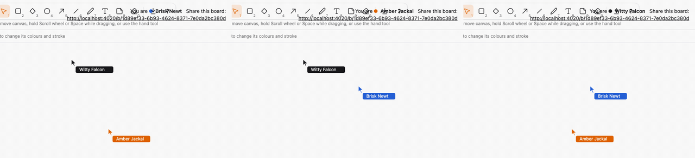
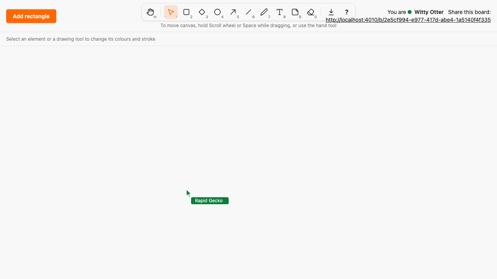
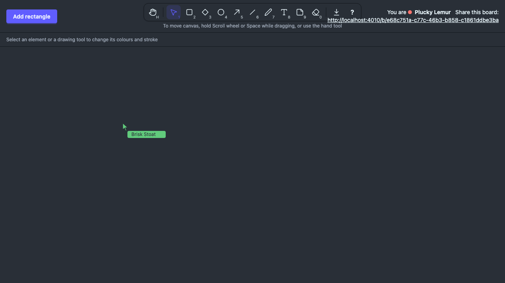

# Live cursors

*2026-10-30T10:20:30Z by Showboat 0.6.1*
<!-- showboat-id: 7f3f20af-4441-4fc6-8ca7-f994d2ecd5a8 -->

Outcome: every viewer of a board sees the other viewers' pointers, live, each with a name label and colour. Cursors are positioned in canvas coordinates (so they stay right when either side scrolls), disappear when the viewer leaves the canvas or hides the tab, or after 2000 ms of silence, never cross boards, are never persisted and are not part of an export. The brief's approval is recorded as addendum D11 and the design as ADR 0007. No new runtime dependency (A15), no Phoenix.Presence or Tracker (A12), and pointer events stay in the canvas hook (A13).

The transport is the preview transport: the hook pushes `cursor` and `cursor_leave`, and `BoardLive` validates the payload with guards and relays it with `broadcast_from` on the board topic. The identity (random id, name and colour derived from it) lives in `Sketch.Canvas.Viewer`:

```bash
sed -n "/def handle_event(\"cursor\"/,/def handle_event(\"erase\", %{\"element_ids\"/p" lib/sketch_web/live/board_live.ex | sed "\$d"
```

```output
  def handle_event("cursor", %{"x" => x, "y" => y, "seq" => seq}, socket)
      when is_canvas_point(x, y) and is_seq(seq) do
    %{id: viewer_id, name: name, color: color} = socket.assigns.viewer

    broadcast_preview(socket, "cursor", %{
      viewer_id: viewer_id,
      name: name,
      color: color,
      x: x,
      y: y,
      seq: seq
    })
  end

  def handle_event("cursor_leave", %{"seq" => seq}, socket) when is_seq(seq) do
    broadcast_preview(socket, "cursor_leave", %{viewer_id: socket.assigns.viewer.id, seq: seq})
  end

```

```bash
sed -n "/def new do/,/defp pick/p" lib/sketch/canvas/viewer.ex
```

```output
  def new do
    8 |> :crypto.strong_rand_bytes() |> Base.url_encode64(padding: false) |> from_id()
  end

  @doc "The viewer whose identity the id determines."
  @spec from_id(String.t()) :: t()
  def from_id(id) do
    %{id: id, name: name(id), color: pick(@colors, {id, :color})}
  end

  @doc "How many distinct names there are."
  @spec name_count() :: pos_integer()
  def name_count, do: length(@adjectives) * length(@animals)

  defp name(id), do: "#{pick(@adjectives, {id, :adjective})} #{pick(@animals, {id, :animal})}"

  defp pick(list, key), do: Enum.at(list, :erlang.phash2(key, length(list)))
```

The pure client logic is in `assets/js/hooks/cursor_logic.ts`: `CursorSender` (20 per second, only when the position changed, one counter shared by moves and leaves) and `RemoteCursors` (newest sequence number wins per viewer, a leave also counts as a sequence number so a late move cannot revive the cursor, 2000 ms expiry). fast-check properties cover delivery in any order, the exact 2000 ms boundary, independence between viewers and the 50 ms spacing:

```bash
docs/evidence/pbt-drag-share/run-ts.sh test/remote_cursors.test.ts test/cursor_sender.test.ts
```

```output
✔ cursor messages are at least 50 ms apart, so at most 20 per second
✔ a cursor message is only sent when the pointer moved since the last one
✔ the last position is always sent, and the first without waiting
✔ sequence numbers count up from 1 without gaps
✔ leaving a canvas the cursor was never shown on sends nothing
✔ leaving takes the next sequence number and cancels a message still waiting
✔ coming back after leaving sends the same position again
✔ whatever order messages arrive in, each viewer ends where their newest message says
✔ a late or repeated message never replaces a newer one
✔ a leave stops an older cursor message from bringing the cursor back
✔ viewers do not affect each other
✔ a cursor disappears exactly 2000 ms after the last message from its viewer
✔ 1999 ms of silence keeps a cursor and 2000 ms removes it
✔ the next expiry is the soonest cursor's, and nothing when none is shown
✔ payloads without a viewer, a position or a sequence number are not cursors
ℹ tests 15
ℹ pass 15
ℹ fail 0
```

The server side. The A10 test now relays 50 cursor moves and a leave and asserts zero Repo queries; the A07 test sends a preview, a cursor and a leave from one view of a board and asserts that a view of another board receives none of them; the new LiveView tests cover the payload, identity, edge positions and every malformed payload:

```bash
mix test test/sketch_web/live/board_live_cursor_test.exs test/sketch_web/live/board_live_drag_test.exs test/sketch/canvas/viewer_test.exs 2>&1 | grep -E "^Result"
```

```output
Result: 23 passed (2 properties, 21 tests)
```

The export clones only `#elements > [data-element]`, so the cursor layer, like the selection and draw-preview layers, is outside it. There is no exclusion list to extend; the E2E test below proves it by exporting while a cursor is shown:

```bash
grep -n "ELEMENT_SELECTOR" assets/js/export/export_dom.ts | head -2
```

```output
18:const ELEMENT_SELECTOR = "#elements > [data-element]"
128:  const all = Array.from(canvas.querySelectorAll(ELEMENT_SELECTOR)).map((element) => ({
```

The three-browser run: `cursor-demo.mjs` opens three Chromium contexts on one board and moves each pointer along its own path in lockstep; each frame is a screenshot of each browser, cropped to the right part of the page (the viewer's own name sits next to the share link, and every browser shows the other two labelled cursors in their colours). Each frame waits until every browser shows the other two cursors at the expected canvas spots, so the GIF cannot show a cursor that is not there:

```bash {image}

```



One viewer's screen in the light theme and the dark theme. The label colours are the stroke colour tokens of the palette (ADR 0006), so they follow the theme; the label text uses the page background colour, which keeps it readable on both:

```bash {image}

```



```bash {image}

```



The new Playwright spec, `cursors.spec.ts`, drives real browsers against the real server. B sees A's labelled cursor at A's canvas spot (also after B scrolls, and when A has scrolled before moving) and the pointer layer never takes a click; A leaving the canvas and a hidden tab remove the cursor on B while B's clock is frozen, so the 2000 ms expiry cannot hide a missing leave; silence removes it after 2000 ms and not after 1900 ms (clock API, A20) and every message restarts the timer; a third board sees nothing and is seen by nobody; an SVG export made while a cursor is shown has no cursor; the dark theme renders. Then the whole suite:

```bash
docs/evidence/pbt-drag-share/run-e2e.sh cursors.spec.ts
```

```output
8 passed
```

```bash
docs/evidence/pbt-drag-share/run-e2e.sh
```

```output
76 passed
```

Mutation 1, a cursor event writes to the database: `mutations/cursor-writes-db.patch` makes the cursor handler read the board's elements, one query per move. The A10 telemetry test sees the query and fails:

```bash
docs/evidence/live-cursors/mutate.sh cursor-writes-db mix test test/sketch_web/live/board_live_drag_test.exs 2>&1 | grep -E '^Result|^Mutation'
```

```output
Result: 11/12 passed
Mutation killed (exit 2)
```

Mutation 2, cursors are broadcast to all boards: `mutations/cursors-to-all-boards.patch` relays them on one topic that every board's view subscribes to. The A07 LiveView test (a view of another board receives nothing) and the E2E test with a third board both fail:

```bash
docs/evidence/live-cursors/mutate.sh cursors-to-all-boards mix test test/sketch_web/live/board_live_drag_test.exs 2>&1 | grep -E '^Result|^Mutation'
```

```output
Result: 11/12 passed
Mutation killed (exit 2)
```

```bash
docs/evidence/live-cursors/mutate.sh cursors-to-all-boards docs/evidence/pbt-drag-share/run-e2e.sh cursors.spec.ts -g 'another board'
```

```output
1 failed
Mutation killed (exit 1)
```

Mutation 3, no stale expiry: `mutations/no-stale-expiry.patch` makes `expire` remove nothing. Three fast-check and example tests fail, and so does the E2E clock test:

```bash
docs/evidence/live-cursors/mutate.sh no-stale-expiry docs/evidence/pbt-drag-share/run-ts.sh test/remote_cursors.test.ts | grep -E '^(✖|Mutation)' | sort -u
```

```output
✖ 1999 ms of silence keeps a cursor and 2000 ms removes it
✖ a cursor disappears exactly 2000 ms after the last message from its viewer
✖ failing tests:
✖ the next expiry is the soonest cursor's, and nothing when none is shown
Mutation killed (exit 1)
```

```bash
docs/evidence/live-cursors/mutate.sh no-stale-expiry docs/evidence/pbt-drag-share/run-e2e.sh cursors.spec.ts -g 'two seconds'
```

```output
1 failed
Mutation killed (exit 1)
```

Mutation 4, leaving is never sent: `mutations/leave-not-sent.patch` drops the `cursor_leave` push. Both E2E leave tests fail (the receiver's clock is frozen, so the 2000 ms expiry cannot cover for it):

```bash
docs/evidence/live-cursors/mutate.sh leave-not-sent docs/evidence/pbt-drag-share/run-e2e.sh cursors.spec.ts -g 'leaving the canvas|tab becoming hidden'
```

```output
2 failed
Mutation killed (exit 1)
```

Every file this PR touched outside the evidence folder (A added, M modified) against `export`. The cursor logic, the layer and the viewer module are new; the canvas hook gains the pointer listeners, the timer and the two handlers (pointer events stay in that file, A13); `architecture/rules.exs` only gains verification files and wording for A07 and A10, and no rule, status or allowlist changed.

```bash
git diff --name-status -M export...HEAD -- . ':!docs/evidence' | sort -k2; git diff --shortstat export...HEAD -- . ':!docs/evidence'
```

```output
M	ARCHITECTURE.md
M	architecture/rules.exs
M	assets/css/app.css
M	assets/js/hooks/canvas.ts
A	assets/js/hooks/cursor_layer.ts
A	assets/js/hooks/cursor_logic.ts
A	assets/test/cursor_sender.test.ts
A	assets/test/remote_cursors.test.ts
A	docs/adr/0007-live-cursors-as-transient-board-messages.md
M	docs/SPEC-ADDENDUM.md
A	e2e/tests/cursors.spec.ts
M	e2e/tests/support/canvas.ts
M	lib/sketch_web/live/board_live.ex
M	lib/sketch/canvas.ex
A	lib/sketch/canvas/viewer.ex
A	test/sketch_web/live/board_live_cursor_test.exs
M	test/sketch_web/live/board_live_drag_test.exs
A	test/sketch/canvas/viewer_test.exs
 18 files changed, 1207 insertions(+), 14 deletions(-)
```
