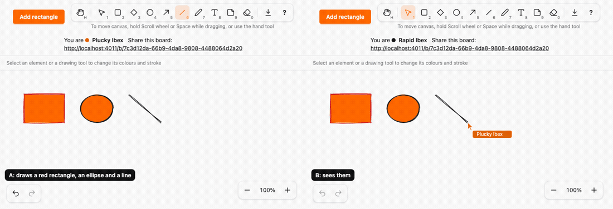
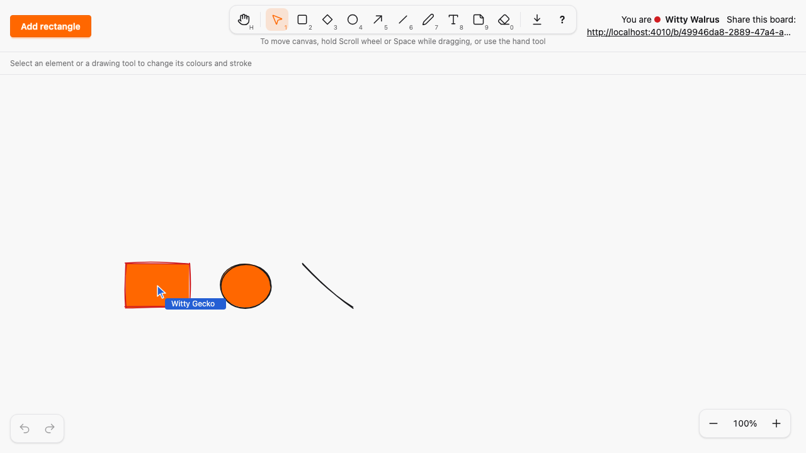
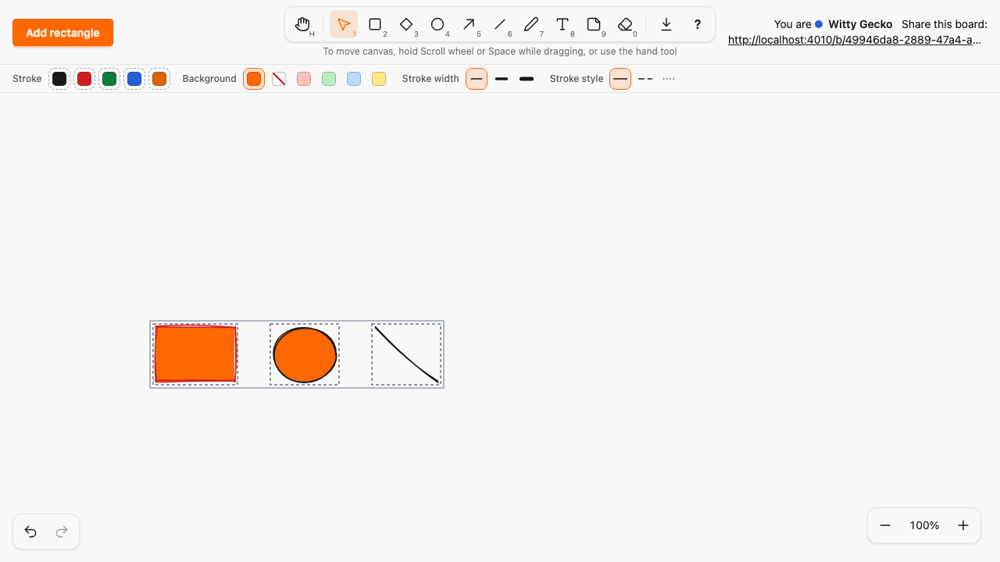
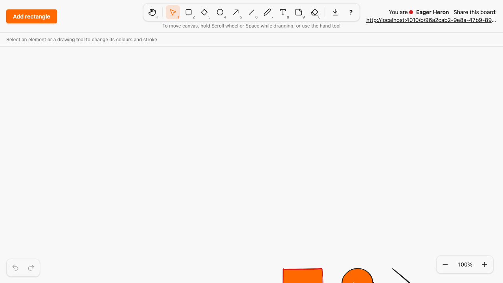

# Multi-select: shift-click, marquee, group move, delete, style and clipboard (addendum D13)

*2026-10-30T20:01:30Z by Showboat 0.6.1*
<!-- showboat-id: fdc58a4c-9329-4929-b2d4-004e4b0c6f4e -->

Outcome: the canvas has multi-select. Shift+click toggles an element, a marquee on empty canvas selects every element whose box it touches (Shift adds), Ctrl/⌘+A selects all and Esc clears. Dragging a selected element moves the whole group: one batched `group_preview` per tick (20/s, never persisted) and, on release, one `commit_position` per element, each its own version; a member that fails is reverted alone. The move clamps one delta for the whole group, so the layout survives the canvas edge. Delete, the eraser, duplicate, copy, cut, paste and style changes act on the whole selection, each as one undo entry, and the properties panel marks mixed values. Selection stays local UI state (addendum D8): nothing about it is pushed, broadcast or stored. Group resize is out of scope (addendum D13). No new runtime dependency (A15), no migration.

The chord lives in its own registry with its own group; the two pointer gestures are help-only entries in the same registry:

```bash
mix run --no-start -e "IO.inspect(SketchWeb.Shortcuts.groups()); for a <- ~w(select_all toggle_selected select_in_box), do: IO.inspect({a, SketchWeb.Shortcuts.get(a).group, Enum.map(SketchWeb.Shortcuts.get(a).chords, & &1.keys)})" 2>&1 | tail -4
```

```output
[:tool, :history, :clipboard, :selection, :zoom, :export, :canvas, :editor]
{"select_all", :selection, [["Ctrl/⌘", "A"]]}
{"toggle_selected", :selection, []}
{"select_in_box", :selection, []}
```

```bash
grep -E "action: \"select_all\"" assets/js/generated/manifest.ts | sed -E "s/^ +//"
```

```output
{ group: "selection", action: "select_all", contexts: ["canvas"], chords: [{ key: ["a"], code: null, mod: "command", shift: false, alt: false, modifiers: "exact" }] },
```

The batched preview: the server checks every entry like a single `preview` and relays the whole list on the board topic with `broadcast_from/4`. The A10 test in `board_live_drag_test.exs` now also sends 50 group previews and a group cancel and requires zero Repo queries from either LiveView; the same file covers A07 for group previews, a malformed entry dropping the whole message, and a commit of an erased member failing alone without a flash:

```bash
mix test test/sketch_web/live/board_live_drag_test.exs 2>&1 | grep -E "^Result"
```

```output
Result: 17 passed
```

The pure logic is in `assets/js/hooks/selection_logic.ts`, checked by fast-check: toggling, the marquee hit test against a brute-force corner model, Shift-marquee union, the group move (every element inside the canvas and moved by the same delta), the per-element merge of a batched preview against an explicit model of the D2 rules (base version, newer seq per element and drag, erase), one element cancelled while the rest keep flowing, the mixed style state, restyle targets, the eraser taking the whole selection, and the Ctrl/⌘+A matcher under every modifier combination. The history model gained a group commit entry (undo and redo replay every member; an erased member is left out) and group style coalescing:

```bash
docs/evidence/pbt-drag-share/run-ts.sh test/selection_logic.test.ts
```

```output
✔ toggling adds an unselected element, removes a selected one, and twice is the identity
✔ a marquee is the same box whichever corner it starts from and selects exactly the boxes it touches
✔ a marquee replaces the selection, and with Shift adds to it without duplicates
✔ a group move clamps the delta, so every element stays inside the canvas and keeps its relative position
✔ a group move that fits is not clamped at all
✔ a batched group preview applies the single-preview rules to each element: base version, newer seq per drag, erase
✔ an element no longer on the board, or being edited here, takes nothing from a group preview
✔ cancelling one element of a group drag leaves the other elements' previews flowing
✔ the style panel shows a property when it applies to a selected kind, its value when all agree, and mixed otherwise
✔ a group restyle commits once per selected element the property applies to and whose value differs
✔ an eraser stroke that touches a selected element erases the whole selection, and otherwise only what it touches
✔ united keeps order and drops duplicates
✔ Ctrl/⌘+A selects all on the canvas only, with exactly those modifiers
ℹ tests 13
ℹ pass 13
ℹ fail 0
```

```bash
docs/evidence/pbt-drag-share/run-ts.sh test/history_logic.test.ts test/remote_previews.test.ts | grep -E "group|ℹ"
```

```output
✔ a group move is one entry: undo and redo replay every element's change together, and an erased member is left out
✔ group style changes coalesce only with a change of the same property on the same elements
ℹ tests 20
ℹ pass 20
ℹ fail 0
```

The two-browser Playwright spec. A marquee-selects a rectangle, an ellipse and a line and drags them: B sees all three move live while A still holds the mouse, B received `group_preview` frames and no single `preview` frame, B shows the committed positions at version 1, and B never shows a selection outline, marquee or selection attribute; one undo restores all three. Shift+click toggles, Shift+marquee adds, Ctrl/⌘+A and Esc. B erases the ellipse mid-drag: A releases, the rectangle and line land at version 1 and nothing else reverts. Delete erases the group and one undo brings it back. Restyling shows the stroke colour as mixed (no pressed swatch), then blue applies to all three and one undo restores red, ink and ink. A group copied on board 1 pastes on board 2 with the same relative layout, selected. A group dragged past the left edge stops as a whole:

```bash
docs/evidence/pbt-drag-share/run-e2e.sh multi-select.spec.ts
```

```output
7 passed
```

A new control would have to fit the header and style bar; the mixed state is a style on the existing swatches, and the layout spec passes at the four widths:

```bash
docs/evidence/pbt-drag-share/run-e2e.sh layout.spec.ts
```

```output
8 passed
```

The two-browser run: `multi-select-demo.mjs` opens two Chromium contexts on one board. A draws a red rectangle, an ellipse and a line; marquee-selects them (B sees no marquee and no selection); drags the group (B sees all three move live) and releases; sets the mixed stroke colour to blue; deletes the group and undoes; selects all with Ctrl/⌘+A and drags left past the canvas edge, where the group stops as a whole. A is on the left, B on the right.

```bash {image}

```



B while A is still dragging the group: all three moved by the same delta from one batched preview, no outline in B.

```bash {image}

```



A after the release: the group outline and one outline per element, no resize handles.

```bash {image}

```



The properties panel with a red rectangle, an ink ellipse and an ink line selected: the stroke colour is mixed (dashed swatches, none pressed); the fill applies to two of them and agrees.

```bash {image}

```


B on board 2 after A pasted the group copied on board 1: same relative layout.

```bash {image}

```



Each mutation is applied by `mutate.sh` from `mutations/`, the check runs, and an `EXIT` trap reverts the patch; `mutate.sh` prints `Mutation killed` only when the check fails.

Mutation 1, clamping each element instead of the delta: `per-element-clamp.patch` makes `movedGroup` clamp every element to the canvas on its own. fast-check finds a group whose layout breaks at the edge:

```bash
docs/evidence/multi-select/mutate.sh per-element-clamp docs/evidence/pbt-drag-share/run-ts.sh test/selection_logic.test.ts 2>&1 | grep -E "^✖ a group|Counterexample|^Mutation" | sort -u
```

```output
  Counterexample: [[{"box":{"x":0,"y":0,"width":0,"height":0},"points":[]},{"box":{"x":0,"y":349,"width":0,"height":229},"points":[]}],{"x":0,"y":3423}]
✖ a group move clamps the delta, so every element stays inside the canvas and keeps its relative position
✖ a group move that fits is not clamped at all
Mutation killed (exit 1)
```

Mutation 2, a persisted group preview: `group-preview-persisted.patch` makes the `group_preview` handler call `commit_position` for each entry before relaying it. The A10 test sees the queries:

```bash
docs/evidence/multi-select/mutate.sh group-preview-persisted mix test test/sketch_web/live/board_live_drag_test.exs 2>&1 | grep -E "^ +1\) test|^Result|^Mutation" | sed -E "s/^ +//"
```

```output
1) test group drags (addendum D13) group previews and the group cancel reach other views without any database query (A10) (SketchWeb.BoardLiveDragTest)
Result: 16/17 passed
Mutation killed (exit 2)
```

Mutation 3, selection broadcast: `selection-broadcast.patch` pushes the selection to the server, which relays it, and the other browser draws it. The E2E check that B shows no selection fails:

```bash
docs/evidence/multi-select/mutate.sh selection-broadcast docs/evidence/pbt-drag-share/run-e2e.sh multi-select.spec.ts -g "marquee-selects three kinds"
```

```output
1 failed
Mutation killed (exit 1)
```

Mutation 4, a failed commit reverting the whole group: `failed-commit-reverts-group.patch` makes A, when any member fails, commit the other members back to where they were (an all-or-nothing group move). In the spec B erases the ellipse mid-drag, so its commit fails; the rectangle and line must stay at their new positions:

```bash
docs/evidence/multi-select/mutate.sh failed-commit-reverts-group docs/evidence/pbt-drag-share/run-e2e.sh multi-select.spec.ts -g "erases one element mid-drag"
```

```output
1 failed
Mutation killed (exit 1)
```

Every file this PR touched outside the evidence folder (A added, M modified) against `guardrails-2`:

```bash
git diff --name-status guardrails-2...HEAD -- . ':!docs/evidence' | sort -k2; git diff --shortstat guardrails-2...HEAD -- . ':!docs/evidence'
```

```output
M	ARCHITECTURE.md
M	assets/css/app.css
M	assets/js/generated/manifest.ts
M	assets/js/hooks/canvas_logic.ts
M	assets/js/hooks/canvas.ts
M	assets/js/hooks/clipboard_logic.ts
M	assets/js/hooks/history_logic.ts
A	assets/js/hooks/selection_logic.ts
M	assets/js/hooks/selection.ts
M	assets/js/hooks/style_panel.ts
M	assets/js/hooks/tools.ts
M	assets/test/clipboard_logic.test.ts
M	assets/test/history_logic.test.ts
A	assets/test/selection_logic.test.ts
M	assets/test/tools.test.ts
M	docs/SPEC-ADDENDUM.md
A	e2e/tests/multi-select.spec.ts
M	lib/sketch_web/components/style_panel.ex
M	lib/sketch_web/live/board_live.ex
A	lib/sketch_web/selection_actions.ex
M	lib/sketch_web/shortcuts.ex
M	test/sketch_web/live/board_live_drag_test.exs
 22 files changed, 1712 insertions(+), 179 deletions(-)
```
