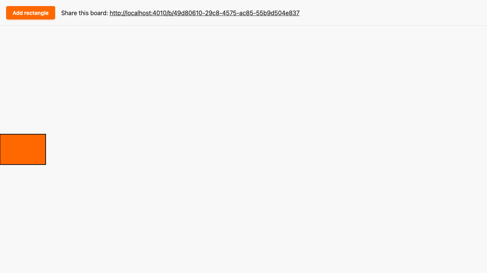

# Dragging and sharing property tests

*2026-10-29T04:04:56Z by Showboat 0.6.1*
<!-- showboat-id: d5b13f1e-aece-4c79-b70e-281f1aa7adba -->

**Outcome: dragging and sharing hold for every generated input on the client, the server and in two real browsers, and each property fails with a small counterexample when the code it guards is broken. The acceptance property also found a real D2 gap, now fixed.**

What is proven:

1. Client logic (`assets/js/hooks/canvas_logic.ts`, fast-check, seed 1). The hook's pure decisions now live in a DOM-free module the `Canvas` hook imports: clamping a dragged position, the preview throttle delay and remote preview acceptance. Any shuffled delivery of previews from up to four drags of one rectangle applies exactly the highest-seq preview of each drag whose `base_version` is at least the known version; an older `base_version` never applies; `drag_cancel` returns to the committed position and ends that drag; re-delivery is a no-op (500 runs each). The throttle sends previews at least 50 ms apart and always sends the last position (1000 runs). The clamp keeps any position, including huge and negative ones, in bounds and leaves in-bounds positions unchanged (1000 runs).
2. LiveView (ExUnitProperties). Random `preview`, `drag_cancel` and `commit` interleavings from 2-3 views on board A and one view on board B: only successful commits query the Repo, with exactly one UPDATE; relays reach only the other views on A; every view converges on the stored `x`, `y` and `data-version` (25 runs of up to 12 events). Random visits to existing, unknown and malformed board ids show exactly that board's rectangles and share link, or redirect without creating a board (50 runs).
3. Two real browsers (Playwright and fast-check, seed 1, 5 runs). Drag paths of 2-8 waypoints, anywhere including far outside the canvas: B shows the clamped end while A still holds the mouse, then both converge on it with `data-version` up by exactly one per drag.

**The D2 finding.** The original hook remembered `seq` only for a rectangle's current drag. With two interleaved drags of one rectangle, an older preview of the first drag applied again once the second drag had taken over, which breaks D2 ("drop a preview whose seq is not newer for that drag_id"). `RemotePreviews` now keeps the latest `seq` per `drag_id`. Mutation (e) below restores the original rule and shows the counterexample.

`run-ts.sh`, `run-tests.sh` and `run-e2e.sh` drop timings, PIDs and compile lines so `showboat verify` can diff the output. `mutate.sh` applies a patch from `mutations/`, runs the given command and reverts the patch through an `EXIT` trap.

```bash
docs/evidence/pbt-drag-share/run-ts.sh 'test/**/*.test.ts'
```

```output
✔ a dragged position is always a whole number within the canvas bounds
✔ a dragged position is the rounded cursor minus the grab offset whenever that is in bounds
✔ every in-bounds position, including both edges, is reachable unchanged
✔ previews of one drag are at least 50 ms apart, so at most 20 per second
✔ the last position of a drag is always previewed (trailing edge)
✔ the first move of a drag is previewed without waiting
✔ any delivery order applies the highest-seq current preview of each drag
✔ a preview based on an older version than the known one never applies
✔ drag_cancel returns to the committed position and ends that drag
✔ re-delivering a preview is a no-op
ℹ tests 10
ℹ pass 10
ℹ fail 0
```

```bash
docs/evidence/pbt-drag-share/run-tests.sh test/sketch_web/properties --seed 1 --trace
```

```output


SketchWeb.Properties.SharingTest [test/sketch_web/properties/sharing_test.exs]
  * property a shared link shows exactly that board, and a bad link creates nothing [L#69]

SketchWeb.Properties.DragEventsTest [test/sketch_web/properties/drag_events_test.exs]
  * property previews and cancels never touch the database and stay on their board (A07, A10) [L#148]


Result: 2 passed
```

```bash
docs/evidence/pbt-drag-share/run-e2e.sh drag-properties --repeat-each=3
```

```output
3 passed
```

```bash {image}

```



## Mutation checks

Each check must end with `Mutation killed`. The patch is reverted by the trap afterwards.

### (a) Preview acceptance ignores `base_version`

`mutations/acceptance-ignores-base-version.patch` deletes the `base_version < knownVersion` check in `RemotePreviews.accept`. A single preview based on version 3, against a known version 5, now applies.

```bash
docs/evidence/pbt-drag-share/mutate.sh acceptance-ignores-base-version docs/evidence/pbt-drag-share/run-ts.sh test/remote_previews.test.ts
```

```output
✖ any delivery order applies the highest-seq current preview of each drag
✖ a preview based on an older version than the known one never applies
✔ drag_cancel returns to the committed position and ends that drag
✔ re-delivering a preview is a no-op
ℹ tests 4
ℹ pass 2
ℹ fail 2
✖ failing tests:
✖ any delivery order applies the highest-seq current preview of each drag
  Counterexample: [[{"rectangle_id":"rect-1","drag_id":"drag-a","seq":1,"base_version":3,"x":0,"y":0}]]
  Shrunk 7 time(s)
✖ a preview based on an older version than the known one never applies
  Counterexample: [[{"rectangle_id":"rect-1","drag_id":"drag-a","seq":1,"base_version":3,"x":0,"y":0}]]
  Shrunk 7 time(s)
Mutation killed (exit 1)
```

### (b) The throttle drops the trailing edge

`mutations/throttle-drops-trailing-edge.patch` turns `previewDelay` into a leading-edge-only throttle: a move within 50 ms of the last preview is dropped instead of delayed. The rate limit still holds, which is why the trailing-edge property exists: two moves 1 ms apart leave the second position unsent.

```bash
docs/evidence/pbt-drag-share/mutate.sh throttle-drops-trailing-edge docs/evidence/pbt-drag-share/run-ts.sh test/preview_throttle.test.ts
```

```output
✔ previews of one drag are at least 50 ms apart, so at most 20 per second
✖ the last position of a drag is always previewed (trailing edge)
✔ the first move of a drag is previewed without waiting
ℹ tests 3
ℹ pass 2
ℹ fail 1
✖ failing tests:
✖ the last position of a drag is always previewed (trailing edge)
  Counterexample: [[{"at":1001,"position":{"x":0,"y":0}},{"at":1002,"position":{"x":0,"y":1}}]]
  Shrunk 16 time(s)
Mutation killed (exit 1)
```

### (c) The clamp is off by one

`mutations/clamp-off-by-one.patch` clamps to `max - 1`. All three clamp properties fail, shrunk to a zero-sized canvas where the clamp returns -1.

```bash
docs/evidence/pbt-drag-share/mutate.sh clamp-off-by-one docs/evidence/pbt-drag-share/run-ts.sh test/drag_position.test.ts
```

```output
✖ a dragged position is always a whole number within the canvas bounds
✖ a dragged position is the rounded cursor minus the grab offset whenever that is in bounds
✖ every in-bounds position, including both edges, is reachable unchanged
ℹ tests 3
ℹ pass 0
ℹ fail 3
✖ failing tests:
✖ a dragged position is always a whole number within the canvas bounds
  Counterexample: [{"x":0,"y":0},{"x":0,"y":0},{"x":0,"y":0}]
  Shrunk 7 time(s)
✖ a dragged position is the rounded cursor minus the grab offset whenever that is in bounds
  Counterexample: [{"x":0,"y":0},{"x":0,"y":0},{"x":0,"y":0}]
  Shrunk 5 time(s)
✖ every in-bounds position, including both edges, is reachable unchanged
  Counterexample: [{"max":{"x":0,"y":0},"target":{"x":0,"y":0},"grab":{"x":0,"y":0}}]
  Shrunk 4 time(s)
Mutation killed (exit 1)
```

### (d) The LiveView persists on `preview`

`mutations/preview-persists.patch` makes `handle_event("preview", ...)` call `Sketch.Canvas.commit_position` before relaying. The LiveView property shrinks to a single in-bounds preview that issued an UPDATE.

```bash
docs/evidence/pbt-drag-share/mutate.sh preview-persists docs/evidence/pbt-drag-share/run-tests.sh test/sketch_web/properties/drag_events_test.exs --seed 1 | grep -vE '^       (test/|\(|lib/)'
```

```output


  1) property previews and cancels never touch the database and stay on their board (A07, A10) (SketchWeb.Properties.DragEventsTest)
     test/sketch_web/properties/drag_events_test.exs:148
     Failed with generated values (after 3 successful runs):

         * Clause:    {view_count, events} <- scenario()
           Generated: {2, [%{x: 0, y: 0, seq: 0, kind: :preview, view: 0, drag_id: "00000000-0000-4000-8000-000000000001", base_version: 0, rectangle: 0}]}

     Assertion with == failed
     code:  assert Enum.map(received_queries(), &query_kind/1) == expected_queries(event, sender)
     left:  [{#PID<…>, :update}]
     right: []
     stacktrace:


Result: 0/1 passed
Failed: 1 property
Mutation killed (exit 2)
```

### (e) The original rule: `seq` tracked only for the rectangle's current drag

`mutations/seq-per-rectangle-not-per-drag.patch` restores the pre-refactor rule. Two drags of one rectangle are enough: after drag a's previews take over from drag c, drag c's older `seq: 1` applies again, and re-delivering a preview is no longer a no-op.

```bash
docs/evidence/pbt-drag-share/mutate.sh seq-per-rectangle-not-per-drag docs/evidence/pbt-drag-share/run-ts.sh test/remote_previews.test.ts
```

```output
✖ any delivery order applies the highest-seq current preview of each drag
✔ a preview based on an older version than the known one never applies
✔ drag_cancel returns to the committed position and ends that drag
✖ re-delivering a preview is a no-op
ℹ tests 4
ℹ pass 2
ℹ fail 2
✖ failing tests:
✖ any delivery order applies the highest-seq current preview of each drag
  Counterexample: [[{"rectangle_id":"rect-1","drag_id":"drag-c","seq":2,"base_version":5,"x":0,"y":0},{"rectangle_id":"rect-1","drag_id":"drag-a","seq":2,"base_version":5,"x":0,"y":0},{"rectangle_id":"rect-1","drag_id":"drag-a","seq":1,"base_version":5,"x":0,"y":0},{"rectangle_id":"rect-1","drag_id":"drag-c","seq":1,"base_version":5,"x":0,"y":0}]]
  Shrunk 11 time(s)
✖ re-delivering a preview is a no-op
  Counterexample: [[{"rectangle_id":"rect-1","drag_id":"drag-c","seq":1,"base_version":5,"x":0,"y":0},{"rectangle_id":"rect-1","drag_id":"drag-a","seq":1,"base_version":5,"x":0,"y":0}]]
  Shrunk 7 time(s)
Mutation killed (exit 1)
```

The tree is clean again and every property passes:

```bash
git diff --quiet -- lib assets/js && echo 'lib/ and assets/js/ match the committed tree' && docs/evidence/pbt-drag-share/run-ts.sh 'test/**/*.test.ts' | grep 'ℹ' && docs/evidence/pbt-drag-share/run-tests.sh test/sketch_web/properties --seed 1 | grep Result
```

```output
lib/ and assets/js/ match the committed tree
ℹ tests 10
ℹ pass 10
ℹ fail 0
Result: 2 passed
```
