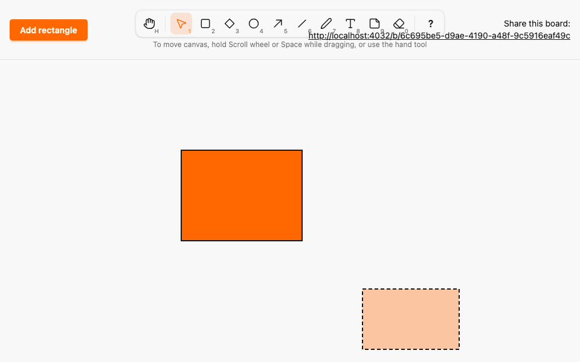
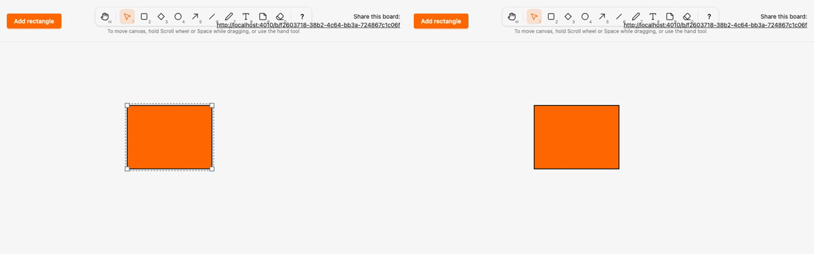

# Local render model with parity-checked renderers, starting with rectangle

*2026-10-29T19:46:48Z by Showboat 0.6.1*
<!-- showboat-id: a11bfccc-c207-4fdc-ae26-9257f32672ac -->

**Outcome: a rectangle now renders as one `<g>` wrapper translated to its box, with its children drawn in local coordinates by `SketchWeb.Elements.Rectangle` on the server and `assets/js/elements/rectangle.ts` on the client. A move changes only the wrapper's transform and live box; a resize, a draw preview and a remote preview redraw the children with the client renderer. The two renderers cannot drift: a renderer missing on either side fails to compile or type-check, a stale fixture fails `mix ci`, and a client renderer that draws anything different fails `node --test`. The other seven kinds keep their old code paths (ADR 0004 items 4 and 5).**

How it works:

- `SketchWeb.ElementRenderer` is the behaviour: `render(%{width, height, points, text})` returns SVG nodes (`%{tag, attrs, children?, text?}`) in `[0, width] × [0, height]`. `SketchWeb.Elements.element/1` is the one kind-agnostic wrapper: `id`, `data-element`, `data-kind`, the committed `data-x/y/width/height`, `data-version`, the live `x/y/width/height` and `transform="translate(x y)"`, rendering the nodes through `dynamic_tag`.
- `SketchWeb.Elements` holds `@renderers [rectangle: Rectangle]` and raises a `CompileError` unless its kinds are exactly `Sketch.Canvas.element_kinds() -- Sketch.Canvas.legacy_kinds()`. `Kinds.Legacy` is the single list of kinds not yet migrated: a kind PR moves its spec out of `Legacy` and adds its renderer, or neither. `BoardLive` dispatches every rendered kind to `Elements.element/1`; its rectangle fallback clause is gone, so an unhandled kind raises instead of drawing a rectangle.
- `mix sketch.gen.manifest` now also writes `MIGRATED_KINDS`/`MigratedKind` from the server map, and the client table is `RENDERERS = { rectangle } as const satisfies Record<MigratedKind, Renderer>`. `assets/js/elements/dom.ts` materialises a node tree under a wrapper, setting only attributes that changed, so a move leaves the children untouched.
- While a gesture holds an element, the hook sets `phx-update="ignore"` on it. LiveView 1.2 then merges only the server's `data-*` attributes (the committed box and version) and leaves the other attributes and the children to the gesture, for any kind. `keepGestureMarkers` (the `onBeforeElUpdated` callback, formerly `keepDraggedPosition`) only carries `data-dragging` and `data-erasing` across patches; the per-kind attribute list is gone.
- `mix sketch.gen.render_fixtures` writes `assets/test/fixtures/render_parity.json`: for each rendered kind, the children for every size in {0, 1, 2, 119, 120, 3999, 4000}² (plus point sets and texts derived from the spec for kinds that have them), with attribute values as the strings HEEx writes. `--check` runs in `mix ci` and the CI static job.

Which kinds are rendered by a renderer, which are still legacy, and what the client manifest says:

```bash
mix run --no-start -e 'IO.inspect(SketchWeb.Elements.kinds(), label: "rendered"); IO.inspect(Sketch.Canvas.legacy_kinds(), label: "legacy")' 2>&1 | grep -vE '^(Compiling|Generated)'; grep -E '^export (const|type) Migrated|^export const MIGRATED' assets/js/generated/manifest.ts; grep -n 'satisfies' assets/js/elements/index.ts
```

```output
rendered: [:rectangle]
legacy: [:diamond, :ellipse, :arrow, :freedraw, :line, :text, :note]
export const MIGRATED_KINDS = ["rectangle"] as const
export type MigratedKind = (typeof MIGRATED_KINDS)[number]
5:export const RENDERERS = { rectangle } as const satisfies Record<MigratedKind, Renderer>
```

Both generated files are current, and the ExUnit tests pass: the committed fixture is the generated one, the renderers cover exactly the non-legacy kinds, and for every fixture shape the HEEx output of `Elements.element/1` (parsed with LazyHTML) is a wrapper at the element's box whose children equal the fixture tree, so the fixture's attribute strings are what the browser receives.

```bash
mix sketch.gen.manifest --check 2>&1 | tail -1 && mix sketch.gen.render_fixtures --check 2>&1 | tail -1 && docs/evidence/pbt-drag-share/run-tests.sh test/sketch_web/elements_test.exs --seed 1 --trace 2>&1 | grep -E '^  \* test|^Result'
```

```output
assets/js/generated/manifest.ts is up to date
assets/test/fixtures/render_parity.json is up to date
  * test rectangle renders the fixture's node tree inside a wrapper translated to its box [L#23]
  * test the renderers cover exactly the kinds that left Sketch.Canvas.Kinds.Legacy [L#13]
  * test the committed render parity fixture is the generated one (ADR 0004) [L#8]
Result: 3 passed
```

The client side: `render_parity.test.ts` checks that the fixture covers exactly `MIGRATED_KINDS` and that each client renderer returns the fixture's tree for every shape (49 rectangle shapes). The whole assets suite still passes.

```bash
docs/evidence/pbt-drag-share/run-ts.sh test/render_parity.test.ts && npm --prefix assets test 2>&1 | grep -E '^ℹ (tests|pass|fail) '
```

```output
✔ the parity fixture covers exactly the kinds with a renderer (mix sketch.gen.render_fixtures)
✔ the rectangle client renderer draws the same node tree as the server renderer for every fixture shape
ℹ tests 2
ℹ pass 2
ℹ fail 0
ℹ tests 58
ℹ pass 58
ℹ fail 0
```

The Playwright spec `e2e/tests/render-model.spec.ts` uses two browsers and no sleeps. The first test adds a rectangle and checks in both browsers that the wrapper is `translate(100 100)` with one `rect` at `0,0` sized 120×80; A drags it, and mid-drag both browsers show `translate(300 150)` with the child unchanged and the committed `data-*` box still at the origin; after release the committed box follows at version 1. A then resizes it from the south-east handle: mid-resize both show a 200×150 child, and after release version 2.

The second test is the one the old attribute list existed for: B commits a move of the rectangle while A is still dragging it. A's committed `data-x/y` and `data-version` update to B's commit, but A's wrapper stays under A's pointer; A releases and wins with version 2. Then the same while A resizes: B's commit arrives mid-resize, A keeps its 200×150 child, and A's commit wins with version 4. The existing drag, concurrent-drag, elements and eraser specs run alongside:

```bash
docs/evidence/pbt-drag-share/run-e2e.sh render-model dragging concurrent-drag drag-properties elements eraser
```

```output
14 passed
```

Mutation 1: `mutations/server-renderer-without-client.patch` migrates ellipse on the server only. It moves the spec out of `Legacy` into `Sketch.Canvas.Kinds.Ellipse` and adds `SketchWeb.Elements.Ellipse`, so the server compiles. Regenerating the manifest adds `ellipse` to `MigratedKind`, and `tsc` rejects the client table that has no ellipse renderer. (`mutate.sh` reverts the patch and restores the generated files on exit.)

```bash
docs/evidence/render-model/mutate.sh server-renderer-without-client bash -c 'set -o pipefail; mix sketch.gen.manifest > /dev/null && grep "^export const MIGRATED_KINDS" assets/js/generated/manifest.ts && npm --prefix assets run --silent typecheck 2>&1 | grep -E "error TS" | sed -E "s/\([0-9]+,[0-9]+\)//"'
```

```output
export const MIGRATED_KINDS = ["rectangle", "ellipse"] as const
js/elements/index.ts: error TS1360: Type '{ readonly rectangle: Renderer; }' does not satisfy the expected type 'Record<"rectangle" | "ellipse", Renderer>'.
js/elements/index.ts: error TS7053: Element implicitly has an 'any' type because expression of type '"rectangle" | "ellipse"' can't be used to index type '{ readonly rectangle: Renderer; }'.
Mutation killed (exit 2)
```

Mutation 2: `mutations/client-renderer-without-server.patch` adds an ellipse client renderer to `RENDERERS` without a server renderer. The manifest is unchanged, and `tsc` rejects the extra key.

```bash
docs/evidence/render-model/mutate.sh client-renderer-without-server bash -c 'set -o pipefail; npm --prefix assets run --silent typecheck 2>&1 | grep -E "error TS" | sed -E "s/\([0-9]+,[0-9]+\)//"'
```

```output
js/elements/index.ts: error TS2353: Object literal may only specify known properties, and 'ellipse' does not exist in type 'Record<"rectangle", Renderer>'.
Mutation killed (exit 2)
```

Mutation 3: `mutations/client-stroke-width.patch` changes the client rectangle's `stroke-width` from 2 to 3 without touching the server. Both type checks pass, and the parity test fails on that attribute.

```bash
docs/evidence/render-model/mutate.sh client-stroke-width bash -c 'set -o pipefail; npm --prefix assets run --silent typecheck && cd assets && node --test test/render_parity.test.ts 2>&1 | grep -E "^(✔|✖) |^ +[+-] +.stroke-width.:" | sed -E "s/ \([0-9.]+m?s\)$//" | awk "!seen[\$0]++"'
```

```output
✔ the parity fixture covers exactly the kinds with a renderer (mix sketch.gen.render_fixtures)
✖ the rectangle client renderer draws the same node tree as the server renderer for every fixture shape
✖ failing tests:
  +       'stroke-width': '3',
  -       'stroke-width': '2',
Mutation killed (exit 1)
```

Mutation 4: `mutations/server-stroke-width.patch` makes the same change on the server only. Everything compiles, and `mix sketch.gen.render_fixtures --check` (in `mix ci` and CI) fails because the committed fixture no longer matches.

```bash
docs/evidence/render-model/mutate.sh server-stroke-width bash -c 'set -o pipefail; mix sketch.gen.render_fixtures --check 2>&1 | grep -E "stale"'
```

```output
** (Mix) assets/test/fixtures/render_parity.json is stale or was edited by hand. Run `mix sketch.gen.render_fixtures` and commit the result.
Mutation killed (exit 1)
```

Mutation 5: `mutations/server-float-x.patch` makes the server write `x` as the float `0.0` and the fixture is regenerated, so only the parity test can catch it. HEEx writes `0.0` where the client writes `0`, and the test fails on exactly that attribute.

```bash
docs/evidence/render-model/mutate.sh server-float-x bash -c 'set -o pipefail; mix sketch.gen.render_fixtures > /dev/null && cd assets && node --test test/render_parity.test.ts 2>&1 | grep -E "^(✔|✖) |^ +[+-] +x:" | sed -E "s/ \([0-9.]+m?s\)$//" | awk "!seen[\$0]++"'
```

```output
✔ the parity fixture covers exactly the kinds with a renderer (mix sketch.gen.render_fixtures)
✖ the rectangle client renderer draws the same node tree as the server renderer for every fixture shape
✖ failing tests:
  +       x: '0',
  -       x: '0.0',
Mutation killed (exit 1)
```

Mutation 6: `mutations/renderer-map-drops-rectangle.patch` empties the renderer map, as if rectangle's renderer were deleted while its spec stays out of `Legacy`. `SketchWeb.Elements` does not compile.

```bash
docs/evidence/render-model/mutate.sh renderer-map-drops-rectangle bash -c 'set -o pipefail; mix compile --force 2>&1 | grep -E "CompileError|must render" | sed -E "s/^ +//"'
```

```output
** (CompileError) SketchWeb.Elements must render exactly the kinds outside Sketch.Canvas.Kinds.Legacy: expected [:rectangle], has renderers for []
Mutation killed (exit 1)
```

Mutation 7: `mutations/drag-not-claimed.patch` stops the hook from setting `phx-update="ignore"` on the dragged element, so LiveView patches it like any other. The existing dragging specs still pass, because none of them commits a remote change during a drag; the new render-model test catches it: B's commit snaps A's dragged rectangle to B's position.

```bash
docs/evidence/render-model/mutate.sh drag-not-claimed bash -c 'set -o pipefail; npm --prefix e2e test -- render-model dragging 2>&1 | grep -E "^ +[0-9]+ (passed|failed)|✘|Expected:|Received:" | sed -E "s/ \([0-9.]+m?s\)$//; s/^ +//"'
```

```output
✘  6 [chromium] › tests/render-model.spec.ts:80:1 › a remote commit mid-drag or mid-resize updates the committed box but never snaps the dragged rectangle
Expected: "translate(300 150)"
Received: "translate(400 350)"
1 failed
5 passed
Mutation killed (exit 1)
```

The DOM in two live browsers. `dom.sh` starts the dev server, and `dom.mjs` has A add, move, resize and then start drawing a rectangle while it prints the wrapper (dev-only `data-phx-*` annotations, comments and whitespace removed; UUIDs shown as `<id>`). Mid-move, A's wrapper is claimed (`phx-update="ignore"`), its live `x/y` and `transform` moved, and its committed `data-*` box and its child are unchanged. Mid-resize, B's child was redrawn by the client renderer at 200×150 while the committed box stays 120×80; after the commit the server render is identical. B's preview of A's new rectangle is the same wrapper and renderer. It also writes the screenshot of B below.

```bash
docs/evidence/render-model/dom.sh docs/evidence/render-model/draw-preview.png
```

```output
B after A adds a rectangle:
  <g id="element-<id>" data-element="<id>" data-kind="rectangle" data-x="100" data-y="100" data-width="120" data-height="80" data-version="0" x="100" y="100" width="120" height="80" transform="translate(100 100)" class="cursor-grab touch-none"><rect class="fill-primary stroke-base-content" height="80" stroke-width="2" width="120" x="0" y="0"></rect></g>
A mid-move (live box and transform changed; committed data-* and children unchanged):
  <g id="element-<id>" data-element="<id>" data-kind="rectangle" data-x="100" data-y="100" data-width="120" data-height="80" data-version="0" x="300" y="150" width="120" height="80" transform="translate(300 150)" class="cursor-grab touch-none" data-dragging="" phx-update="ignore"><rect class="fill-primary stroke-base-content" height="80" stroke-width="2" width="120" x="0" y="0"></rect></g>
B mid-move, from A's preview:
  <g id="element-<id>" data-element="<id>" data-kind="rectangle" data-x="100" data-y="100" data-width="120" data-height="80" data-version="0" x="300" y="150" width="120" height="80" transform="translate(300 150)" class="cursor-grab touch-none"><rect class="fill-primary stroke-base-content" height="80" stroke-width="2" width="120" x="0" y="0"></rect></g>
B mid-resize (the client renderer redrew the child):
  <g id="element-<id>" data-element="<id>" data-kind="rectangle" data-x="300" data-y="150" data-width="120" data-height="80" data-version="1" x="300" y="150" width="200" height="150" transform="translate(300 150)" class="cursor-grab touch-none"><rect class="fill-primary stroke-base-content" height="150" stroke-width="2" width="200" x="0" y="0"></rect></g>
B after A's resize is committed (server render):
  <g id="element-<id>" data-element="<id>" data-kind="rectangle" data-x="300" data-y="150" data-width="200" data-height="150" data-version="2" x="300" y="150" width="200" height="150" transform="translate(300 150)" class="cursor-grab touch-none"><rect class="fill-primary stroke-base-content" height="150" stroke-width="2" width="200" x="0" y="0"></rect></g>
B's preview of A's rectangle in progress:
  <g data-draw="<id>" data-kind="rectangle" class="local-preview" x="600" y="380" width="160" height="100" transform="translate(600 380)"><rect x="0" y="0" width="160" height="100" stroke-width="2" class="fill-primary stroke-base-content"></rect></g>
```

Browser B while A draws a rectangle: the dashed preview is the client renderer's `rect` under a `local-preview` wrapper. Then the two-browser recording (`record.sh`, Playwright video of the first render-model test, slowed 3x): A (left) adds a rectangle, moves it and resizes it from the south-east handle, and B (right) mirrors each step. The last frame of both browsers follows.

```bash {image}

```



```bash {image}

```


```bash {image}

```


