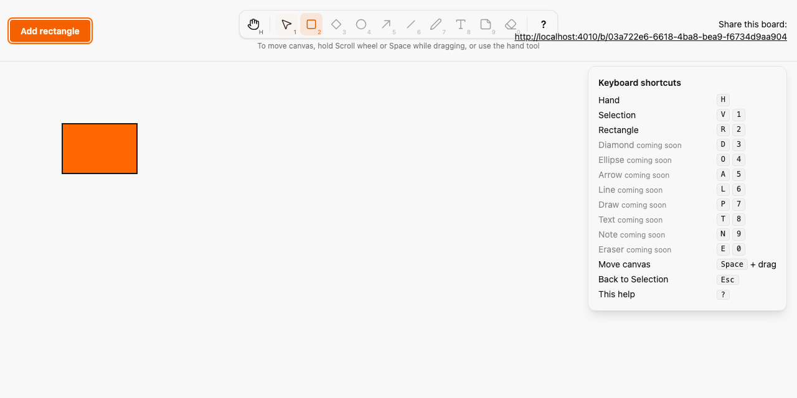
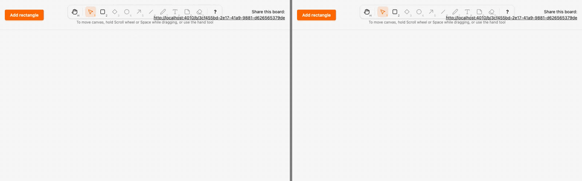

# Toolbar, keyboard shortcuts and panning

*2026-10-29T04:30:52Z by Showboat 0.6.1*
<!-- showboat-id: 1536876c-4e10-4065-97d6-c5faf9b0c1b5 -->

**Outcome: the board has an Excalidraw-style toolbar. Hand (H), Selection (V/1) and Rectangle (R/2) work now; the other eight tools show as disabled "Coming soon" and their keys do nothing. The Hand tool, Space+drag and middle-button drag pan the canvas, Esc returns to Selection and ? toggles a shortcuts panel.**

What is proven:

1. Keymap (`assets/js/hooks/tools.ts`, fast-check, seed 1, 500 runs each). Every enabled tool is reachable by its letter in either case and by its number; no two tools share a key; any random key sequence (tool keys, Esc, ?, Space, random strings, random Ctrl/Meta/Alt and editable flags) selects the same tool as a hand-written binding model; a key with Ctrl, Meta or Alt or typed into an editable target never changes the tool; Esc always yields Selection; disabled tools never become active through keys or toolbar clicks. Two more properties cover the pointer decision (middle button, Space and Hand pan; only Selection on a rectangle drags) and the pan arithmetic.
2. LiveView. `create_at` with in-bounds, edge and out-of-bounds points stores a clamped rectangle through `Sketch.Canvas` and a second view on the board renders it; non-integer coordinates create nothing.
3. Two real browsers (Playwright, `--repeat-each=3`). R then a click in A creates a rectangle B sees; 2 also selects Rectangle; V and 1 return to Selection and dragging still moves; H, Space and the middle button pan the viewport (exact scroll offsets) without moving a rectangle or adding one through a focused button; every toolbar button's `aria-keyshortcuts` key selects its tool or, if disabled, leaves the tool alone; Esc, Alt/Ctrl keys and typing into an input or contenteditable behave as above; ? and the help button toggle the panel and Esc closes it.

The tool is local UI state owned by the `Canvas` hook. It updates `aria-pressed` and `data-tool` through `this.js().setAttribute`, so LiveView patches keep them. Toolbar buttons reach the hook with `JS.dispatch`; the help panel uses `JS.toggle`, which the hook re-executes for the ? key.

The scripts reuse `run-ts.sh`, `run-tests.sh` and `run-e2e.sh` from `docs/evidence/pbt-drag-share/`, which drop timings so `showboat verify` can diff the output. `mutate.sh` applies a patch from `mutations/`, runs the command and reverts the patch through an `EXIT` trap.

```bash
docs/evidence/pbt-drag-share/run-ts.sh test/tools.test.ts
```

```output
✔ every enabled tool is reachable by its letter, in either case, and by its number
✔ no two tools share a key, and no tool key is reserved for Esc, ? or Space
✔ any key sequence selects the same tool as the simple binding model
✔ a key with Ctrl, Meta or Alt, or typed into an editable target, never changes the tool
✔ Esc always returns to Selection
✔ disabled tools never become active through keys or toolbar clicks
✔ the middle button, Space and the Hand tool pan; only Selection on a rectangle drags
✔ panning scrolls by exactly the opposite of the pointer movement
ℹ tests 8
ℹ pass 8
ℹ fail 0
```

```bash
docs/evidence/pbt-drag-share/run-tests.sh test/sketch_web/live/board_live_test.exs --seed 1 --trace
```

```output


SketchWeb.BoardLiveTest [test/sketch_web/live/board_live_test.exs]
  * test a committed position updates the rectangle, ignoring stale versions [L#115]
  * test shows the shareable board url [L#109]
  * test a create broadcast for an already loaded rectangle is not counted twice [L#80]
  * test create_at with non-integer coordinates creates nothing [L#55]
  * test unknown and malformed ids redirect without creating a board [L#98]
  * test a rectangle created elsewhere appears [L#65]
  * test existing rectangles render on mount [L#74]
  * test create_at creates a clamped rectangle that another view on the board receives [L#21]
  * test a create arriving after a newer commit_position does not undo it [L#134]
  * test clicking add renders a rectangle [L#12]


Result: 10 passed
```

```bash
docs/evidence/pbt-drag-share/run-e2e.sh shortcuts --repeat-each=3
```

```output
18 passed
```

## Mutation check

The check must end with `Mutation killed`. The patch is reverted by the trap afterwards.

`mutations/modifiers-not-ignored.patch` makes `isShortcutInput` look only at editable targets, so Ctrl, Meta and Alt no longer stop a shortcut. Pressing Ctrl+H would switch to the Hand tool instead of reaching the browser. Both properties shrink to a single key press.

```bash
docs/evidence/shortcuts/mutate.sh modifiers-not-ignored docs/evidence/pbt-drag-share/run-ts.sh test/tools.test.ts
```

```output
✔ every enabled tool is reachable by its letter, in either case, and by its number
✔ no two tools share a key, and no tool key is reserved for Esc, ? or Space
✖ any key sequence selects the same tool as the simple binding model
✖ a key with Ctrl, Meta or Alt, or typed into an editable target, never changes the tool
✔ Esc always returns to Selection
✔ disabled tools never become active through keys or toolbar clicks
✔ the middle button, Space and the Hand tool pan; only Selection on a rectangle drags
✔ panning scrolls by exactly the opposite of the pointer movement
ℹ tests 8
ℹ pass 6
ℹ fail 2
✖ failing tests:
✖ any key sequence selects the same tool as the simple binding model
  Counterexample: ["selection",[{"key":"h","ctrlKey":true,"metaKey":false,"altKey":false,"editable":false}]]
  Shrunk 2 time(s)
✖ a key with Ctrl, Meta or Alt, or typed into an editable target, never changes the tool
  Counterexample: ["hand",{"key":"1","ctrlKey":false,"metaKey":false,"altKey":true,"editable":false}]
  Shrunk 2 time(s)
Mutation killed (exit 1)
```

## Evidence images

The toolbar with the Rectangle tool active, the hint under it and the shortcuts panel open. Then browser A (left) presses R and clicks: the rectangle appears in A and B (right) together; A pans with the Hand tool, then with Space+drag under the Selection tool, while B and the stored rectangle stay put. The GIF is Playwright video of the first E2E test, slowed 4x and aligned on the frame where the rectangle appears in each browser.

```bash {image}

```



```bash {image}

```


