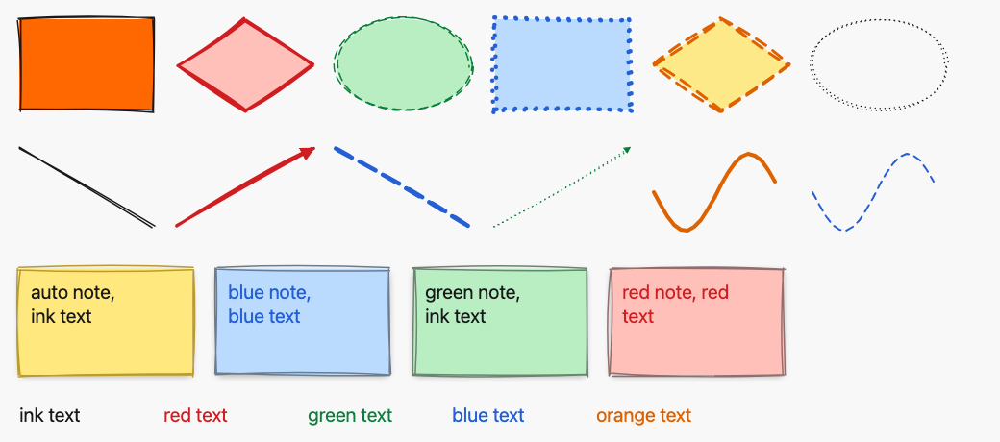
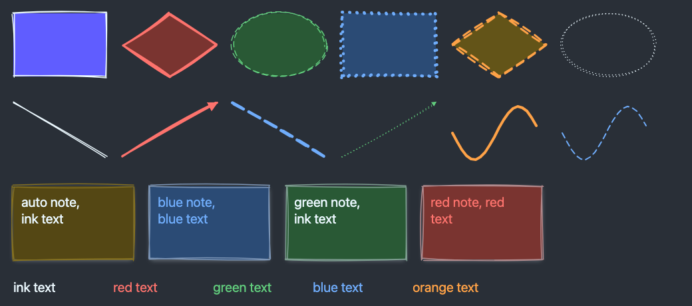

# Colours and stroke styles from a palette registry (ADR 0006, addendum D10)

*2026-10-30T07:15:55Z by Showboat 0.6.1*
<!-- showboat-id: ad08f3e7-407c-4025-98c7-71309c7f900d -->

Outcome: every element now has a stroke colour, fill colour, stroke width and stroke style, chosen from one registry of tokens (`Sketch.Canvas.Style`), never colour values. Each kind declares which properties apply to it; an inapplicable property stays at its default, enforced by Ash and by PostgreSQL. A properties bar above the canvas restyles the selected element through a new `commit_style` action, or sets the style the next element is drawn in. Every existing element keeps its look: the defaults (`ink`, `auto`, `thin`, `solid`) reproduce the old rendering, `auto` being the kind's own fill. No runtime dependency was added.

The registry, with each kind's applicable properties as the client manifest gets them:

```bash
mix run --no-start -e "for p <- Sketch.Canvas.style_properties(), do: IO.puts(\"#{p}: #{Enum.join(Sketch.Canvas.style_tokens(p), \", \")}\")" 2>&1 | tail -4; grep -oE "^  [a-z]+: \{ id.*style: \[[^]]*\]" assets/js/generated/manifest.ts | sed -E "s/: \{ id.*style: / /"
```

```output
stroke_color: ink, red, green, blue, orange
fill_color: auto, none, red, green, blue, yellow
stroke_width: thin, bold, extra_bold
stroke_style: solid, dashed, dotted
  rectangle ["stroke_color", "fill_color", "stroke_width", "stroke_style"]
  diamond ["stroke_color", "fill_color", "stroke_width", "stroke_style"]
  ellipse ["stroke_color", "fill_color", "stroke_width", "stroke_style"]
  arrow ["stroke_color", "stroke_width", "stroke_style"]
  freedraw ["stroke_color", "stroke_width", "stroke_style"]
  line ["stroke_color", "stroke_width", "stroke_style"]
  text ["stroke_color"]
  note ["stroke_color", "fill_color"]
```

The migration only adds four text columns with the defaults and eight CHECKs (expand only), generated by `mix ash.codegen` from the registry and the kind specs: one CHECK per property lists its tokens, one keeps it at its default for kinds it does not apply to. An old server keeps inserting valid rows, which the migration test checks by rolling the migration back, inserting, and migrating up.

```bash
sed -n "/def up/,/^  end/p" priv/repo/migrations/20261030064759_styling.exs | grep -E "add | IN \(" | sed -E "s/^ +//"
```

```output
add :stroke_color, :text, null: false, default: "ink"
add :fill_color, :text, null: false, default: "auto"
add :stroke_width, :text, null: false, default: "thin"
add :stroke_style, :text, null: false, default: "solid"
stroke_color IN ('ink', 'red', 'green', 'blue', 'orange')
stroke_color = 'ink' OR kind IN ('rectangle', 'diamond', 'ellipse', 'arrow', 'freedraw', 'line', 'text', 'note')
fill_color IN ('auto', 'none', 'red', 'green', 'blue', 'yellow')
fill_color = 'auto' OR kind IN ('rectangle', 'diamond', 'ellipse', 'note')
stroke_width IN ('thin', 'bold', 'extra_bold')
stroke_width = 'thin' OR kind IN ('rectangle', 'diamond', 'ellipse', 'arrow', 'freedraw', 'line')
stroke_style IN ('solid', 'dashed', 'dotted')
stroke_style = 'solid' OR kind IN ('rectangle', 'diamond', 'ellipse', 'arrow', 'freedraw', 'line')
```

`commit_style` accepts only the four style attributes and increments the version atomically, like the other two commits, and publishes the same element event:

```bash
sed -n "/update :commit_style/,/end/p;/publish :commit_style/p" lib/sketch/canvas/element.ex; grep -n "define :commit_style" lib/sketch/canvas.ex
```

```output
    update :commit_style do
      accept @style_properties
      change atomic_update(:version, expr(version + 1))
    end
    publish :commit_style, [:board_id], transform: &__MODULE__.event_payload/1
22:      define :commit_style, action: :commit_style, get_by: [:id, :board_id]
```

Server side: the style tests on Element (defaults reproduce the old look, every applicable token is stored and broadcast, Ash rejects unknown tokens and inapplicable values before the database, the CHECKs reject both in raw SQL, `commit_style` writes only the style, bumps the version and is scoped to the board), the migration test, the BoardLive style tests (the panel renders from the registry, style params are checked against it with guards, a commit restyles every view and a reload), the commit-model property with style commits, the concurrent-commit test with restyles interleaved, the kind contract, and the CSS coverage test (every colour token has a light and both dark values, every class a renderer emits is defined).

```bash
mix test test/sketch/canvas/element_style_test.exs test/sketch/canvas/element_migration_test.exs test/sketch_web/live/board_live_style_test.exs test/sketch/properties/commit_model_test.exs test/sketch/canvas/concurrent_commits_test.exs test/sketch/canvas/kind_contract_test.exs test/sketch_web/style_css_test.exs test/sketch_web/elements_test.exs --seed 0 --trace 2>&1 | grep -E "^Result"
```

```output
Result: 52 passed (2 properties, 50 tests)
```

Render parity: every fixture shape is still drawn in the default style, and three shapes per kind are also drawn in a sample of styles, every applicable token on its own plus a few combinations that change every applicable property at once (not the full product, which would multiply the file). The fixture grew from 2.3 MB to 2.9 MB. Distinct styles per kind:

```bash
mix sketch.gen.render_fixtures --check 2>&1 | grep render_parity && python3 -c "
import json, collections
d = json.load(open(\"assets/test/fixtures/render_parity.json\"))
for kind, cases in d.items():
    styles = collections.Counter(tuple(c[\"shape\"][\"style\"].values()) for c in cases)
    print(kind, len(cases), \"cases,\", len(styles), \"styles\")
"
```

```output
assets/test/fixtures/render_parity.json is up to date
rectangle 351 cases, 20 styles
diamond 351 cases, 20 styles
ellipse 351 cases, 20 styles
arrow 186 cases, 14 styles
freedraw 333 cases, 14 styles
line 186 cases, 14 styles
text 591 cases, 5 styles
note 621 cases, 15 styles
```

Client side: every client renderer matches the server for every fixture shape, seed and sampled style; the style helpers have their own fast-check properties (`style.test.ts`); then the whole assets suite.

```bash
docs/evidence/pbt-drag-share/run-ts.sh test/render_parity.test.ts test/style.test.ts | grep -E "^(✔|✖|ℹ)"; npm --prefix assets test 2>&1 | grep -E "^ℹ (pass|fail) "
```

```output
✔ the parity fixture covers every element kind (mix sketch.gen.render_fixtures)
✔ the rectangle client renderer draws the same node tree as the server renderer for every fixture shape
✔ the diamond client renderer draws the same node tree as the server renderer for every fixture shape
✔ the ellipse client renderer draws the same node tree as the server renderer for every fixture shape
✔ the arrow client renderer draws the same node tree as the server renderer for every fixture shape
✔ the freedraw client renderer draws the same node tree as the server renderer for every fixture shape
✔ the line client renderer draws the same node tree as the server renderer for every fixture shape
✔ the text client renderer draws the same node tree as the server renderer for every fixture shape
✔ the note client renderer draws the same node tree as the server renderer for every fixture shape
✔ the default style is the first token of every property (mix sketch.gen.manifest)
✔ a kind's style properties come from its generated spec, and every property applies to some kind
✔ the style for a kind keeps applicable tokens and resets the others to their default
✔ reading a style keeps known tokens and falls back to the default for anything else
✔ a solid stroke has no dash array and a dashed or dotted one always has one
ℹ tests 14
ℹ pass 14
ℹ fail 0
ℹ pass 77
ℹ fail 0
```

Playwright, two browsers, no sleeps, full suite. The new `styling.spec.ts`: A selects a rectangle and sets a red stroke, a dashed style and a blue fill from the bar; each change bumps the version, B sees the tokens, the palette classes and the dash pattern (computed by the browser as `8px, 6px`, with a stroke colour different from ink), and a reload keeps them. With the ellipse tool and nothing selected, the bar sets the next element's style (one button pressed by keyboard: focus and Enter); A's preview and B's remote preview already carry it, the committed ellipse has it, and a line drawn next keeps the colour, width and style but not the fill. The text tool offers only the stroke colour, which colours the glyphs, and restyling a selected text reaches B. `arrow.spec.ts` now expects the ink arrowhead marker (`#arrowhead-ink`).

```bash
docs/evidence/pbt-drag-share/run-e2e.sh
```

```output
57 passed
```

Mutation 1, the client maps a token to the wrong class: `mutations/client-wrong-class.patch` makes `strokeClass` in `style.ts` return `stroke-palette-red` for `orange`. It type-checks, and default-style fixture cases would not see it; the sampled styles do, so parity fails for every kind whose outline or line uses `strokeClass`. Text and notes colour their glyphs through `inkClass`, which is not mutated, and still pass.

```bash
docs/evidence/styling/mutate.sh client-wrong-class docs/evidence/styling/client-parity.sh
```

```output
✔ the parity fixture covers every element kind (mix sketch.gen.render_fixtures)
✖ the rectangle client renderer draws the same node tree as the server renderer for every fixture shape
✖ the diamond client renderer draws the same node tree as the server renderer for every fixture shape
✖ the ellipse client renderer draws the same node tree as the server renderer for every fixture shape
✖ the arrow client renderer draws the same node tree as the server renderer for every fixture shape
✖ the freedraw client renderer draws the same node tree as the server renderer for every fixture shape
✖ the line client renderer draws the same node tree as the server renderer for every fixture shape
✔ the text client renderer draws the same node tree as the server renderer for every fixture shape
✔ the note client renderer draws the same node tree as the server renderer for every fixture shape
✖ failing tests:
Mutation killed (exit 1)
```

Mutation 2a, fill accepted on a line by Ash: `mutations/ash-accepts-fill-on-line.patch` deletes the generated `attribute_equals` validations. The two Ash tests fail (the changeset for a filled line is valid, and `commit_style` no longer reports the kind), while the raw SQL CHECK test still passes: the database still refuses the row, so the two layers are tested separately.

```bash
docs/evidence/styling/mutate.sh ash-accepts-fill-on-line docs/evidence/styling/ash-fill-test.sh
```

```output
1) test style attributes (A08, ADR 0006) Ash rejects a non-default value for a property that does not apply to the kind, before the database
2) test style attributes (A08, ADR 0006) commit_style rejects a property that does not apply to the stored kind
Result: 9/11 passed
Mutation killed (exit 2)
```

Mutation 2b, fill accepted on a line by PostgreSQL: `mutations/check-accepts-fill-on-line.patch` adds `line` to the `fill_color_fits_kind` CHECK in the migration; `check-fill-test.sh` re-applies the migration to the test database (and restores it afterwards). Only the raw SQL CHECK test fails; Ash still rejects the value.

```bash
docs/evidence/styling/mutate.sh check-accepts-fill-on-line docs/evidence/styling/check-fill-test.sh
```

```output
1) test style attributes (A08, ADR 0006) the database rejects unknown tokens and inapplicable values
Result: 10/11 passed
Mutation killed (exit 2)
```

Mutation 3, `commit_style` without the version increment: `mutations/commit-style-without-version.patch` drops `atomic_update(:version, expr(version + 1))` from the action. The commit-model property fails (a style commit must broadcast and store version + 1), and so does the concurrency test (versions 1..50 with no duplicates).

```bash
docs/evidence/styling/mutate.sh commit-style-without-version docs/evidence/styling/version-test.sh
```

```output
1) property the database and the broadcasts follow a model of creates, moves, shape, text and style edits, erases, and wrong-board edits and erases (A07, A08, A09, A11, ADR 0006)
2) test concurrent moves, resizes and restyles never lose a version increment or each other's fields (A09, ADR 0006)
Result: 1/3 passed (1/2 properties, 0/1 test)
Mutation killed (exit 2)
```

The properties bar (`panel.png`, taken by the restyle test after A's three changes): swatches for stroke and background colours and segmented buttons for width and style, each a native button with `aria-pressed`, an `aria-label` and a title, grouped with `role=group` and a label. It is a fixed-height bar above the canvas rather than an overlay, so it never covers an element and never moves the canvas mid-gesture; with nothing selected and no drawing tool it shows a hint.

```bash {image}

```


A board of styled shapes (`board.exs` creates it with fixed seeds, `screenshots.mjs` photographs it): every fill, stroke colour, width and style on shapes; lines, arrows (the arrowhead follows the stroke colour) and freehand strokes; notes whose paper follows the fill and whose text takes the stroke colour; and coloured text. The first shape in each theme is the default style, identical to the look before this change. Dark mode has its own value for every colour: strokes and text lighter, fills deeper, so ink stays readable on every fill.

```bash {image}

```



```bash {image}

```



Two-browser recording (`record.sh`, Playwright video of the restyle test, slowed 3x, A left and B right): A draws a rectangle, selects it and picks a red stroke, a dashed style and a blue fill from the bar; B's copy changes with each commit.

```bash {image}

```


Every file this PR touched outside the evidence folder (A added, M modified) against `hand-drawn`. New: ADR 0006, the style registry and its four enum types, the migration and snapshot, the panel component, the client style helpers and panel class, the style tests on both sides and the E2E spec. Production dependencies are unchanged (A15 passes in `mix ci`). `architecture/rules.exs` (A08, A09, A22 text and A08's `verified_by`) is a protected file under A16.

```bash
git diff --name-status -M hand-drawn...HEAD -- . ":!docs/evidence" | sort -k2; git diff --shortstat hand-drawn...HEAD -- . ":!docs/evidence"
```

```output
M	ARCHITECTURE.md
M	architecture/rules.exs
M	assets/css/app.css
M	assets/js/elements/arrow.ts
M	assets/js/elements/diamond.ts
M	assets/js/elements/dom.ts
M	assets/js/elements/ellipse.ts
M	assets/js/elements/freedraw.ts
M	assets/js/elements/line.ts
M	assets/js/elements/note.ts
M	assets/js/elements/rectangle.ts
M	assets/js/elements/renderer.ts
M	assets/js/elements/segments.ts
A	assets/js/elements/style.ts
M	assets/js/elements/text.ts
M	assets/js/generated/manifest.ts
M	assets/js/hooks/canvas.ts
M	assets/js/hooks/selection.ts
A	assets/js/hooks/style_panel.ts
M	assets/test/fixtures/render_parity.json
A	assets/test/style.test.ts
M	docs/adr/0003-element-model.md
A	docs/adr/0006-styles-from-a-palette-registry.md
M	docs/SPEC-ADDENDUM.md
M	e2e/tests/arrow.spec.ts
A	e2e/tests/styling.spec.ts
M	lib/sketch_web/client_manifest.ex
A	lib/sketch_web/components/style_panel.ex
M	lib/sketch_web/element_renderer.ex
M	lib/sketch_web/elements.ex
M	lib/sketch_web/elements/arrow.ex
M	lib/sketch_web/elements/diamond.ex
M	lib/sketch_web/elements/ellipse.ex
M	lib/sketch_web/elements/freedraw.ex
M	lib/sketch_web/elements/line.ex
M	lib/sketch_web/elements/note.ex
M	lib/sketch_web/elements/rectangle.ex
M	lib/sketch_web/elements/text.ex
M	lib/sketch_web/live/board_live.ex
M	lib/sketch_web/render_fixtures.ex
M	lib/sketch/canvas.ex
M	lib/sketch/canvas/element.ex
M	lib/sketch/canvas/kind.ex
M	lib/sketch/canvas/kinds.ex
M	lib/sketch/canvas/kinds/arrow.ex
M	lib/sketch/canvas/kinds/diamond.ex
M	lib/sketch/canvas/kinds/ellipse.ex
M	lib/sketch/canvas/kinds/freedraw.ex
M	lib/sketch/canvas/kinds/line.ex
M	lib/sketch/canvas/kinds/note.ex
M	lib/sketch/canvas/kinds/rectangle.ex
M	lib/sketch/canvas/kinds/text.ex
A	lib/sketch/canvas/style.ex
A	lib/sketch/canvas/style/fill_color.ex
A	lib/sketch/canvas/style/stroke_color.ex
A	lib/sketch/canvas/style/stroke_style.ex
A	lib/sketch/canvas/style/stroke_width.ex
A	priv/repo/migrations/20261030064759_styling.exs
A	priv/resource_snapshots/repo/elements/20261030064800.json
M	test/sketch_web/elements_test.exs
A	test/sketch_web/live/board_live_style_test.exs
M	test/sketch_web/live/board_live_test.exs
A	test/sketch_web/style_css_test.exs
M	test/sketch/canvas/concurrent_commits_test.exs
M	test/sketch/canvas/element_migration_test.exs
A	test/sketch/canvas/element_style_test.exs
M	test/sketch/canvas/kind_contract_test.exs
M	test/sketch/properties/commit_model_test.exs
M	test/support/canvas_fixtures.ex
 69 files changed, 5701 insertions(+), 2905 deletions(-)
```
