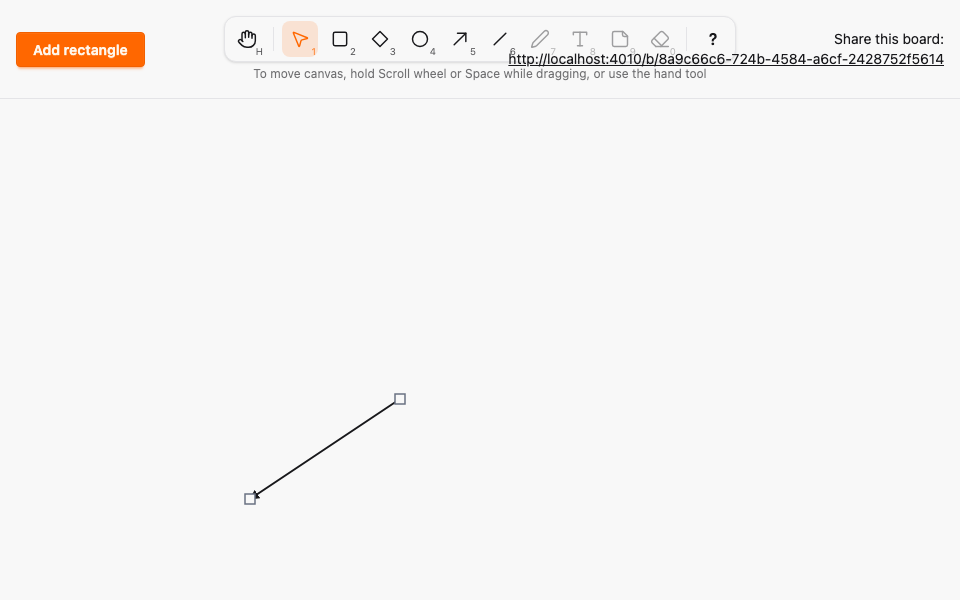

# Arrow tool

*2026-10-29T09:36:11Z by Showboat 0.6.1*
<!-- showboat-id: 17093542-0614-4c3f-9ea3-f84691995176 -->

**Outcome: the Arrow tool (A or 5) is live. An arrow is a line with an arrowhead at its second point, so the head follows the drag direction (start to end). Drawing, endpoint editing, moving, selection and hit-testing behave exactly like the line; other browsers see the dashed preview with the head too.**

What changed (small, mirroring the Line PR):

- `:arrow` is a new element kind with exactly 2 points, declared once in `Geometry` next to `:line`. Ash (`PointsFitShape`) and PostgreSQL (`points_match_kind`, `width_at_least_min`, `height_at_least_min`) both derive from it; the migration was generated by `mix ash.codegen`, not written by hand. A08 holds for arrows in both layers.
- The canvas `<defs>` holds one `<marker id="arrowhead">` filled with `base-content`, so it follows the theme like the stroke. Arrow strokes (and previews) reference it with `marker-end`; the transparent hit line has no marker.
- The toolbar button and the A/5 shortcut are enabled.

What is proven below: the properties pick up the new kind through `element_kinds()`, the TypeScript properties know A/5, a LiveView test checks the stored points and the marker, a Playwright spec draws right-to-left across two browsers, and one mutation (arrow points reversed on create, so the head lands at the wrong end) is caught.

```bash
docs/evidence/pbt-drag-share/run-tests.sh test/sketch/canvas/element_test.exs test/sketch/canvas/element_migration_test.exs --seed 1 2>&1 | grep -E '^Result'
```

```output
Result: 25 passed
```

```bash
docs/evidence/pbt-drag-share/run-tests.sh test/sketch/properties/geometry_test.exs test/sketch/properties/commit_model_test.exs --seed 1 --trace
```

```output


Sketch.Properties.CommitModelTest [test/sketch/properties/commit_model_test.exs]
  * property the database and the broadcasts follow a model of successful commits (A08, A09, A11) [L#169]

Sketch.Properties.GeometryTest [test/sketch/properties/geometry_test.exs]
  * property the default box of the next element is inside the canvas [L#186]
  * property Ash and PostgreSQL agree on every shape [L#157]
  * property the box around any two canvas points is a valid line whose points round-trip [L#163]
  * property clamp_box always yields a box inside the canvas, and keeps one already inside [L#178]
  * property PostgreSQL alone accepts a shape iff its box fits the canvas and its kind's minimum size, and its points fit the kind and the box [L#150]
  * property Ash alone accepts a shape iff its box fits the canvas and its kind's minimum size, and its points fit the kind and the box [L#143]


Result: 7 passed
```

```bash
docs/evidence/pbt-drag-share/run-ts.sh test/tools.test.ts
```

```output
✔ every enabled tool is reachable by its letter, in either case, and by its number
✔ no two tools share a key, and no tool key is reserved for Esc, ? or Space
✔ any key sequence selects the same tool as the simple binding model
✔ a key with Ctrl, Meta or Alt, or typed into an editable target, never changes the tool
✔ Esc always returns to Selection
✔ disabled tools never become active through keys or toolbar clicks
✔ the middle button, Space and Hand pan; Rectangle, Diamond, Ellipse, Arrow and Line draw; Selection resizes, moves or deselects
✔ panning scrolls by exactly the opposite of the pointer movement
ℹ tests 8
ℹ pass 8
ℹ fail 0
```

```bash
docs/evidence/pbt-drag-share/run-tests.sh test/sketch_web/live/board_live_test.exs --seed 1 --trace --only describe:lines 2>&1 | grep -E '^  \* test lines a drawn arrow|^Result'
```

```output
  * test lines a drawn arrow keeps its start and end and renders an arrowhead on the end [L#289]
Result: 7 passed, 13 excluded
```

```bash
docs/evidence/pbt-drag-share/run-e2e.sh arrow shortcuts --repeat-each=3
```

```output
24 passed
```

`mutations/arrow-points-reversed.patch` reverses an arrow's points when it is created, so the head is at the start instead of the end. The LiveView test fails with the stored points reversed relative to the drag:

```bash
docs/evidence/tool-arrow/mutate.sh arrow-points-reversed docs/evidence/pbt-drag-share/run-tests.sh test/sketch_web/live/board_live_test.exs --seed 1 --only describe:lines 2>&1 | grep -E 'Assertion|code:|left:|right:|^Result|Mutation'
```

```output
     Assertion with == failed
     code:  assert Enum.map(arrow.points, &{&1.x, &1.y}) == [{200, 80}, {0, 0}]
     left:  [{0, 0}, {200, 80}]
     right: [{200, 80}, {0, 0}]
Result: 6/7 passed, 13 excluded
Mutation killed (exit 2)
```

Browser A after dragging the head endpoint of an arrow drawn right-to-left, then the two-browser recording: A (left) draws, edits the head and reloads while B (right) mirrors every step. The GIF is Playwright video, slowed 4x.

```bash {image}

```



```bash {image}

```


