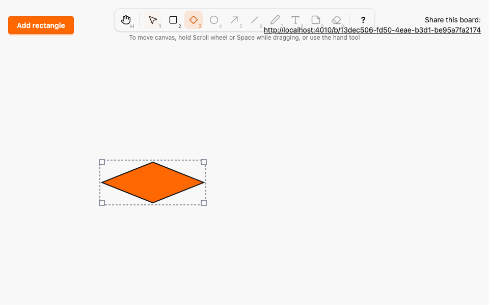
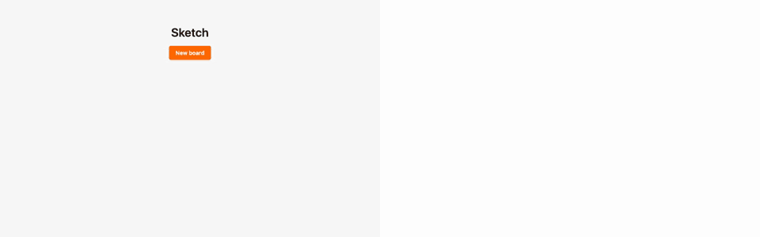

# Diamond tool

*2026-10-29T05:37:16Z by Showboat 0.6.1*
<!-- showboat-id: 708cf144-3a9b-4384-9140-55683255d0f3 -->

**Outcome: the Diamond tool (D or 3) is live. Dragging in any direction draws a diamond, a click makes the default 120 x 80 one, and other browsers see a dashed diamond preview while it is drawn. A diamond is a box element of kind `diamond`, rendered as an SVG `polygon` whose points are the midpoints of its box edges. Selecting, moving and resizing work exactly as for rectangles, and kind and box persist across reload. No migration is needed: `kind` is a text column and the allowed values live in the Ash `one_of` constraint (`mix ash.codegen --check` is clean).**

What is proven below:

1. Box invariant for both kinds. Ash alone and PostgreSQL alone each accept a box of either kind iff it is at least 1 x 1 and inside the canvas.
2. Kind is preserved. Random sequences of `commit_position` and `commit_shape` over a mix of rectangles and diamonds match a model that includes `kind`, in stored rows and in broadcasts.
3. The keymap model (fast-check) treats D and 3 as enabled, and Diamond draws like Rectangle.
4. Two real browsers (Playwright, `--repeat-each=3`): D, drag to draw, B sees a dashed `polygon` preview, then the committed `polygon` with the right box and points; select and resize (B sees the new size before release); reload keeps kind and box; Esc cancels; a click creates the default size.
5. A mutation that drops the kind from the create path is caught.

Hit-testing is the browser default for SVG: a click selects the diamond when it lands on the rhombus, not in the empty corners of its box. The selection outline and handles use the box.

```bash
docs/evidence/pbt-drag-share/run-tests.sh test/sketch/properties/geometry_test.exs test/sketch/properties/commit_model_test.exs --seed 1 --trace
```

```output


Sketch.Properties.CommitModelTest [test/sketch/properties/commit_model_test.exs]
  * property the database and the broadcasts follow a model of successful commits (A08, A09, A11) [L#112]

Sketch.Properties.GeometryTest [test/sketch/properties/geometry_test.exs]
  * property clamp_box always yields a box inside the canvas, and keeps one already inside [L#99]
  * property the default box of the next element is inside the canvas [L#107]
  * property PostgreSQL alone accepts a box of any kind iff it is at least 1 x 1 and inside the canvas [L#92]
  * property Ash alone accepts a box of any kind iff it is at least 1 x 1 and inside the canvas [L#83]


Result: 5 passed
```

```bash
docs/evidence/pbt-drag-share/run-ts.sh test/tools.test.ts
```

```output
✔ every enabled tool is reachable by its letter, in either case, and by its number
✔ no two tools share a key, and no tool key is reserved for Esc, ? or Space
✔ any key sequence selects the same tool as the simple binding model
✔ a key with Ctrl, Meta or Alt, or typed into an editable target, never changes the tool
✔ Esc always returns to Selection
✔ disabled tools never become active through keys or toolbar clicks
✔ the middle button, Space and Hand pan; Rectangle and Diamond draw; Selection resizes, moves or deselects
✔ panning scrolls by exactly the opposite of the pointer movement
ℹ tests 8
ℹ pass 8
ℹ fail 0
```

```bash
docs/evidence/pbt-drag-share/run-e2e.sh diamond shortcuts --repeat-each=3
```

```output
27 passed
```

## Mutation check

`mutations/create-drops-kind.patch` makes the server create every drawn element as a rectangle, as if `kind` were dropped from the create payload. The Diamond spec then fails because the element is no longer a `polygon`. The patch is reverted by the trap afterwards.

```bash
docs/evidence/tool-diamond/mutate.sh create-drops-kind docs/evidence/pbt-drag-share/run-e2e.sh diamond -g "A draws and resizes"
```

```output
1 failed
Mutation killed (exit 1)
```

## Evidence images

Browser A with the diamond selected (outline and four corner handles), then the two-browser recording: A (left) draws a diamond while B (right) shows the dashed preview, then A selects it and resizes it from the bottom-right corner, and B mirrors each step. The GIF is Playwright video, slowed 4x.

```bash {image}

```



```bash {image}

```


