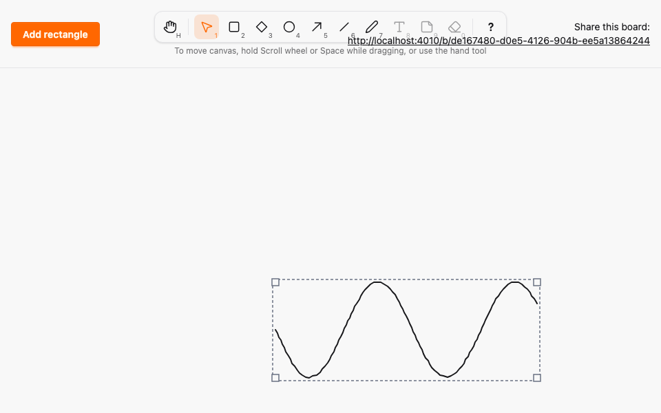

# Freehand draw tool

*2026-10-29T09:59:18Z by Showboat 0.6.1*
<!-- showboat-id: ed3931a1-8995-49f3-bdaa-81d2104a670f -->

**Outcome: the Draw tool (P or 7) is live. Press and drag to draw a freehand stroke; other browsers watch it grow before you let go, and the finished stroke can be moved and box-resized, and survives a reload.**

What changed (small, mirroring the Line and Arrow PRs):

- `:freedraw` is a point kind with 2 to 500 points, declared once in `Geometry` (`@max_freedraw_points 500`). Ash (`PointsFitShape`, attribute `max_length`) and PostgreSQL (`points_match_kind`, `points_within_box`, minimum sizes) both derive from it; the migration was generated by `mix ash.codegen`. A08 holds for strokes in both layers.
- `canvas_logic.ts` has two pure helpers: `thinStroke` drops a point closer than 4 px to the previous kept one, always keeps the first and last, and widens the spacing until the stroke fits the maximum; `scalePoints` rescales relative points when the box is resized. `canvas.ts` thins incrementally while the pointer moves, so the preview and the committed points are the same list.
- Previews reuse `draw_preview` and its 20/s throttle with the current thinned list; they are never persisted (A10). A click without movement, Esc and pointercancel create nothing.
- A stroke renders as a `<g>` with a wide transparent hit `<polyline>` and a round-joined, round-capped stroke `<polyline>`. Selecting it shows the box outline with corner handles; moving and resizing scale the points proportionally, with no per-point editing.

What is proven below: the Elixir properties pick up `:freedraw` through `element_kinds()` and compare Ash and raw SQL, including strokes above 500 points and outside the box; TypeScript properties cover thinning and scaling; LiveView tests cover create, broadcast and resize; a Playwright spec draws a curve across two browsers; and one mutation (thinning drops the last point) is caught.

```bash
docs/evidence/pbt-drag-share/run-tests.sh test/sketch/canvas/element_test.exs test/sketch/canvas/element_migration_test.exs --seed 1 2>&1 | grep -E "^Result"
```

```output
Result: 26 passed
```

```bash
docs/evidence/pbt-drag-share/run-tests.sh test/sketch/properties/geometry_test.exs test/sketch/properties/commit_model_test.exs --seed 1 --trace
```

```output


Sketch.Properties.CommitModelTest [test/sketch/properties/commit_model_test.exs]
  * property the database and the broadcasts follow a model of successful commits (A08, A09, A11) [L#170]

Sketch.Properties.GeometryTest [test/sketch/properties/geometry_test.exs]
  * property the default box of the next element is inside the canvas [L#205]
  * property Ash and PostgreSQL agree on every shape [L#176]
  * property the box around any two canvas points is a valid line whose points round-trip [L#182]
  * property clamp_box always yields a box inside the canvas, and keeps one already inside [L#197]
  * property PostgreSQL alone accepts a shape iff its box fits the canvas and its kind's minimum size, and its points fit the kind and the box [L#169]
  * property Ash alone accepts a shape iff its box fits the canvas and its kind's minimum size, and its points fit the kind and the box [L#162]


Result: 7 passed
```

```bash
docs/evidence/pbt-drag-share/run-ts.sh test/freedraw_geometry.test.ts test/tools.test.ts
```

```output
✔ thinning keeps the first and last points
✔ thinning never exceeds the maximum and keeps at least two points
✔ thinning leaves every original point within the distance of a kept point
✔ thinning is idempotent
✔ thinning keeps a lone point
✔ scalePoints keeps the points inside the new box
✔ scalePoints round-trips for an identity scale
✔ every enabled tool is reachable by its letter, in either case, and by its number
✔ no two tools share a key, and no tool key is reserved for Esc, ? or Space
✔ any key sequence selects the same tool as the simple binding model
✔ a key with Ctrl, Meta or Alt, or typed into an editable target, never changes the tool
✔ Esc always returns to Selection
✔ disabled tools never become active through keys or toolbar clicks
✔ the middle button, Space and Hand pan; Rectangle, Diamond, Ellipse, Arrow, Draw and Line draw; Selection resizes, moves or deselects
✔ panning scrolls by exactly the opposite of the pointer movement
ℹ tests 15
ℹ pass 15
ℹ fail 0
```

```bash
docs/evidence/pbt-drag-share/run-tests.sh test/sketch_web/live/board_live_test.exs --seed 1 --trace --only describe:"freehand strokes" 2>&1 | grep -E "^  \* test freehand|^Result"
```

```output
  * test freehand strokes a stroke with too few, too many or malformed points creates nothing [L#491]
  * test freehand strokes a drawn stroke is stored with its relative points and rendered in every view [L#466]
  * test freehand strokes resizing a stroke commits the scaled points and every view renders them [L#540]
  * test freehand strokes a stroke preview grows in other views and is never persisted [L#510]
Result: 4 passed, 20 excluded
```

```bash
docs/evidence/pbt-drag-share/run-e2e.sh draw shortcuts --repeat-each=3
```

```output
24 passed
```

`mutations/thinning-drops-last-point.patch` makes the thinning helper return only the interior points it kept, so the stroke loses the point under the pointer when it is released. The first-and-last property fails, and fast-check shrinks the counterexample to the smallest stroke:

```bash
docs/evidence/tool-draw/mutate.sh thinning-drops-last-point docs/evidence/pbt-drag-share/run-ts.sh test/freedraw_geometry.test.ts 2>&1 | grep -E "^(✖|ℹ (pass|fail))|Counterexample|Shrunk|Mutation"
```

```output
✖ thinning keeps the first and last points
✖ thinning never exceeds the maximum and keeps at least two points
✖ thinning leaves every original point within the distance of a kept point
✖ thinning is idempotent
ℹ pass 3
ℹ fail 4
✖ failing tests:
✖ thinning keeps the first and last points
  Counterexample: [[{"x":0,"y":0},{__proto__:null,"x":0,"y":0}],2]
  Shrunk 7 time(s)
✖ thinning never exceeds the maximum and keeps at least two points
  Counterexample: [[{"x":0,"y":0},{"x":0,"y":0}],2]
  Shrunk 8 time(s)
✖ thinning leaves every original point within the distance of a kept point
  Counterexample: [[{"x":0,"y":0},{"x":0,"y":4}]]
  Shrunk 14 time(s)
✖ thinning is idempotent
  Counterexample: [[{"x":0,"y":0},{"x":0,"y":4},{"x":0,"y":0}],2]
  Shrunk 16 time(s)
Mutation killed (exit 1)
```

Browser A after drawing a squiggle, moving it and resizing it by the south-east handle (the box outline and corner handles show the selection), then the two-browser recording: A (left) draws while B (right) watches the stroke grow, then A moves and resizes it. The GIF is Playwright video, slowed 3x.

```bash {image}

```



```bash {image}

```


