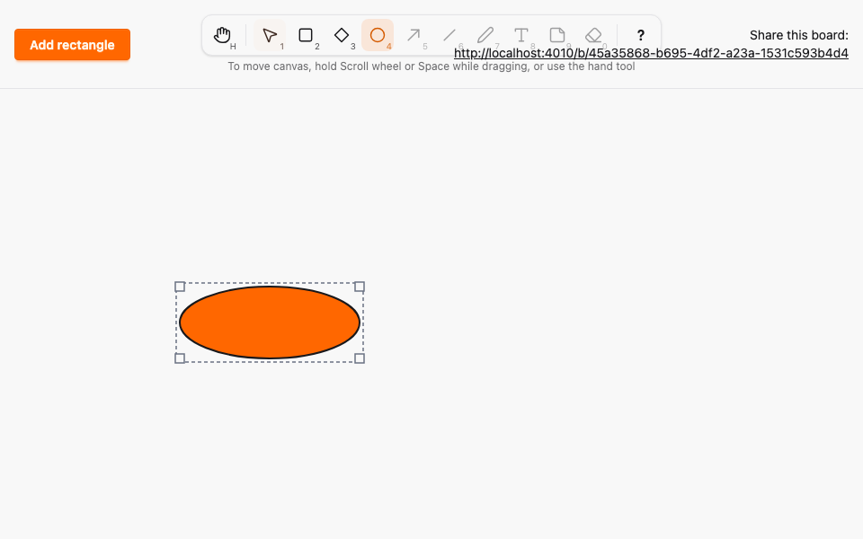

# Ellipse tool

*2026-10-29T08:25:40Z by Showboat 0.6.1*
<!-- showboat-id: 2e6e7713-5247-4327-9311-7ec4c2ebabc1 -->

**Outcome: the Ellipse tool (O or 4) is live. Dragging in any direction draws an ellipse, a click makes the default 120 x 80 one, and other browsers see a dashed ellipse preview while it is drawn. An ellipse is a box element of kind `ellipse`, rendered as an SVG `ellipse` inscribed in its box: cx and cy at the box centre, rx and ry half the width and height. Selecting, moving and resizing work exactly as for rectangles and diamonds, and kind and box persist across reload. No migration is needed: `kind` is a text column and the allowed values live in the Ash `one_of` constraint (`mix ash.codegen --check` is clean).**

What is proven below:

1. Box invariant for all kinds. Ash alone and PostgreSQL alone each accept a box of any kind iff it is at least 1 x 1 and inside the canvas.
2. Kind is preserved. Random sequences of `commit_position` and `commit_shape` over a mix of element kinds match a model that includes `kind`, in stored rows and in broadcasts.
3. The keymap model (fast-check) treats O and 4 as enabled, and Ellipse draws like Rectangle and Diamond.
4. Two real browsers (Playwright, `--repeat-each=3`): O, drag to draw, B sees a dashed `ellipse` preview, then the committed `ellipse` with matching cx, cy, rx and ry; select and resize (B sees the new size before release); reload keeps kind and box; Esc cancels; a click creates the default size; a click in the box corner outside the ellipse does not select it.
5. A mutation that makes rx use the full width is caught.

Hit-testing is the browser default for SVG: a click selects the ellipse only when it lands on the ellipse, not in the empty corners of its box. The selection outline and handles use the box.

```bash
docs/evidence/pbt-drag-share/run-tests.sh test/sketch/properties/geometry_test.exs test/sketch/properties/commit_model_test.exs --seed 1 --trace
```

```output


Sketch.Properties.CommitModelTest [test/sketch/properties/commit_model_test.exs]
  * property the database and the broadcasts follow a model of successful commits (A08, A09, A11) [L#112]

Sketch.Properties.GeometryTest [test/sketch/properties/geometry_test.exs]
  * property clamp_box always yields a box inside the canvas, and keeps one already inside [L#99]
  * property the default box of the next element is inside the canvas [L#107]
  * property PostgreSQL alone accepts a box of any kind iff it is at least 1 x 1 and inside the canvas [L#92]
  * property Ash alone accepts a box of any kind iff it is at least 1 x 1 and inside the canvas [L#83]


Result: 5 passed
```

```bash
docs/evidence/pbt-drag-share/run-ts.sh test/tools.test.ts
```

```output
✔ every enabled tool is reachable by its letter, in either case, and by its number
✔ no two tools share a key, and no tool key is reserved for Esc, ? or Space
✔ any key sequence selects the same tool as the simple binding model
✔ a key with Ctrl, Meta or Alt, or typed into an editable target, never changes the tool
✔ Esc always returns to Selection
✔ disabled tools never become active through keys or toolbar clicks
✔ the middle button, Space and Hand pan; Rectangle, Diamond and Ellipse draw; Selection resizes, moves or deselects
✔ panning scrolls by exactly the opposite of the pointer movement
ℹ tests 8
ℹ pass 8
ℹ fail 0
```

```bash
docs/evidence/pbt-drag-share/run-e2e.sh ellipse shortcuts --repeat-each=3
```

```output
30 passed
```

## Mutation check

`mutations/rx-uses-full-width.patch` makes the client set rx to the full box width instead of half, as if the ellipse were not inscribed in its box. The Ellipse spec fails because B's preview and the committed geometry no longer match. The patch is reverted by the trap afterwards.

```bash
docs/evidence/tool-ellipse/mutate.sh rx-uses-full-width docs/evidence/pbt-drag-share/run-e2e.sh ellipse -g "A draws and resizes"
```

```output
1 failed
Mutation killed (exit 1)
```

## Evidence images

Browser A with the ellipse selected (outline and four corner handles), then the two-browser recording: A (left) draws an ellipse while B (right) shows the dashed preview, then A selects it and resizes it from the bottom-right corner, and B mirrors each step. The GIF is Playwright video, slowed 4x.

```bash {image}

```



```bash {image}

```


