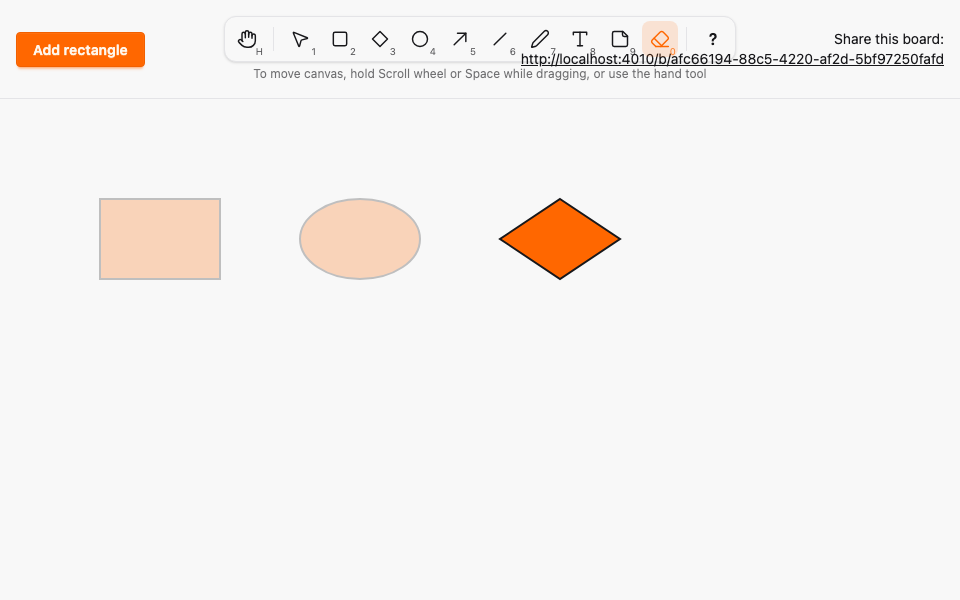

# Eraser tool and deleting elements

*2026-10-29T17:18:37Z by Showboat 0.6.1*
<!-- showboat-id: 7a6d0424-9be7-4474-a7f1-ccc9914a5e44 -->

**Outcome: the Eraser (E or 0) is live. Click an element to erase it, or drag across several: each one the pointer passes over fades, and releasing erases them for everyone. Esc cancels the pending set. With Selection, Delete or Backspace erases the selected element, but not while a text or note editor has focus. Erases survive a reload, and an erase always wins: no late or reordered create, commit or drag preview can bring an erased element back.**

How it works:

- `erase` is an Ash `destroy` on `Element` (a hard delete), exposed as `Sketch.Canvas.erase_element(id, board_id)` with `get_by: [:id, :board_id]` like `commit_position`. An element on another board is not found, so the erase fails and nothing is published (A07). `Ash.Notifier.PubSub` publishes `erase` with `%{id, board_id}` on the board topic only after the transaction commits (A11). No migration was needed.
- Merge semantics (ADR 0001, addendum D0): an erase is a tombstone. `BoardState` records erased ids, removes the element and ignores every create or commit for that id, whether it arrives before or after the erase. The state is the highest version per element that was never erased, so it is order-independent, idempotent and convergent.
- In PostgreSQL a commit for an erased element finds no row, fails and publishes nothing. The LiveView drops a commit for an id it already knows is erased, without a flash or a revert. It also pushes `erased` to the hook, which drops remote previews of that id in `RemotePreviews` and ends a local drag of it without committing.
- The pure helper `eraserHits(elements, path)` in `canvas_logic.ts` returns the elements whose bounding box the pointer path touches (Liang-Barsky clipping per segment, edges included, a single point for a click). Pointer handling stays in `canvas.ts` (A13).

The Ash tests: a successful erase deletes the row and broadcasts `{id, board_id}`; an erase from another board, or one rolled back with its transaction, keeps the element and broadcasts nothing.

```bash
docs/evidence/pbt-drag-share/run-tests.sh test/sketch/canvas/element_test.exs --seed 1 --trace --only describe:"erase (A07, A11)" 2>&1 | grep -E "^  \* test erase|^Result"
```

```output
  * test erase (A07, A11) an erase from another board fails, keeps the element and broadcasts nothing [L#526]
  * test erase (A07, A11) hard-deletes the element and broadcasts its id and board after commit [L#515]
  * test erase (A07, A11) an erase rolled back with its transaction keeps the element and broadcasts nothing [L#541]
Result: 3 passed, 34 excluded
```

The LiveView tests: the eraser event erases every listed element in both views and the database, Delete's single id reaches a second view, a repeated or concurrent erase broadcasts once, another board's element cannot be erased, malformed params change nothing, a commit for an erased element is dropped without a flash, revert or broadcast, and a late create or commit broadcast never brings the element back.

```bash
docs/evidence/pbt-drag-share/run-tests.sh test/sketch_web/live/board_live_erase_test.exs --seed 1 --trace 2>&1 | grep -E "^  \* test|^Result"
```

```output
  * test a commit for an erased element is dropped without a flash, a revert or a broadcast [L#104]
  * test erasing the same element twice or from two views erases it once [L#60]
  * test a create or commit delivered after the erase never brings the element back [L#127]
  * test an element of another board cannot be erased and nobody is told about it [L#73]
  * test malformed erase params change nothing [L#93]
  * test Delete erases the one selected element and a second view sees it go [L#50]
  * test the eraser erases every element it passed over, in every view and the database [L#32]
Result: 7 passed
```

The merge properties extend PR #7's CRDT suite (500 runs each). Generated event lists now mix creates, commits and erases over four ids. Every delivery order gives the same state, an event applied twice changes nothing, the state is the highest version per id that was never erased, every erased id is absent and remembered in every order, a create or commit after an erase never resurrects the element, and two replicas that saw disjoint halves converge.

```bash
docs/evidence/pbt-drag-share/run-tests.sh test/sketch/properties/lww_merge_test.exs --seed 1 --trace 2>&1 | grep -E "^  \* property|^Result"
```

```output
  * property an event older than the known version never changes the state [L#121]
  * property the state per element is its highest-version event, whichever action produced it, unless it was erased [L#85]
  * property two replicas that saw disjoint halves converge in either merge order, erases included [L#142]
  * property every erased id is absent and remembered in every delivery order [L#91]
  * property a create or commit delivered after an erase never resurrects the element [L#101]
  * property applying an event twice equals applying it once [L#76]
  * property every delivery order of the same events, erases included, yields the same state [L#70]
Result: 7 passed
```

The model property drives random sequences of creates, moves, shape and text edits, erases and wrong-board erases against PostgreSQL. After every step the rows equal the model, and the broadcasts equal exactly the successful operations, each on its own board. A commit on an erased element must fail. A second property erases one element of each kind and then tries commits and erases on it: all fail, nothing is broadcast and the row stays gone.

```bash
docs/evidence/pbt-drag-share/run-tests.sh test/sketch/properties/commit_model_test.exs --seed 1 --trace 2>&1 | grep -E "^  \* property|^Result"
```

```output
  * property a commit or erase after an erase fails, broadcasts nothing and leaves the row gone (A11) [L#280]
  * property the database and the broadcasts follow a model of creates, moves, shape and text edits, erases, and wrong-board edits and erases (A07, A08, A09, A11) [L#252]
Result: 2 passed
```

The TypeScript properties (fast-check). `eraserHits` is checked against an independent exact oracle built from integer orientation tests: a segment touches a box iff an endpoint lies inside it or it crosses one of the four edges. It returns exactly those elements, in order, for paths of one to six points and boxes that may be zero wide or tall (lines). A click hits exactly the boxes containing it, a segment's hit ignores its direction, and a longer path never hits fewer elements. `RemotePreviews` never accepts a preview of an erased element again, whatever its seq or base version, leaves other elements' previews untouched, and reports nothing to revert for an erased element's drag. The tools properties now include E and 0 for the Eraser, and Delete or Backspace erase only as plain keys outside an editable target.

```bash
docs/evidence/pbt-drag-share/run-ts.sh test/eraser_hits.test.ts test/remote_previews.test.ts test/tools.test.ts
```

```output
✔ the eraser hits exactly the elements whose bounding box the path touches, in element order
✔ a click hits exactly the boxes containing the point, edges included
✔ a segment's hit does not depend on its direction, and a longer path never hits fewer elements
✔ a segment crossing a zero-width line's box hits it, and one passing beside it does not
✔ any delivery order applies the highest-seq current preview of each drag
✔ a preview based on an older version than the known one never applies
✔ drag_cancel returns to the committed position and ends that drag
✔ re-delivering a preview is a no-op
✔ after an erase, no preview of that element is ever accepted, and other elements are unaffected
✔ finishing a drag of an erased element reports nothing to revert
✔ every enabled tool is reachable by its letter, in either case, and by its number
✔ no two tools share a key, and no tool key is reserved for Esc, ? or Space
✔ any key sequence selects the same tool as the simple binding model
✔ a key with Ctrl, Meta or Alt, or typed into an editable target, never changes the tool
✔ Esc always returns to Selection
✔ every tool is enabled, and keys or toolbar clicks only ever select an enabled tool
✔ Delete and Backspace erase the selection only as plain keys outside an editable target
✔ the middle button, Space and Hand pan; Rectangle, Diamond, Ellipse, Arrow, Draw, Line and Note draw; Text opens the editor; Eraser erases; Selection resizes, moves or deselects
✔ panning scrolls by exactly the opposite of the pointer movement
✔ lines and arrows get endpoint handles, text gets none and every other kind gets corners
ℹ tests 20
ℹ pass 20
ℹ fail 0
```

The Playwright spec `e2e/tests/eraser.spec.ts` uses two browsers and no sleeps. A draws a rectangle, an ellipse and a diamond, presses E and drags across the first two: only those two fade, on A only, and on release B sees both disappear while the diamond stays. A starts another drag over the diamond with 0 and presses Esc: the fade clears and the diamond stays, also after B reloads. A selects the diamond and presses Delete; B sees it go and both reloads show an empty board. A second test types into a note and presses Backspace inside the editor, which only edits the text; Backspace on the selected note then erases it. A third test has B erase the rectangle A is dragging: A's element disappears mid-drag, A's release brings nothing back and shows no error, and both browsers converge to an empty board, also after reloading. The shortcuts spec now expects E and 0 to select the Eraser and the help panel to list Delete and Backspace. Run three times each:

```bash
docs/evidence/pbt-drag-share/run-e2e.sh eraser shortcuts --repeat-each=3
```

```output
27 passed
```

Mutation 1: `mutations/late-create-resurrects.patch` lets a versioned event through for an erased id, as if the tombstone only blocked repeated erases. All seven merge properties fail. The resurrection property shrinks to the smallest counterexample: no prior events, id `a`, and one late create of `a` at version 0.

```bash
docs/evidence/tool-eraser/mutate.sh late-create-resurrects docs/evidence/pbt-drag-share/run-tests.sh test/sketch/properties/lww_merge_test.exs --seed 1 2>&1 | grep -E "^  [0-9]+\) property|^Result|Mutation" | sed -E "s/ \(Sketch.Properties.LwwMergeTest\)//"; docs/evidence/tool-eraser/mutate.sh late-create-resurrects docs/evidence/pbt-drag-share/run-tests.sh test/sketch/properties/lww_merge_test.exs:101 --seed 1 2>&1 | grep -E "Failed with|Clause|Generated" | sed -E "s/^ +//"
```

```output
  1) property an event older than the known version never changes the state
  2) property the state per element is its highest-version event, whichever action produced it, unless it was erased
  3) property two replicas that saw disjoint halves converge in either merge order, erases included
  4) property every erased id is absent and remembered in every delivery order
  5) property a create or commit delivered after an erase never resurrects the element
  6) property applying an event twice equals applying it once
  7) property every delivery order of the same events, erases included, yields the same state
Result: 0/7 passed
Mutation killed (exit 2)
Failed with generated values (after 3 successful runs):
* Clause:    events <- events()
Generated: []
* Clause:    id <- member_of(~w(a b c d))
Generated: "a"
* Clause:    late <-
Generated: [%{id: "a", version: 0, x: 0, y: 0, text: "", width: 0, kind: :rectangle, points: [], height: 0}]
```

Mutation 2: `mutations/erase-broadcasts-before-commit.patch` makes the LiveView broadcast `erase` itself before calling the Ash action, so the notification goes out before the delete commits and even when it fails (A11). The LiveView tests catch both: a repeated erase is announced twice, and an erase of another board's element, which fails, still tells the viewer to drop it.

```bash
docs/evidence/tool-eraser/mutate.sh erase-broadcasts-before-commit docs/evidence/pbt-drag-share/run-tests.sh test/sketch_web/live/board_live_erase_test.exs --seed 1 2>&1 | grep -E "^  [0-9]+\) test|code:|^Result|Mutation" | sed -E "s/ \(SketchWeb.BoardLiveEraseTest\)//"
```

```output
  1) test erasing the same element twice or from two views erases it once
     code: refute_receive %Broadcast{event: "erase"}, 100
  2) test an element of another board cannot be erased and nobody is told about it
     code: refute_push_event(ctx.eraser, "erased", %{})
Result: 5/7 passed
Mutation killed (exit 2)
```

Browser A in the middle of an eraser drag: the rectangle and the ellipse it passed over are faded, the diamond is untouched and the Eraser button is pressed. Then the two-browser recording (half speed): A (left) draws three shapes, drags the eraser across two and B (right) sees them vanish on release; A starts erasing the diamond, presses Esc to keep it, then selects it and presses Delete, and both boards end empty.

```bash {image}

```



```bash {image}

```


