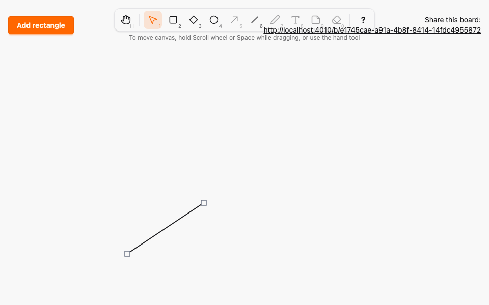
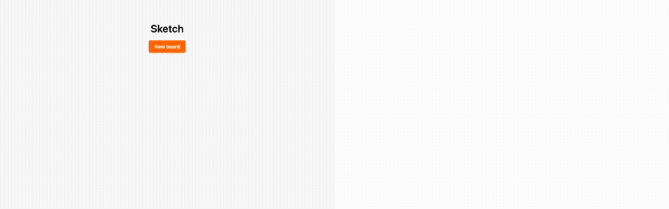

# Line tool and element points

*2026-10-29T09:11:17Z by Showboat 0.6.1*
<!-- showboat-id: 712fae92-28ef-42cd-83b5-5256b8625427 -->

**Outcome: the Line tool (L or 6) is live, and lines are the first element with points. Dragging in any direction draws a two-point line that other browsers see as a dashed preview while it is drawn; a click with L creates nothing; Esc cancels. With Selection, clicking a line selects it and shows a handle on each endpoint. Dragging an endpoint previews live and commits through `commit_shape`; dragging the body moves the line through `commit_position`, and the points move with it because they are relative to the box.**

Schema change (ADR 0003):

- `Element.points` is an array of the new embedded resource `Sketch.Canvas.Point` (`x`, `y` integers), relative to the element's `x`/`y`. It is stored as `jsonb[]`, the AshPostgres default for an array of embeds; a single `jsonb` column fails inside atomic updates, which cast the value to `jsonb[]`. Existing rows get `{}` from the column default.
- A line has exactly 2 points, box kinds have none, and every point lies inside `[0, width] x [0, height]`. Ash enforces this with the atomic `PointsFitShape` validation; PostgreSQL with the CHECK constraints `points_match_kind` and `points_within_box`. Counts and bounds come from `Sketch.Canvas.Geometry`.
- The minimum size is per kind: box kinds keep `width, height >= 1`, point kinds allow 0, because a horizontal or vertical line has a flat box. Ash (attribute `min: 0` plus a `compare` validation for box kinds) and the CHECKs `width_at_least_min`/`height_at_least_min` change together. Bounds still hold, so A08 is not weakened.
- `commit_shape` now takes the box and points together; a size change without points is rejected.

What is proven below:

1. The CHECKs exist in PostgreSQL 18 and reject malformed or misplaced points. `points_within_box` uses `array_to_json` and `jsonb_build_object`, which PostgreSQL declares STABLE because they are generic over element types, so the CHECK is accepted but is not formally IMMUTABLE. Over `jsonb[]` input they are deterministic.
2. Ash alone and PostgreSQL alone each match one model of a valid shape (box, per-kind minimum size, point count, well-formed integer points inside the box) for random kinds, boxes and points inside, on and outside the box, with 0 to 4 points; a third property checks they agree directly.
3. Random `commit_position` and `commit_shape` sequences over five elements (two of them lines) match a pure model in stored rows and broadcasts; merge properties still hold with points in the events.
4. fast-check: the box around two points is inside the canvas and tightly contains both, relative points round-trip, and moving an endpoint lands it at the clamped pointer while the other endpoint stays put.
5. LiveView: line create (including server-side clamping), rejected malformed points, draw previews, endpoint commit and broadcasts.
6. Two real browsers (Playwright, `--repeat-each=3`): draw, endpoint edit, move and reload; lines in four directions including flat ones; click creates nothing; Esc cancels.
7. Three mutations are caught: the DB CHECK ignoring y, the shared inside-the-box check using width for y, and an endpoint move that keeps the old box.

```bash
PGPASSWORD=postgres psql -h 127.0.0.1 -U postgres -d sketch_test -At -c "SELECT conname FROM pg_constraint WHERE conrelid = 'elements'::regclass AND contype = 'c' ORDER BY conname" -c "SELECT proname, provolatile FROM pg_proc WHERE proname IN ('jsonb_path_exists', 'array_to_json', 'jsonb_build_object', 'cardinality') GROUP BY proname, provolatile ORDER BY proname"
```

```output
height_at_least_min
points_match_kind
points_within_box
version_not_negative
width_at_least_min
x_within_canvas
y_within_canvas
array_to_json|s
cardinality|i
jsonb_build_object|s
jsonb_path_exists|i
```

```bash
docs/evidence/pbt-drag-share/run-tests.sh test/sketch/canvas/element_test.exs test/sketch/canvas/element_migration_test.exs --seed 1 2>&1 | grep -E "^Result"
```

```output
Result: 24 passed
```

```bash
docs/evidence/pbt-drag-share/run-tests.sh test/sketch/properties/geometry_test.exs test/sketch/properties/commit_model_test.exs test/sketch/properties/lww_merge_test.exs --seed 1 --trace
```

```output


Sketch.Properties.CommitModelTest [test/sketch/properties/commit_model_test.exs]
  * property the database and the broadcasts follow a model of successful commits (A08, A09, A11) [L#169]

Sketch.Properties.LwwMergeTest [test/sketch/properties/lww_merge_test.exs]
  * property the state per element is its highest-version event, whichever action produced it [L#67]
  * property an event older than the known version never changes the state [L#73]
  * property two replicas that saw disjoint halves converge in either merge order [L#88]
  * property applying an event twice equals applying it once [L#58]
  * property every delivery order of the same events yields the same state [L#52]

Sketch.Properties.GeometryTest [test/sketch/properties/geometry_test.exs]
  * property the default box of the next element is inside the canvas [L#186]
  * property Ash and PostgreSQL agree on every shape [L#157]
  * property the box around any two canvas points is a valid line whose points round-trip [L#163]
  * property clamp_box always yields a box inside the canvas, and keeps one already inside [L#178]
  * property PostgreSQL alone accepts a shape iff its box fits the canvas and its kind's minimum size, and its points fit the kind and the box [L#150]
  * property Ash alone accepts a shape iff its box fits the canvas and its kind's minimum size, and its points fit the kind and the box [L#143]


Result: 12 passed
```

```bash
docs/evidence/pbt-drag-share/run-ts.sh test/line_geometry.test.ts test/tools.test.ts
```

```output
✔ the box around two points is inside the canvas and tightly contains both points
✔ relative points round-trip to the clamped canvas points they were drawn from
✔ moving an endpoint puts it at the clamped pointer and leaves the other endpoint where it was
✔ every enabled tool is reachable by its letter, in either case, and by its number
✔ no two tools share a key, and no tool key is reserved for Esc, ? or Space
✔ any key sequence selects the same tool as the simple binding model
✔ a key with Ctrl, Meta or Alt, or typed into an editable target, never changes the tool
✔ Esc always returns to Selection
✔ disabled tools never become active through keys or toolbar clicks
✔ the middle button, Space and Hand pan; Rectangle, Diamond, Ellipse and Line draw; Selection resizes, moves or deselects
✔ panning scrolls by exactly the opposite of the pointer movement
ℹ tests 11
ℹ pass 11
ℹ fail 0
```

```bash
docs/evidence/pbt-drag-share/run-tests.sh test/sketch_web/live/board_live_test.exs --seed 1 --trace --only describe:lines 2>&1 | grep -E "^  \* test lines|^Result"
```

```output
  * test lines moving a line commits only its position; the points move with it [L#401]
  * test lines the server rebuilds a line's box around its points clamped into the canvas [L#289]
  * test lines a line draw preview carries its points to other views, even when 0 tall [L#325]
  * test lines a line with too few, too many or malformed points creates nothing [L#304]
  * test lines a drawn line is stored with its relative points and rendered in every view [L#268]
  * test lines dragging an endpoint previews to other views and commit_shape stores the new shape [L#348]
Result: 6 passed, 13 excluded
```

```bash
docs/evidence/pbt-drag-share/run-e2e.sh line shortcuts --repeat-each=3
```

```output
30 passed
```

## Mutation checks

Each check must end with `Mutation killed`; the trap reverts the patch afterwards. `mutate-migration.sh` also rolls the test database back one migration and re-migrates, before the command and again in the trap, so the mutated CHECK is the one PostgreSQL enforces and the real one is restored.

`mutations/db-check-ignores-y.patch` drops `@.y < 0` and `@.y > $h` from the `points_within_box` CHECK. The PostgreSQL-alone property finds a line with a point at `y = -1`, above its box, which the database now accepts while Ash and the model reject it.

```bash
docs/evidence/tool-line/mutate-migration.sh db-check-ignores-y docs/evidence/pbt-drag-share/run-tests.sh test/sketch/properties/geometry_test.exs --seed 1 --trace 2>&1 | grep -E "^  [0-9]\) |Generated:|^Result|Mutation"
```

```output
  1) property Ash and PostgreSQL agree on every shape (Sketch.Properties.GeometryTest)
           Generated: {:line, %{x: 526, y: 1361, width: 8, height: 1770}, [%{x: 1, y: 146}, %{x: 1, y: -1}]}
  2) property PostgreSQL alone accepts a shape iff its box fits the canvas and its kind's minimum size, and its points fit the kind and the box (Sketch.Properties.GeometryTest)
           Generated: {:line, %{x: 526, y: 1361, width: 8, height: 1770}, [%{x: 1, y: 146}, %{x: 1, y: -1}]}
Result: 4/6 passed
Mutation killed (exit 2)
```

`mutations/inside-check-uses-width-for-y.patch` makes `Geometry.points_inside?/3`, which the `PointsFitShape` validation uses, compare y against the width. The Ash-alone property finds a line taller than it is wide with a point inside the box but below `y = width`, which Ash now rejects. The test model has its own inside check, so it does not move with the mutation.

```bash
docs/evidence/tool-line/mutate.sh inside-check-uses-width-for-y docs/evidence/pbt-drag-share/run-tests.sh test/sketch/properties/geometry_test.exs --seed 1 --trace 2>&1 | grep -E "^  [0-9]\) |Generated:|^Result|Mutation"
```

```output
  1) property Ash and PostgreSQL agree on every shape (Sketch.Properties.GeometryTest)
           Generated: {:line, %{x: 1489, y: 75, width: 2511, height: 3923}, [%{x: 1252, y: 1523}, %{x: 2203, y: 3381}]}
  2) property Ash alone accepts a shape iff its box fits the canvas and its kind's minimum size, and its points fit the kind and the box (Sketch.Properties.GeometryTest)
           Generated: {:line, %{x: 1489, y: 75, width: 2511, height: 3923}, [%{x: 1252, y: 1523}, %{x: 2203, y: 3381}]}
Result: 4/6 passed
Mutation killed (exit 2)
```

`mutations/endpoint-keeps-old-box.patch` makes the client's `movedEndpoint` keep the line's old box instead of recomputing it from the new endpoints. fast-check shrinks to a flat line at the origin whose start point is dragged down by one pixel: the point is now below the old 0-tall box, so the edited line is invalid.

```bash
docs/evidence/tool-line/mutate.sh endpoint-keeps-old-box docs/evidence/pbt-drag-share/run-ts.sh test/line_geometry.test.ts
```

```output
✔ the box around two points is inside the canvas and tightly contains both points
✔ relative points round-trip to the clamped canvas points they were drawn from
✖ moving an endpoint puts it at the clamped pointer and leaves the other endpoint where it was
ℹ tests 3
ℹ pass 2
ℹ fail 1
✖ failing tests:
✖ moving an endpoint puts it at the clamped pointer and leaves the other endpoint where it was
  Counterexample: [{"x":0,"y":0},{"x":0,"y":0},{"x":0,"y":0.5},"start",{"width":1,"height":1}]
  Shrunk 39 time(s)
Mutation killed (exit 1)
```

## Evidence images

Browser A after editing an endpoint, with the line selected and a handle on each endpoint. Then the two-browser recording: A (left) draws a line while B (right) shows the dashed preview, A selects it and drags an endpoint, then moves the whole line, and B mirrors each step. The GIF is Playwright video, slowed 4x.

```bash {image}

```



```bash {image}

```


