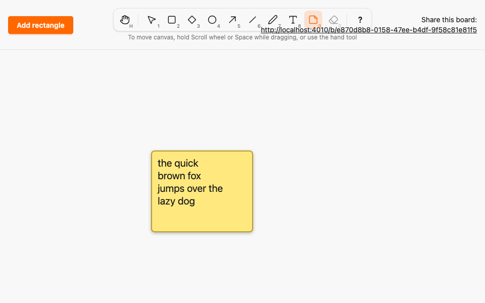
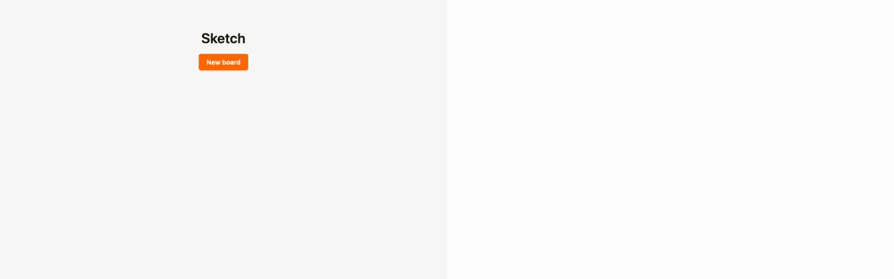

# Note tool

*2026-10-29T16:46:22Z by Showboat 0.6.1*
<!-- showboat-id: 42823f3b-2689-4756-ae54-58d15a7f3573 -->

**Outcome: the Note tool (N or 9) is live. Drag to draw a note, or click for a 200 by 160 one, and an editor opens inside it right away. Type and the text wraps to the note width, live in every other browser. Resize the note and the lines re-wrap. A double-click with Selection edits it, an empty note is kept, and everything survives a reload.**

What changed, following the Ellipse and Text PRs:

- `:note` is a box kind: width and height at least 1, resizable like a rectangle. Its `text` may be empty or whitespace and at most 2000 code points (`Geometry.text_fits_kind?/2`). Only `:text` still needs a non-blank character, and every other kind still stores `""`. The Ash validation and the `text_matches_kind` CHECK both derive from `Geometry`, and the migration was generated by `mix ash.codegen`.
- The pure helper `wrapText(text, maxWidth, charWidth)` in `canvas_logic.ts` wraps greedily at word boundaries, hard-breaks a word longer than a line, keeps explicit newlines, and is idempotent. `Geometry` now also holds `char_width` (12 px, 0.6 of the 20 px font), `note_padding` (12 px) and the default note size (200 by 160), and the hook reads them from `data-*` attributes.
- A note renders as a rounded `<rect class="note-body">` with a soft yellow fill from theme-aware CSS variables, plus a slight drop shadow, and a nested `<svg>` that clips the `<text>`. The lines are built on the client: the server renders the `<text>` empty (`phx-update="ignore"`) and the hook lays it out from `data-text` and the width, so every client, including a late joiner, wraps identically.
- The editor is the Text tool's `TextEditor` with a fixed frame: a `<textarea>` placed inside the note with the same padding. Esc or a click outside commits, and unlike Text an empty note is still created. Typing previews reuse `draw_preview` (kind `note`) and `preview`, with the keepalive.
- Resizing uses the existing corner handles and `commit_shape` without `text`. Remote previews and commits re-wrap through `setShape`.

```bash
docs/evidence/pbt-drag-share/run-tests.sh test/sketch/canvas/element_test.exs --seed 1 --trace --only describe:"note text (A08)" 2>&1 | grep -E "^  \* test note text|^Result"
```

```output
  * test note text (A08) commit_shape resizes a note and may clear its text [L#421]
  * test note text (A08) the database accepts empty notes and rejects overlong ones [L#432]
  * test note text (A08) a note needs a box of at least 1 by 1 and text within the maximum [L#408]
  * test note text (A08) a note may be empty, whitespace or up to the maximum length [L#399]
Result: 4 passed, 30 excluded
```

LiveView tests cover creating a note with text, an empty note, editing, resizing and the preview relay.

```bash
docs/evidence/pbt-drag-share/run-tests.sh test/sketch_web/live/board_live_test.exs --seed 1 --trace --only describe:note 2>&1 | grep -E "^  \* test note|^Result"
```

```output
  * test note an empty note is still created, and overlong text creates nothing [L#812]
  * test note a note is created with its text and renders as a rounded body with a clipped text in every view [L#785]
  * test note typing previews of a new note reach other views as note previews [L#907]
  * test note resizing commits the new box without touching the text [L#871]
  * test note editing commits the text with the same box, and clearing it keeps an empty note [L#827]
Result: 5 passed, 29 excluded
```

The Elixir properties pick `:note` up through `element_kinds()`. Ash and raw SQL must agree on every generated shape, including empty and too-long note text.

```bash
docs/evidence/pbt-drag-share/run-tests.sh test/sketch/properties/geometry_test.exs test/sketch/properties/commit_model_test.exs --seed 1 --trace 2>&1 | grep -E "^  \* property|^Result"
```

```output
  * property the database and the broadcasts follow a model of creates, moves, shape and text edits, and wrong-board edits (A08, A09, A11) [L#226]
  * property the default box of the next element is inside the canvas [L#247]
  * property Ash and PostgreSQL agree on every shape [L#218]
  * property the box around any two canvas points is a valid line whose points round-trip [L#224]
  * property clamp_box always yields a box inside the canvas, and keeps one already inside [L#239]
  * property PostgreSQL alone accepts a shape iff its box fits the canvas and its kind's minimum size, its points fit the kind and the box, and its text fits the kind [L#211]
  * property Ash alone accepts a shape iff its box fits the canvas and its kind's minimum size, its points fit the kind and the box, and its text fits the kind [L#204]
Result: 7 passed
```

The TypeScript properties for `wrapText` (fast-check, 1000 runs each): no line exceeds the width unless it is a lone character wider than it, long words are hard-broken, every non-whitespace character survives in order, explicit newlines stay, and wrapping the output again changes nothing.

```bash
docs/evidence/pbt-drag-share/run-ts.sh test/text_geometry.test.ts test/tools.test.ts
```

```output
✔ splitting text yields one line per newline, CR or CRLF, and no line holds a line break
✔ the text box is deterministic and sized by the line count and the longest line, capped to the canvas
✔ the text box always lies inside the canvas
✔ typing more text never shrinks the box
✔ an empty text still has a one-line box at least one unit wide
✔ wrapped lines fit the width unless a single character is wider than it
✔ a word longer than the width is hard-broken into lines that fit
✔ wrapping keeps every non-whitespace character in order
✔ explicit line breaks stay line breaks, and an empty paragraph stays an empty line
✔ wrapping its own output changes nothing
✔ a sentence wraps at word boundaries, greedily
✔ every enabled tool is reachable by its letter, in either case, and by its number
✔ no two tools share a key, and no tool key is reserved for Esc, ? or Space
✔ any key sequence selects the same tool as the simple binding model
✔ a key with Ctrl, Meta or Alt, or typed into an editable target, never changes the tool
✔ Esc always returns to Selection
✔ disabled tools never become active through keys or toolbar clicks
✔ the middle button, Space and Hand pan; Rectangle, Diamond, Ellipse, Arrow, Draw, Line and Note draw; Text opens the editor; Selection resizes, moves or deselects
✔ panning scrolls by exactly the opposite of the pointer movement
✔ lines and arrows get endpoint handles, text gets none and every other kind gets corners
ℹ tests 20
ℹ pass 20
ℹ fail 0
```

The Playwright spec `e2e/tests/note.spec.ts` uses two browsers and no sleeps. A presses N and clicks: an editor opens in a 200 by 160 note that B shows at once. A types a long sentence and B sees it wrapped inside the note. A narrows the note and B sees the lines re-wrap before the commit. After the commit and a reload the note, its text and its wrapping are the same. A second test drags a note, keeps it empty, and edits it with a double-click. The shortcuts spec now expects N and 9 to select Note.

```bash
docs/evidence/pbt-drag-share/run-e2e.sh note shortcuts --repeat-each=3
```

```output
24 passed
```

`mutations/wrap-drops-last-word.patch` makes `wrapText` skip the last word of every paragraph. Five properties and example tests fail, and the preservation property shrinks to the single character `a`.

```bash
docs/evidence/tool-note/mutate.sh wrap-drops-last-word docs/evidence/pbt-drag-share/run-ts.sh test/text_geometry.test.ts 2>&1 | grep -E "^(✖|ℹ (pass|fail))|Counterexample|Shrunk|Mutation"
```

```output
✖ a word longer than the width is hard-broken into lines that fit
✖ wrapping keeps every non-whitespace character in order
✖ explicit line breaks stay line breaks, and an empty paragraph stays an empty line
✖ wrapping its own output changes nothing
✖ a sentence wraps at word boundaries, greedily
ℹ pass 6
ℹ fail 5
✖ failing tests:
✖ a word longer than the width is hard-broken into lines that fit
  Counterexample: [1,1]
  Shrunk 2 time(s)
✖ wrapping keeps every non-whitespace character in order
  Counterexample: ["a",1,0.5]
  Shrunk 6 time(s)
✖ explicit line breaks stay line breaks, and an empty paragraph stays an empty line
  Counterexample: [[""],1,0.5]
  Shrunk 3 time(s)
✖ wrapping its own output changes nothing
  Counterexample: ["a a",1,0.5]
  Shrunk 6 time(s)
✖ a sentence wraps at word boundaries, greedily
Mutation killed (exit 1)
```

Browser A after typing the sentence into a note: it wraps inside the 200 px note with the padding, and the note is a soft yellow with a slight shadow. Then the two-browser recording: A (left) clicks with N and types while B (right) watches the preview wrap, then A narrows the note and B re-wraps it.

```bash {image}

```



```bash {image}

```


