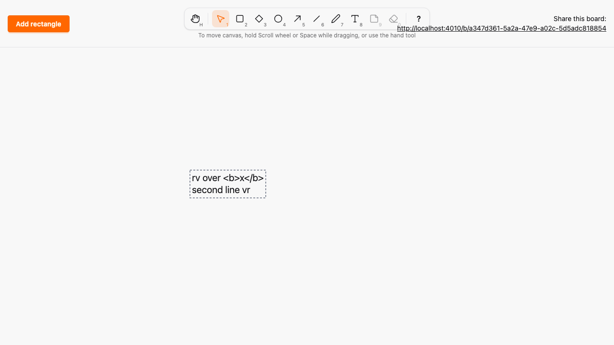
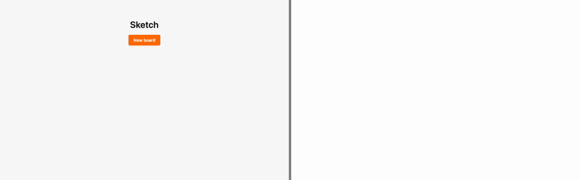

# Text tool

*2026-10-29T10:40:55Z by Showboat 0.6.1*
<!-- showboat-id: f367920f-2555-4444-9768-e704bcda9ab4 -->

**Outcome: the Text tool (T or 8) is live. Click the canvas to open an editor, type one or more lines, and press Esc or click outside to commit. Other browsers watch the text appear as it is typed. A double-click with Selection edits it, and the text survives a reload. It renders literally, so `<b>x</b>` shows as those characters.**

What changed, following the Line, Arrow and Draw PRs:

- `Element.text` is a `:string` (default `""`, whitespace kept) counted in code points like PostgreSQL `char_length`. A `:text` element needs a character other than space, tab, CR or LF, and at most 2000 code points (`Geometry.max_text_length/0`), with no NUL. Every other kind stores `""`. Ash enforces this with the attribute's `max_length` and the atomic `TextFitsKind` validation. PostgreSQL enforces it with the `text_length` and `text_matches_kind` CHECKs, generated by `mix ash.codegen`.
- `commit_shape` now also accepts `text`, so an edit updates the text and the box in one atomic version increment. No new action was needed.
- The editor is a `<textarea>` the hook owns, inside a `phx-update="ignore"` layer over the canvas. Enter adds a line; Esc, a click outside or losing focus commits; an empty result creates nothing. The pure helper `textBox` sizes the box from the line count times the 25 px line height and the measured longest line at 20 px (both from `Geometry`), clamped into the canvas.
- Previews reuse `draw_preview` (new text) and `preview` (edits) with a `text` field, throttled to 20/s and never persisted. An open editor resends its latest preview each second, so a pause in typing does not hit the 2000 ms stale timeout.
- Text renders as SVG `<text>` with one `<tspan>` per line. HEEx escapes it on the server and the hook sets `textContent` on the client; `raw/1` is never used. Selection shows the box, and text moves like any element. **Resizing text is out of scope: text has no resize handles.**
- Editing matches Excalidraw: Esc keeps the edits and commits them. Clearing all the text of an existing element reverts it, because there is no delete until the Eraser PR.
- Typing letters such as `r` or `v` in the editor never switches tools, because the keymap ignores editable targets and the editor stops Esc from reaching the window.

```bash
docs/evidence/pbt-drag-share/run-tests.sh test/sketch/canvas/element_test.exs test/sketch/canvas/element_migration_test.exs --seed 1 2>&1 | grep -E "^Result"
```

```output
Result: 32 passed
```

```bash
docs/evidence/pbt-drag-share/run-tests.sh test/sketch/properties/geometry_test.exs test/sketch/properties/commit_model_test.exs test/sketch/properties/lww_merge_test.exs --seed 1 --trace
```

```output


Sketch.Properties.CommitModelTest [test/sketch/properties/commit_model_test.exs]
  * property the database and the broadcasts follow a model of creates, moves, shape and text edits, and wrong-board edits (A08, A09, A11) [L#222]

Sketch.Properties.LwwMergeTest [test/sketch/properties/lww_merge_test.exs]
  * property the state per element is its highest-version event, whichever action produced it [L#68]
  * property an event older than the known version never changes the state [L#74]
  * property two replicas that saw disjoint halves converge in either merge order [L#89]
  * property applying an event twice equals applying it once [L#59]
  * property every delivery order of the same events yields the same state [L#53]

Sketch.Properties.GeometryTest [test/sketch/properties/geometry_test.exs]
  * property the default box of the next element is inside the canvas [L#243]
  * property Ash and PostgreSQL agree on every shape [L#214]
  * property the box around any two canvas points is a valid line whose points round-trip [L#220]
  * property clamp_box always yields a box inside the canvas, and keeps one already inside [L#235]
  * property PostgreSQL alone accepts a shape iff its box fits the canvas and its kind's minimum size, its points fit the kind and the box, and its text fits the kind [L#207]
  * property Ash alone accepts a shape iff its box fits the canvas and its kind's minimum size, its points fit the kind and the box, and its text fits the kind [L#200]


Result: 12 passed
```

```bash
docs/evidence/pbt-drag-share/run-ts.sh test/text_geometry.test.ts test/tools.test.ts
```

```output
✔ splitting text yields one line per newline, CR or CRLF, and no line holds a line break
✔ the text box is deterministic and sized by the line count and the longest line, capped to the canvas
✔ the text box always lies inside the canvas
✔ typing more text never shrinks the box
✔ an empty text still has a one-line box at least one unit wide
✔ every enabled tool is reachable by its letter, in either case, and by its number
✔ no two tools share a key, and no tool key is reserved for Esc, ? or Space
✔ any key sequence selects the same tool as the simple binding model
✔ a key with Ctrl, Meta or Alt, or typed into an editable target, never changes the tool
✔ Esc always returns to Selection
✔ disabled tools never become active through keys or toolbar clicks
✔ the middle button, Space and Hand pan; Rectangle, Diamond, Ellipse, Arrow, Draw and Line draw; Text opens the editor; Selection resizes, moves or deselects
✔ panning scrolls by exactly the opposite of the pointer movement
✔ lines and arrows get endpoint handles, text gets none and every other kind gets corners
ℹ tests 14
ℹ pass 14
ℹ fail 0
```

```bash
docs/evidence/pbt-drag-share/run-tests.sh test/sketch_web/live/board_live_test.exs --seed 1 --trace --only describe:text 2>&1 | grep -E "^  \* test text|^Result"
```

```output
  * test text markup in text renders as literal text, never as elements [L#631]
  * test text editing commits the text and box together and every view renders the new text [L#671]
  * test text blank or overlong text creates nothing [L#658]
  * test text typed text is stored and rendered one tspan per line in every view [L#607]
  * test text typing previews reach other views with their text and are never persisted [L#726]
Result: 5 passed, 24 excluded
```

The Playwright spec `e2e/tests/text.spec.ts` uses two browsers and no sleeps. A presses T, clicks and types `rv over <b>x</b>`, one character at a time. After every keystroke B must show exactly the typed prefix, and the tool must still be Text. A then adds a second line and commits with Esc; both browsers render the markup literally, with no `<b>` element. A switches to Selection, double-clicks to edit, types ` vr`, and B sees the edit live before A clicks outside to commit. The text has no resize handles; A moves it, and B reloads and still sees it. A second test covers the 8 shortcut and checks that an empty or blank editor creates nothing. The shortcuts spec now lists Text as enabled with T and 8.

```bash
docs/evidence/pbt-drag-share/run-e2e.sh text shortcuts --repeat-each=3
```

```output
24 passed
```

`mutations/db-check-length-off-by-one.patch` loosens the generated CHECK to `char_length(text) <= 2001`, and `mutate-migration.sh` re-runs the migration on the test database. Ash still rejects 2001 code points but PostgreSQL now accepts them, so both the SQL-only property and the Ash-versus-SQL property fail. StreamData shrinks the counterexample to the smallest box with 2001 `a` characters, shown here as `a{2001}`:

```bash
docs/evidence/tool-text/mutate-migration.sh db-check-length-off-by-one docs/evidence/pbt-drag-share/run-tests.sh test/sketch/properties/geometry_test.exs --seed 1 2>&1 | grep -E "^  [0-9]+\) property|Generated:|^Result|Mutation" | perl -pe "s/(a{20,})/\"a{\".length(\$1).\"}\"/ge"
```

```output
  1) property Ash and PostgreSQL agree on every shape (Sketch.Properties.GeometryTest)
           Generated: {:text, %{x: 0, y: 0, width: 1, height: 1}, [], "a{2001}"}
  2) property PostgreSQL alone accepts a shape iff its box fits the canvas and its kind's minimum size, its points fit the kind and the box, and its text fits the kind (Sketch.Properties.GeometryTest)
           Generated: {:text, %{x: 0, y: 0, width: 1, height: 1}, [], "a{2001}"}
Result: 4/6 passed
Mutation killed (exit 2)
```

`mutations/shortcuts-fire-while-editing.patch` drops the `editable` check from the keymap, so letters typed into the editor would switch tools. The keymap properties fail, and fast-check shrinks to a single digit or letter typed into an editable target:

```bash
docs/evidence/tool-text/mutate.sh shortcuts-fire-while-editing docs/evidence/pbt-drag-share/run-ts.sh test/tools.test.ts 2>&1 | grep -E "^(✖|ℹ (pass|fail))|Counterexample|Shrunk|Mutation"
```

```output
✖ any key sequence selects the same tool as the simple binding model
✖ a key with Ctrl, Meta or Alt, or typed into an editable target, never changes the tool
ℹ pass 7
ℹ fail 2
✖ failing tests:
✖ any key sequence selects the same tool as the simple binding model
  Counterexample: ["hand",[{"key":"6","ctrlKey":false,"metaKey":false,"altKey":false,"editable":true}]]
  Shrunk 6 time(s)
✖ a key with Ctrl, Meta or Alt, or typed into an editable target, never changes the tool
  Counterexample: ["hand",{"key":"d","ctrlKey":false,"metaKey":false,"altKey":false,"editable":true}]
  Shrunk 1 time(s)
Mutation killed (exit 1)
```

The same mutation also fails the browser spec: the `r` in `rv over` switches A to Rectangle while A is typing.

```bash
docs/evidence/tool-text/mutate.sh shortcuts-fire-while-editing docs/evidence/pbt-drag-share/run-e2e.sh text
```

```output
1 failed
1 passed
Mutation killed (exit 1)
```

Browser A after creating, editing and moving the text. The box outline is shown without resize handles. Then the two-browser recording: A (left) types while B (right) watches the text appear as a faded preview, A commits, double-clicks to edit, and moves it. The GIF is Playwright video, slowed 3x.

```bash {image}

```



```bash {image}

```


