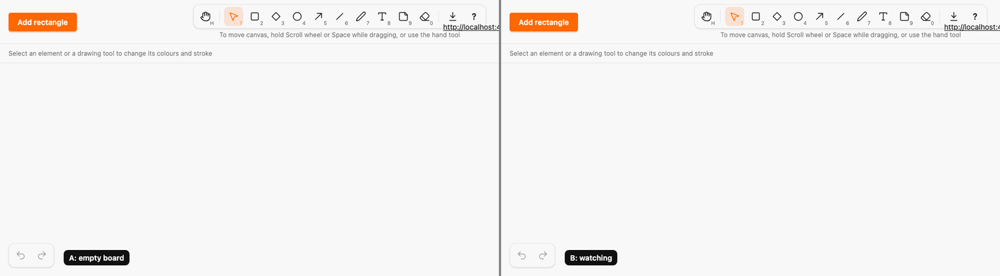
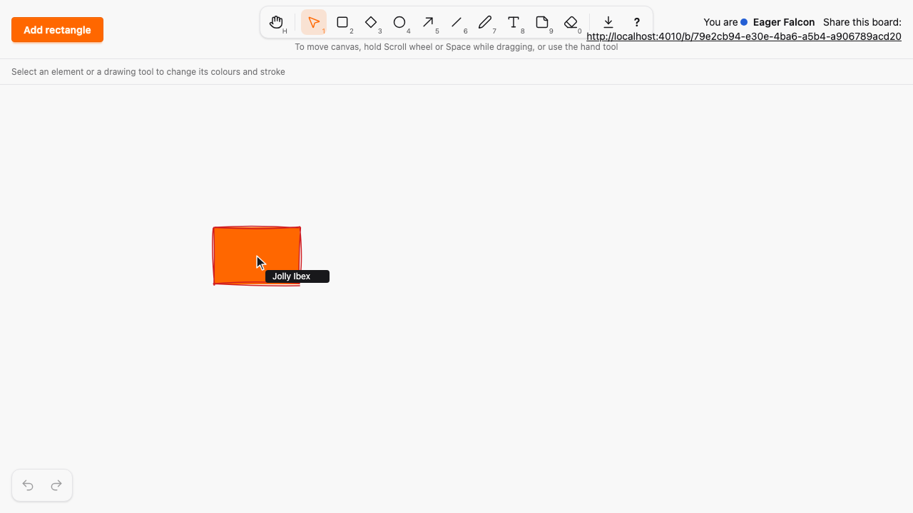
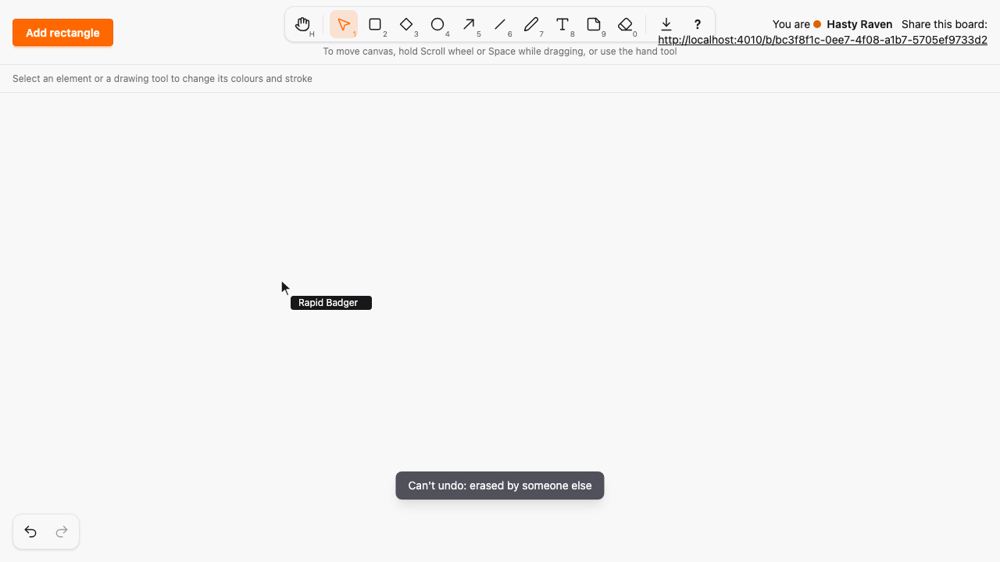

# Undo and redo

*2026-10-30T11:15:23Z by Showboat 0.6.1*
<!-- showboat-id: 47a597df-dcc7-424d-859c-c87b6c48734c -->

Outcome: each viewer can undo and redo their own actions on a board with Ctrl/⌘+Z, Ctrl/⌘+Shift+Z or Ctrl+Y, or the Undo and Redo buttons, and every other viewer sees each step. Every undo and redo is replayed as an ordinary Ash action through the existing code interfaces (`create_element`, `erase_element`, `commit_position`, `commit_shape`, `commit_style`), so it is a normal commit with the atomic version increment and the normal broadcast; `BoardState` and the merge rule of ADR 0001 are unchanged. An undone erase re-creates the element under a new id, so tombstones stay permanent. The approval is recorded as addendum D12 and the design as ADR 0008. No new runtime dependency (A15), pointer listeners stay in the canvas hook (A13), and no kind id is compared outside kind modules (A22).

The stacks are local to each view and live in a pure module, `assets/js/hooks/history_logic.ts`: recording (with coalescing of quick style changes), undo and redo steps, the map from original to current ids, and dropping entries whose element was erased. The canvas hook only records what the server confirmed and runs the replay a step asks for:

```bash
sed -n "/  private step(direction: Direction)/,/^  }/p" assets/js/hooks/history_logic.ts
```

```output
  private step(direction: Direction): Step<S, C> {
    if (this.pending !== undefined) return { status: "busy" }
    const stack = direction === "undo" ? this.undoStack : this.redoStack
    const popped = stack.pop()
    if (popped === undefined) return { status: "empty" }
    this.coalesceTarget = undefined
    const entry = needsLiveElements(popped, direction) ? this.withoutErased(popped) : popped
    if (entry === undefined) return { status: "dropped", direction }
    const replay = this.replayOf(entry, direction)
    this.pending = {
      direction,
      entry,
      recreates: replay.type === "create",
      generation: this.generation,
      depth: this.undoStack.length,
    }
    return { status: "replay", direction, replay }
  }
```

The model tests drive the module against a simulated board with fast-check: undoing every local action restores the board and redoing them all restores the result (ids aside); with other viewers erasing and moving in between, no replay targets an erased id and nothing they erased is re-created; a new action clears the redo stack; coalescing, failed and concurrent replays. The key chords are matched from the generated registry:

```bash
docs/evidence/pbt-drag-share/run-ts.sh test/history_logic.test.ts test/element_history.test.ts
```

```output
✔ Ctrl or Command with Z undoes; with Shift, or Ctrl with Y, it redoes
✔ no chord fires while an editor or input has focus, so its own text undo applies
✔ an element event becomes a snapshot whose create payload has the same content
✔ a malformed element event is not recorded
✔ each change becomes the payload of its commit event
✔ undoing every local action restores the board, and redoing them all restores the result, ids aside
✔ with other viewers erasing and moving in between, no replay targets an erased id and nothing they erased comes back
✔ a new local action clears the redo stack
✔ an entry whose element someone else erased is dropped and changes nothing
✔ undoing an erase creates the element again, and later entries follow it to its new id
✔ an erase of several elements is one entry
✔ style changes of one element and property within the coalescing window are one entry
✔ different properties, different elements and moves never coalesce
✔ a style change after an undo does not coalesce into the entry below
✔ only one replay runs at a time, and a failed replay is dropped
✔ an undo that finishes after a new action does not refill the redo stack, and a redo stays below it
✔ a re-creation where some creates failed keeps only the elements that came back
ℹ tests 17
ℹ pass 17
ℹ fail 0
```

The server side. `create_element` now replies with the created element, `erase` with the elements it erased as they were, and the three commits with `ok`, so a view records only actions that happened; Add rectangle pushes `created` to the clicking view only. The new LiveView tests cover the replies, re-creating every kind from its erase reply under a new id (a StreamData property over kinds, seeds and styles) while the old id stays erased, and that an undone move, resize and restyle reach every view with the next version (A09). A second A09 concurrency test interleaves 25 moves with their undos and requires versions 1..50, and a new merge property says a re-created element appears under its new id in every delivery order and never under the erased one:

```bash
mix test test/sketch_web/live/board_live_undo_test.exs test/sketch/canvas/concurrent_commits_test.exs test/sketch/properties/lww_merge_test.exs 2>&1 | grep -E "^Result"
```

```output
Result: 21 passed (9 properties, 12 tests)
```

```bash
sed -n "/  def handle_event(\"erase\", %{\"element_ids\"/,/^  def handle_event(\"erase\", _params/p" lib/sketch_web/live/board_live.ex
```

```output
  def handle_event("erase", %{"element_ids" => element_ids}, socket) when is_list(element_ids) do
    {erased, socket} =
      if Enum.all?(element_ids, &is_uuid/1),
        do: element_ids |> Enum.uniq() |> Enum.flat_map_reduce(socket, &erase_element/2),
        else: {[], socket}

    {:reply, %{erased: erased}, socket}
  end

  def handle_event("erase", _params, socket), do: {:reply, %{erased: []}, socket}
```

The two-browser run: `undo-demo.mjs` opens two Chromium contexts on one board. A draws a rectangle, moves it, makes it red and erases it, then undoes all four steps with Ctrl+Z and redoes them with Ctrl+Shift+Z. Each frame waits until both browsers show the expected rectangle (position and stroke colour, or none), so the GIF cannot show a state B did not reach. A is on the left, B on the right; the Undo and Redo buttons sit at the bottom left and are disabled while their stack is empty (B never acted, so its buttons stay disabled):

```bash {image}

```



After A's first undo, B sees the erased rectangle back, red and in its moved place, under a new id:

```bash {image}

```



When B has erased the element an entry refers to, A's undo is dropped with a message and nothing comes back:

```bash {image}

```



The new Playwright spec, `undo.spec.ts`, drives real browsers against the real server: A draws, moves, restyles and erases, B sees each undo revert it (with the next version each time, and the erased id never coming back) and each redo replay it, through Ctrl/⌘+Z, Ctrl/⌘+Shift+Z, Ctrl+Y and both buttons; a new action clears redo and one eraser stroke over two elements is one undo; B erases an element and A's undo of a move is dropped with a message, with no resurrection after a reload; if B moved the element after A, A's undo still applies A's previous position (last writer wins); Ctrl+Z inside the text editor is the editor's own undo and leaves the canvas alone, while a committed text edit undoes on the canvas; a reload clears the stacks and keeps the board, and the shortcuts help lists the chords. Then the whole suite:

```bash
docs/evidence/pbt-drag-share/run-e2e.sh undo.spec.ts
```

```output
6 passed
```

```bash
docs/evidence/pbt-drag-share/run-e2e.sh
```

```output
82 passed
```

Mutation 1, an undone erase reuses the old id: `mutations/undo-erase-reuses-old-id.patch` lets `create_element` take an id and makes the hook re-create the element under the erased one. PostgreSQL accepts the insert (the row is gone), but every view's `BoardState` holds that id as a tombstone and ignores the create, so the restored element never appears. The E2E test sees B (and A) without the element after the undo:

```bash
docs/evidence/undo-redo/mutate.sh undo-erase-reuses-old-id docs/evidence/pbt-drag-share/run-e2e.sh undo.spec.ts -g 'B sees every undo'
```

```output
1 failed
Mutation killed (exit 1)
```

Mutation 2, a new action does not clear redo: `mutations/redo-not-cleared.patch` keeps the redo stack when an action is recorded. The model test fails:

```bash
docs/evidence/undo-redo/mutate.sh redo-not-cleared docs/evidence/pbt-drag-share/run-ts.sh test/history_logic.test.ts | grep -E '^(✖|Mutation)' | sort -u
```

```output
✖ a new local action clears the redo stack
✖ failing tests:
Mutation killed (exit 1)
```

Mutation 3, an undo bypasses the version increment: `mutations/undo-bypasses-version-increment.patch` drops `atomic_update(:version, ...)` from `commit_position`, the action an undone move replays through. The A09 undo concurrency test (versions 1..50) and the LiveView test that every view accepts the undone move with the next version both fail:

```bash
docs/evidence/undo-redo/mutate.sh undo-bypasses-version-increment mix test --seed 0 test/sketch/canvas/concurrent_commits_test.exs:97 test/sketch_web/live/board_live_undo_test.exs 2>&1 | grep -E '^Result|^Mutation|^  [0-9]+\) test' | sed -E -e 's/ \(Sketch[A-Za-z.]+\)$//' -e 's/^  [0-9]+\) /  /' | sort
```

```output
  test an undone move is a new commit with the next version, so every view accepts it (A09)
  test undo replays are ordinary commits: moves and their undos never lose a version increment (A09, ADR 0008)
Mutation killed (exit 2)
Result: 10/12 passed (1/1 property, 9/11 tests), 1 excluded
```

Every file this PR touched outside the evidence folder (A added, M modified) against `live-cursors`. The stack logic and the reply parsing are new pure modules; the canvas hook gains the recording, the replay and the key and button handling (pointer events stay in that file, A13); `BoardLive` gains the replies and the `created` push; the chords live in the new `SketchWeb.HistoryActions` registry, copied into the manifest; `architecture/rules.exs` only gains verification files and wording for A09 and A11, and no rule, status or allowlist changed.

```bash
git diff --name-status -M live-cursors...HEAD -- . ':!docs/evidence' | sort -k2; git diff --shortstat live-cursors...HEAD -- . ':!docs/evidence'
```

```output
M	ARCHITECTURE.md
M	architecture/rules.exs
M	assets/js/generated/manifest.ts
M	assets/js/hooks/canvas.ts
A	assets/js/hooks/element_history.ts
A	assets/js/hooks/history_logic.ts
A	assets/test/element_history.test.ts
A	assets/test/history_logic.test.ts
M	docs/adr/0001-ash-atomic-lww-consistency.md
M	docs/adr/0003-element-model.md
A	docs/adr/0008-undo-and-redo-replayed-as-ordinary-commits.md
M	docs/SPEC-ADDENDUM.md
A	e2e/tests/undo.spec.ts
M	lib/sketch_web/client_manifest.ex
M	lib/sketch_web/components/toolbar.ex
A	lib/sketch_web/history_actions.ex
M	lib/sketch_web/live/board_live.ex
A	test/sketch_web/live/board_live_undo_test.exs
M	test/sketch/canvas/concurrent_commits_test.exs
M	test/sketch/properties/lww_merge_test.exs
 20 files changed, 1845 insertions(+), 56 deletions(-)
```
