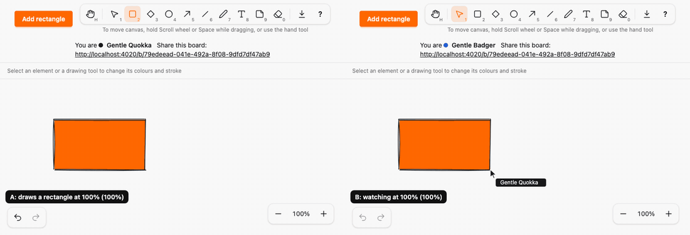
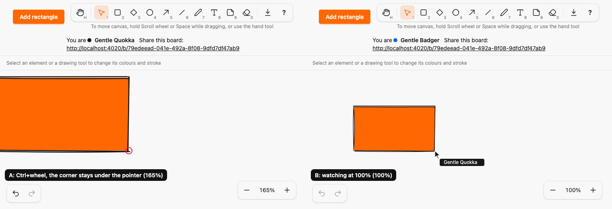
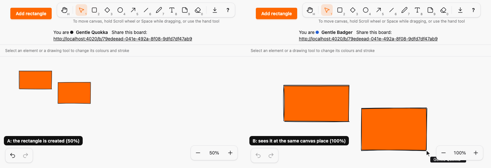

# Zoom

*2026-10-30T12:14:52Z by Showboat 0.6.1*
<!-- showboat-id: 372e5a1b-8a6a-4083-9847-ac83ab65c427 -->

Outcome: each viewer can zoom the canvas from 10% to 400%, locally. Ctrl/⌘+wheel and trackpad pinch zoom around the pointer, so the canvas point under the pointer stays under it; Ctrl/⌘ + `=`/`+`, `-` and `0` step, zoom out and reset to 100%; Shift+1 zooms to fit all elements (an empty board goes to 100%); a small control at the bottom right of the canvas has −, the current percentage (click resets) and +. The browser's own page zoom is prevented for those keys. Zoom is never pushed, broadcast or stored: the svg keeps its `viewBox` in canvas units and only its rendered `width` and `height` change, so drawing, moving, resizing, erasing, cursors and previews all stay in canvas coordinates and other viewers see them in the right place at any zoom. No new runtime dependency (A15), the new wheel listener lives in the canvas hook (A13), no comments or suppressions, no kind id compared outside kind modules (A22). No migration, no SPEC change: SPEC does not exclude zoom.

The math is a pure module, `assets/js/hooks/zoom_logic.ts`: clamp, step levels, the wheel factor, the one screen-to-canvas function every pointer path uses, the scroll that keeps the anchor fixed, fit to content and the chord matcher. The anchor rule in full:

```bash
sed -n "/^export function canvasUnderAnchor/,/^function clampAxis/p" assets/js/hooks/zoom_logic.ts | sed "\$d"
```

```output
export function canvasUnderAnchor(scroll: Point, anchor: Point, zoom: number): Point {
  return { x: (scroll.x + anchor.x) / zoom, y: (scroll.y + anchor.y) / zoom }
}

export function anchoredScroll(scroll: Point, anchor: Point, from: number, to: number): Point {
  const fixed = canvasUnderAnchor(scroll, anchor, from)
  return { x: fixed.x * to - anchor.x, y: fixed.y * to - anchor.y }
}

```

The model tests use fast-check: for any zoom change the canvas point under the anchor is unchanged within 0.5 px (and still is after clamping whenever the scroll range allows it); screen-to-canvas conversion round-trips at any zoom; fit always contains every box, and an empty board fits to 100%; the chords match from the generated registry; the drag threshold is in screen pixels.

```bash
docs/evidence/pbt-drag-share/run-ts.sh test/zoom_logic.test.ts
```

```output
✔ zoom is clamped to 10%..400%
✔ stepping moves to the next level and stops at the ends
✔ repeated steps visit every level in order
✔ the wheel zooms in for negative deltas, out for positive ones, and stays in range
✔ for any zoom change the canvas point under the anchor is unchanged within 0.5 px
✔ the anchor stays fixed after clamping whenever the scroll range allows it
✔ clamped scroll stays inside the zoomed canvas
✔ screen points convert to canvas points at any zoom, and back
✔ fit always contains every box, with padding, whenever the zoom range allows it
✔ fit leaves the padding around the content when the content is not clamped by the canvas
✔ an empty board fits to 100%
✔ zoom chords: Ctrl or Command with =, + or - or 0, and Shift+1 by key position
✔ while an editor has focus only the Ctrl or Command chords still zoom
✔ the drag threshold is in screen pixels
ℹ tests 14
ℹ pass 14
ℹ fail 0
```

The chords, labels and icons live in one registry, `SketchWeb.ZoomActions`. The zoom control and the shortcuts help render from it, and `mix sketch.gen.manifest` copies the chords to the client (Shift+1 matches the key position, `Digit1`, so it works where Shift+1 types another character):

```bash
mix test test/sketch_web/live/board_live_zoom_test.exs 2>&1 | grep -E "^Result"
```

```output
Result: 3 passed
```

```bash
sed -n "/^export const ZOOM_ACTIONS/,/^\] as const/p" assets/js/generated/manifest.ts
```

```output
export const ZOOM_ACTIONS = [
  { id: "zoom_out", label: "Zoom out", chords: [{ key: ["-", "_"], code: null, mod: true, shift: null }] },
  { id: "zoom_in", label: "Zoom in", chords: [{ key: ["=", "+"], code: null, mod: true, shift: null }] },
  { id: "zoom_reset", label: "Reset zoom to 100%", chords: [{ key: ["0"], code: null, mod: true, shift: null }] },
  { id: "zoom_fit", label: "Zoom to fit content", chords: [{ key: [], code: "Digit1", mod: false, shift: true }] },
] as const satisfies readonly ZoomActionSpec[]
```

The two-browser run: `zoom-demo.mjs` opens two Chromium contexts on one board. A draws a rectangle, puts the pointer on its corner and zooms with Ctrl+wheel (the red ring marks the pointer; the corner stays under it at every step), then goes to 50% and drags a second rectangle while B stays at 100%. B sees the live preview and then the rectangle in the same canvas place, and A's cursor at the matching canvas point. A is on the left, B on the right.

```bash {image}

```



At 165% after a Ctrl+wheel step, the rectangle's corner is still under the pointer (red ring), and B, at 100%, shows A's cursor on the same corner:

```bash {image}

```



The rectangle A dragged at 50% appears in B (at 100%) at the same canvas place:

```bash {image}

```



The new Playwright spec, `zoom.spec.ts`, drives real browsers: at 200% and 50% a dragged rectangle gets the expected canvas box and B at 100% sees it in the same place; at 50% and 200% moving, resizing from two corners, a line's endpoint drag and an eraser stroke commit the right canvas coordinates; Ctrl+wheel (the same wheel events a trackpad pinch sends) keeps the canvas point under the pointer through zooming in and out; Shift+1 fits both of two far-apart rectangles in the viewport at exactly the zoom the padding and viewport size give, and an empty board goes to 100%; selection handles are 10px on screen at 200% and 50%, and a line's hit area is 14px wide on screen at both; the text editor opens at the clicked spot at twice the scale at 200% and the created text lands at the same canvas point in B, and a note's editor sits inside its note; a remote cursor from A at 100% is at the right canvas point in B at 200% (and B's cursor in A), and A's draw preview at 50% is in the right canvas place in B at 200%; the exported SVG at 200% and at 50% is byte-for-byte the SVG at 100%; the keys and the buttons step through the levels and clamp at 10% and 400%; the page zoom is prevented for the zoom keys; zoom stays local (B is untouched, a reload returns to 100%); and the shortcuts help lists the chords from the registry.

```bash
docs/evidence/pbt-drag-share/run-e2e.sh zoom.spec.ts
```

```output
21 passed
```

Then the whole suite (82 earlier tests, 2 skipped @measure as before, plus these 21):

```bash
docs/evidence/pbt-drag-share/run-e2e.sh
```

```output
103 passed
```

Mutation 1, the conversion ignores zoom: `mutations/conversion-ignores-zoom.patch` makes `canvasPoint` pass a zoom of 1 to the one conversion function, so every pointer path (drawing, moving, resizing, endpoint drags, erasing, text, cursors) uses unzoomed coordinates. The Playwright draw tests at 200% and 50% fail (the node model tests do not see it, because they call the pure function directly):

```bash
docs/evidence/zoom/mutate.sh conversion-ignores-zoom docs/evidence/pbt-drag-share/run-e2e.sh zoom.spec.ts -g 'dragged rectangle'
```

```output
2 failed
Mutation killed (exit 1)
```

Mutation 2, the anchor is not preserved: `mutations/anchor-not-preserved.patch` drops the anchor offset from `anchoredScroll`, so a zoom change moves the canvas under the pointer. Both fast-check anchor properties fail:

```bash
docs/evidence/zoom/mutate.sh anchor-not-preserved docs/evidence/pbt-drag-share/run-ts.sh test/zoom_logic.test.ts | grep -E '^(✖|Mutation)' | sort -u
```

```output
✖ failing tests:
✖ for any zoom change the canvas point under the anchor is unchanged within 0.5 px
✖ the anchor stays fixed after clamping whenever the scroll range allows it
Mutation killed (exit 1)
```

Mutation 3, handles scale with zoom: `mutations/handles-scale-with-zoom.patch` stops dividing the handle size by the zoom, so handles grow and shrink with the canvas. The Playwright test that measures the handle's size on screen at 200% and 50% fails:

```bash
docs/evidence/zoom/mutate.sh handles-scale-with-zoom docs/evidence/pbt-drag-share/run-e2e.sh zoom.spec.ts -g 'handles keep'
```

```output
2 failed
Mutation killed (exit 1)
```

Every file this PR touched outside the evidence folder (A added, M modified) against `undo-redo`. The pure math and the registry are new modules; the canvas hook gains the wheel and zoom handling and the one conversion function (pointer and wheel listeners stay in that file, A13); the selection overlay and cursor layer take the zoom so handles, outline and cursors keep their screen size; the chords reach the client through the manifest; `architecture/rules.exs` is untouched, so no rule, status or allowlist changed.

```bash
git diff --name-status -M undo-redo...HEAD -- . ':!docs/evidence' | sort -k2; git diff --shortstat undo-redo...HEAD -- . ':!docs/evidence'
```

```output
M	ARCHITECTURE.md
M	assets/css/app.css
M	assets/js/generated/manifest.ts
M	assets/js/hooks/canvas_logic.ts
M	assets/js/hooks/canvas.ts
M	assets/js/hooks/cursor_layer.ts
M	assets/js/hooks/selection.ts
A	assets/js/hooks/zoom_logic.ts
A	assets/test/zoom_logic.test.ts
A	e2e/tests/zoom.spec.ts
M	lib/sketch_web/client_manifest.ex
M	lib/sketch_web/components/toolbar.ex
M	lib/sketch_web/live/board_live.ex
A	lib/sketch_web/zoom_actions.ex
A	test/sketch_web/live/board_live_zoom_test.exs
 15 files changed, 1260 insertions(+), 29 deletions(-)
```
