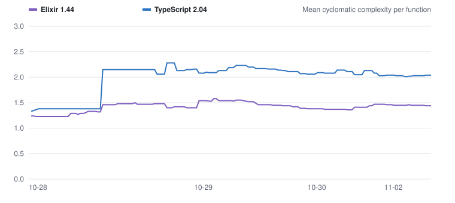

# Complexity trend



The chart shows the mean cyclomatic complexity per function, for each language, at every commit on main. [complexity.csv](complexity.csv) has the full data per commit and language: number of functions, mean, 90th percentile, maximum, and how many functions are over the limit.

## What is measured

- **Elixir**: every `def`, `defp` and `defmacro` clause in `lib/`, scored with Credo's own `CyclomaticComplexity` calculation, so the numbers match the `mix credo --strict` gate. The limit is Credo's default of 9.
- **TypeScript**: every function, method and arrow function in `assets/js`, excluding generated code and `.d.ts` files. The score is 1 plus one for each `if`, loop, `case`, `catch`, ternary, `&&`, `||` and `??`. The limit is 10, as in the PR complexity check. That check uses lizard, which counts slightly differently, so a function can be over 10 here and still pass it. The earliest commits measure the generator's `app.js`.

Tests are not included.

## How it updates

The **Complexity trend** workflow runs on every push to main. It measures each main commit that is not in the CSV yet, then merges the updated CSV and chart into main through a pull request. The history before this workflow was backfilled from the first-parent history of the branch that added it.

To update it locally:

```sh
node tools/complexity/trend.ts backfill
```

`record` measures only the current working tree and stores it under `HEAD`.
